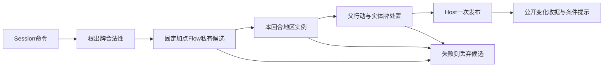

# 越南起义：事件与地区OPS接线

description：共享效果基础进入实际对局的组合边界；参数、权威状态与画面名称分别维护。

PrepareTurnOpsEvent只组装不可变候选，不能自行提交Host。共享AddFixedInfluenceEffect读取正式参数指定的国家/数额；根操作者可以是美国，受益者仍是苏联。临时InfluenceEvent在候选中完成后清除，原始收据仍交给CardActionTransition。激活失败、版本/序号/影响力溢出均不发布加点或移牌。Host按命令ID重放原结果，不重新执行事件。

OPS分两层：普通报价保留Flat修正，地区预算再合并实际Actor拥有的条件贡献与当前实体牌的中国牌奖励。每个已接受目标推进预算，离开地区仅失去对应奖励；拒绝目标不会改变预算。Space和阈值只使用普通报价。回合末沿用明确ExpireAndReset边界清理所有本回合实例。

奥运事件OPS没有实体中国牌，仍可以使用越南地区贡献。其RootCountries固定影响力可达范围，当前棋盘决定控制加价。每次合法操作允许换成由核心派生的地区预算上下文，但必须保持操作ID/Actor/Mode/费用/可达国家、相同quote/map、spent同步、奖励集合只减；父状态仍精确绑定版本、事件序号、国家、RNG和原Operations引用。重建外部GameState不能伪造连续操作。

公开PublicTurnOpsEffect仅增加可空Region ID；UI从显示名字典取地区名称，未参与裁决。Demo的world/tiles等画风接口保持原状。Data/Demo/vietnam-scenario.json是人工练习；加点/奖励数值不从fixture推导，也不复制进工作脚本。

出牌前预览同样调用Core的PreviewRegionalOperations共享工厂，Application仅投影PublicRegionalOps。CardActionOption与PendingOperationsOptions保留普通CurrentOps，并分别公开条件最大值与地区ID；中国牌兼容RegionalMaximum字段。ReadOperationsPreview在政变模式直接读取权威SelectedCoupQuote，其他用途显示普通值与条件最大值；不会把地区奖励塞入太空报价或在UI自行加算。

未扩展：五年计划的美国子牌资格、其它尚未实现事件OPS、重复新resolution激活的裁定。测试和实际Player验收状态以Docs/Testing/vietnam-play.validation.json为准。
