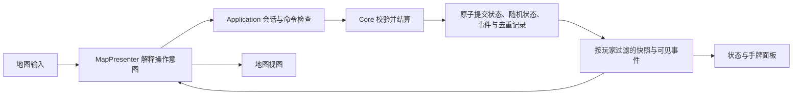

# 游戏实现与可替换地图：接口提案

description：供编码前共同确认的分层、地图输入输出与首批交付边界；接口名称是提案，不是已经存在的 C# 类型。

状态：2026-10-13，待用户确认。用户接受上一轮草图作为参考，未确认最终布局、美术或正式编码。本稿承接 [架构](../Wiki/architecture.md)、[编码方向讨论](coding-direction-discussion.md) 和 [地图契约](../Wiki/map-presentation.md)，不改动已确认规则。

## 1. 目标与起步方式

目标是先完成可验证的本地规则与交互，再做完整本地双人对局；网络和 AI 留到后续。规则、显示与资源可分开演进。选定写实画风不是规则编码的前置条件。

三种起步方式：先规则闭环再占位地图，能尽早检查结算与接口，推荐采用；先地图原型能更快体验操作，但临时交互还要接入权威状态；全部规则实现后再做画面，能集中写规则，但交互问题暴露较晚。前次草图只帮助讨论信息位置，不作为实现必须照搬的设计。

## 2. 依赖与对象边界

| 模块 | 职责 | 边界 |
|---|---|---|
| Core | 国家、卡牌、统一 GameState、行动、事件、选择、回合、随机与胜负规则 | 纯 C#，不引用 Unity、UI、文件、网络或数据库 |
| Application | 绑定会话身份、接收命令、串行调度、版本与重复处理、合法行动查询、玩家视图 | 调用 Core，向外返回过滤后的结果 |
| Infrastructure | 读取和验证 JSON、构造只读定义、存档、可信日志及资源适配 | 实现端口；规则不写在读写文件的代码里 |
| Presentation | 地图、状态面板、手牌、镜头、输入、动画、音频 | 通过 Application 使用规则，不直接改 GameState |
| Networking / AI（后续） | 传输、房间、重连 / 从合法行动中选择 | 使用同一命令边界；正常 AI 只读其玩家视图 |

Bootstrap 是组装入口：选择数据加载器、会话及地图实现。Core 不反向依赖外围模块。地图接口及表现 DTO 属于 Presentation 的纯契约部分；Unity 组件实现它们。Application 不引用 IMapView。

静态 CountryDefinition、CardDefinition 与动态 CountryState、CardInstance 分离，通过稳定 ID 关联。唯一权威 GameState 由规则管线维护；外部拿到只读玩家快照。首版可用隔离的工作副本处理命令，成功后一次提交，避免一开始引入通用事件溯源框架。

对象负责维护自己的不变量，规则服务完成跨对象结算。用组合复用影响力增减、选择、计分、抽弃牌等效果；复杂事件使用显式注册的策略。不会按每张牌复制一套地图或回合逻辑，也不为每个简单类强行创建接口。待选择和继续位置是可序列化的有类型数据，不保存 Unity 协程或回调。

## 3. 一次操作怎样完成

例如玩家选择“放置影响力”并点一个国家：地图只给出节点 ID；Presenter 结合当前操作模式构造命令。会话绑定真实行动身份，核心计算是否合法、费用和结果。客户端不能自己指定合法预算、掷骰结果或完整 after_state。

命令携带 CommandId、GameId、ExpectedStateVersion 和操作参数。同一身份、同一 ID、相同内容重发，返回原收据；同一 ID 改内容则拒绝。新命令版本过期则拒绝。非法命令不扣点、不改变版本或随机状态。查询合法目标与正式执行复用规则判定，查询本身不改变状态；高亮只是提示，执行时仍重新验证。

普通命令依次执行；头条等保密选择沿用已有决策组设计。胜负检查在规则规定的检查点发生，不等动画播完。取消 UI 等待不能撤销已经接受的命令。

## 4. 地图是四部分组合

| 部分 | 内容 | 更换方式 |
|---|---|---|
| MapDefinition | 国家、地区、稳定度、战场及规则邻接 | 同一规则版本下保持统一来源 |
| MapLayout | 节点位置、拾取形状、标签锚点及绘制路线 | 更换布局文件，沿用 layout.schema.json |
| ThemeDefinition | 颜色、材质、字体、图标、模型等资源键 | 更换主题和资产映射，沿用 theme.schema.json |
| IMapView 实现 | 2D/3D 渲染、镜头、拾取与动画 | 用另一个实现接入相同接口 |

地图点击归一化为稳定 NodeId，并保留 Country / Superpower 类型区别。规则国家可能对应桌游中的合并区域；不能根据现实行政边界或视觉接触推断规则邻接。

正式布局覆盖 84 国和 2 个超级大国；镜头只显示一个地区不减少规则数据或正式布局覆盖。若做局部样例，明确标成 fixture，不能作为完整地图加载。规则连接来自 MapDefinition；显示路线不能产生或删除规则边。

2D 改 3D 需要新的相机、拾取和视图实现，不承诺只换贴图即可。首版支持创建对局视图时选择地图模块；对局中无缝热切换不是首批验收项。以后热切换也只更换表现，不重置权威对局。

## 5. 建议固定的地图接口

以下是语义契约，不是可调用 API；最终 C# 签名由获准后的实现计划确定。

| 接口动作 | 输入 / 输出 | 责任 |
|---|---|---|
| LoadAsync(context, cancellation) | MapViewContext → 加载结果与能力信息 | 校验布局、主题和节点映射；完成前不接收游戏输入 |
| Present(frame) | 只读 MapFrame → 一致的当前画面 | 一次呈现同版本国家状态、选择和合法目标提示 |
| Intent 事件 | MapIntent：类型、NodeId、ViewContextId、StateVersion | 报告选择/悬停等意图；不携带权威状态变更 |
| FocusOn(nodeId) | 稳定节点 ID → 镜头定位 | 只影响显示，不推动规则或消耗 RNG |
| PlayTransitions(batch) | 已过滤、带上下文及版本的可见事件批次 | 可跳过或取消；最终回到最新 MapFrame |
| Dispose() | 释放结果 | 清理资源、监听、待处理输入和动画 |

MapViewContext 包含可公开地图定义、布局、主题和资产解析端口，不包含完整 GameState。MapFrame 包含 ViewContextId、StateVersion、国家公开状态、核心已算出的控制方、选中节点，以及同版本合法性提示。框架不让地图自行计算控制权、费用、保护或胜负。

MapPresenter 是地图与会话之间的协调对象：把 PlayerViewSnapshot 和合法行动查询转换为 MapFrame，把用户意图转换为命令。选择国家可以只改变本地选择态；具体操作需要明确的操作模式或选择步骤，不能“点到国家就自动执行任意行动”。

IGameSession 延续已有 SubmitAsync 设计，并提供玩家快照及合法行动查询。地图不直接持有会话；Presenter 持有会话。换地图后仍由同一 Presenter 和会话负责授权与结算。

ViewContextId 用于隔离玩家视角、会话和视图生命周期；StateVersion 用于隔离局面。旧上下文响应一律丢弃，旧版本高亮丢弃并重新查询。切换本地玩家时清除原玩家私有提示、延迟输入和动画。即使版本号相同，旧视角响应也不能进入新视角。

同一上下文同版本允许更新悬停或选中态。合法查询还须对应当前操作模式/待选择 ID 及最新查询序号；过期模式的查询结果即使 StateVersion 相同也不能覆盖当前提示。无匹配查询结果时可以显示地图，但不显示上一次模式的可操作高亮。

主题的装饰资源缺失可以用占位资源并报告。未知节点、拾取形状缺失或布局种类不兼容则拒绝启用该地图交互，保留可用旧视图或显示错误；不能猜一个国家 ID。加载需验证实际地图内容与覆盖，不能只比较 map_dataset_id 字符串。规则 DataDigest 不包含布局、主题和本地化。

## 6. 桌游上的轨道如何替代

胜利点、DEFCON、军事行动、太空竞赛、回合/行动轮由独立状态面板读取同一 PlayerViewSnapshot。可以放在顶部、侧栏，也可以做成底部桌游轨道；这只是排列方式。胜利点仍表达同一条双方拉锯的数轴，而不是两套独立积分。

地图、状态面板、手牌面板分别更新自己的显示；手牌只来自对应玩家获准看到的信息。动画、主题预加载和调试日志也不能拿完整权威状态作为方便的数据源。镜头和显示偏好属于用户设置，不参与权威存档的规则状态与确定性校验。

## 7. 获准后的交付顺序与验收

1. **工程和最小规则闭环**：核实本机 Unity 的实际 C#/测试兼容性，建立 Core、Application、数据适配和 EditMode 测试入口。使用完整静态地图及明确的测试场景，完成一次合法影响力操作与玩家快照。
2. **可操作的占位表现**：接入基础地图、镜头、国家详情和状态面板；先用 Fidel 直接事件和 Decolonization 多国选择验证可复用效果、选择及恢复机制。
3. **完整本地对局**：按依赖接开局、回合、其他 OPS、DEFCON/军事/太空/计分/胜负、牌库与全部事件，补存读档、回放与跨模块组合测试。
4. **正式美术和后续玩法**：比较候选画风再制作正式表现；本地整局稳定后推进联网和 AI。

第一批不声称能够完整开局或打完一局。完整 RulePackLoader 仍必须拒绝未实现处理器；不能为做演示放宽已有正式规则包门禁。测试场景由可信测试装配创建授权 OPS 上下文，普通 UI 命令不能设置预算；尚未实现的玩法不可用。静态定义可独立加载验证，不等于完整规则包可运行。

第一批真实验收：合法操作预算和状态正确；非法目标、预算不足、错误身份和过期新命令拒绝且状态不变；相同命令重试只执行一次，重复 ID 改内容拒绝；玩家投影不泄露隐藏信息。涉及 RNG 的拒绝分支在随机服务接入时验证不消耗随机状态，不制造未运行的覆盖记录。

地图接入时追加验收：两个最小视图适配器把同一输入映射到同一规则结果；换布局不改邻接；旧视角、旧模式和旧版本响应不污染当前显示；缺失拾取映射阻止交互；跳过动画不改变结果。两个适配器可用测试替身验证协议，不等于已经制作两套正式美术。

暂用版本化 JSON 数据与本地存档端口；数据库不是首批依赖。共享规则值不散落到 UI 或脚本常量。每批同步 JSON 描述、Wiki、工作记录和审阅后的 Git 提交，继续执行已有脚本化门槛。

## 8. 本次确认范围

待确认的是：采用上述分层和地图接口边界，按“最小规则闭环 → 占位地图 → 完整本地对局”推进；首批以一次影响力操作为验收。画风、最终地图布局、渲染管线和对局中热切换暂不冻结。

本文及其 JSON 是可审阅提案；本次没有创建 C# 文件、Unity 工程、运行处理器或游戏测试通过记录。收到用户对方向及开工范围的决定后，再整理对应的小批实现计划并按授权范围执行。
