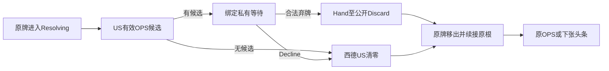

# 封锁对局接线

> description: 等待US私有弃牌、接受后续接原出牌根与头条；候选绑定和事务失败边界。

状态：Core、会话投影和控制器已通过2749项原生测试；Demo第23练习正在验证，尚未交付本批Player。先读[模块JSON](../Descriptors/blockade-play.module.json)。

## Core流程

ActionPracticeDefinition.Blockade引用已装载定义，检查Map/Cards/Ops与其他服务一致且处理器不重叠。事件开始后原牌进入唯一Resolving区，BlockadeDecision固定Owner=US；候选由[手牌基础](blockade-hand-discard.md)计算，绑定GameId/ExpectedVersion/牌区/效果实例/回合和根ID。无候选直接走移除分支，不向玩家发布空选择。

CardActionKind.DiscardForBlockade/DeclineBlockade经Plan进入专用响应。错误候选、身份、旧版本或非法命令拒绝；不会自动解释成Decline。选择成功后先在内部草稿完成弃牌或西德US清零，原牌按印刷星号移出。OpponentOps保留原Actor，只完成事件步骤；普通直接事件完成一个根；头条推进自己的根并继续后继头条，不增加普通行动次数。

HeadlineResolutionRules.Advance同时识别国家选择和Blockade等待。回应后若后继头条失败，整个响应拒绝，内部草稿不提交。影响力变化、牌区与随机/军事等保持各自明确职责；旧收据幂等由现有宿主提供，15项会话专项测试已验证私有候选、公开弃牌、重复收据与后继失败回滚。

验证：[分阶段报告](../Testing/blockade-play.validation.json)。本批之外：五年计划、完整存档/联网、未知持续效果与整局完整性。

## 接线与查阅入口

`PublicBlockadeView`只给回应方候选，`PublicBlockadeResult`仅含已接受结果。`PublicCardSummary.DiscardPile`复制公共弃牌实体ID，旧回执仍保留旧列表。控制器复用固定身份SendCard与幂等缓存，换身份清选牌，换局清命令。

`DemoCatalog.WithBlockade`装配共享定义；`WithBlockadeScenario`读取独立fixture并完整划分早期/后续牌区。人工第2回合美国有马歇尔计划、独立红色政权、亚洲计分，西德美5苏2，苏联持封锁。右侧面板先处理回应再检查根行动方；候选列表和放弃操作都提交权威命令。地图只消费快照，布局与画风可替换。
