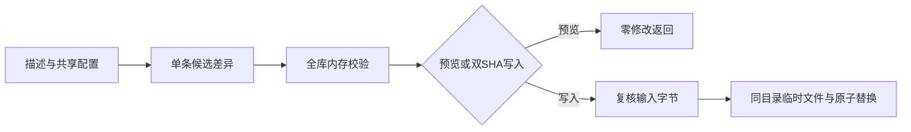

# 单条catalog摘要同步

> description: 根据模块/脚本/数据描述更新既有目录摘要；默认预览，双SHA明确写入，保留独立数据业务状态。

先读[脚本描述](../../Tools/Descriptors/sync-catalog-entry.script.json)，再查synchronize或plan_sync。读取Tools/Configuration/metadata-validation.json确定目录/ID/status语义，不在脚本复制映射。仅同步已登记的一个描述；缺条目、错误ID或其它目录异常需要人工处理，工具不会自动创建或批量覆盖。

```powershell
python Tools/Scripts/sync-catalog-entry.py --project-root E:/TwilightStruggle --descriptor Docs/Descriptors/early-war-play.module.json
```

检查输出changes；把该次catalog_sha256和candidate_sha256原样传入同命令的`--write --expected-catalog-sha <原文件SHA> --expected-candidate-sha <候选SHA>`。成功updated或unchanged且退出0才表示已完成；脚本只更新目录，仍需审阅Git差异和项目所需测试。不能把失败后的候选SHA当成已写入结果。



模块/脚本同步description和status；Data仅同步description，业务status不改。默认UTF-8 JSON输出，不依赖Windows控制台代码页。输出格式变化时catalog统一UTF-8/LF/两空格；无差异保持原始字节。工具不会执行描述入口、联网或调用Git。

35项测试含真实子进程及Windows Junction；原子替换失败/校验后变更使用故障注入，明确不冒称真实磁盘故障。既有只读校验器48项回归通过。CLI照旧只读；其内部Reader/validate追加byte_overrides供本工具候选校验，路径/存在性/大小限制依旧生效。实际结果见[验证报告](../Testing/catalog-entry-sync.validation.json)。

输入应稳定；不是恶意并发路径替换或硬链接沙箱。该验证也不替代C#编译、游戏规则测试或远程Git核对。
