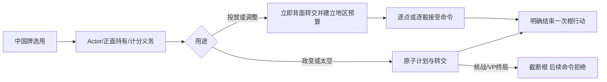

# 中国牌行动试玩

> description: 中国牌作为独立牌主动用于投放、调整、政变或太空，立即背面转交；接共享地区预算、计分义务、固定身份会话与可替换地图，当前不接完整回合末翻面。
> status: implemented-subset；先读[模块JSON](../Descriptors/china-card-playtest.module.json)，再按符号查代码。

`ChinaCardDefinitionLoader.LoadSubset`复用persistent-effects共享契约/OPS来源校验，只取已核实中国牌来源；`DemoCatalog.WithPracticeChina`在普通调整装配后、QuickStart前接入，Editor/播放器读取同一载荷。

`CanPlay`先检查当前Actor/阶段/待选择，再检查独立牌持有方、正面与剩余计分义务。中国牌单列于`CardActionOptions.China`，不混入普通Cards/OwnHand。若本方手中计分牌数量大于等于剩余普通行动数（含当前），不能耗一个行动使用中国牌。当前没有额外行动，后续须扩展该查询，不能把此计算直接当完整规则。

使用开始时`ChinaCardRules.TransferOnUse`复制牌区并立即交给对方背面。中国牌始终只有一个实体，不进Resolving、弃牌或移出区；多步投放/调整的ActiveCard仅引用它。结束时只完成一次根行动。核战/太空VP终局保留已转交中国牌和中断根引用，所有后续命令拒绝；普通牌终局保留Resolving的历史策略不变。

- 投放/调整：冻结实际Actor的报价；亚洲含东南亚满足全部目标时有额外预算，逐点/逐骰历史见[地区预算](regional-ops-budget.md)。地图仍通过原IMapView和合法目标查询，不看显示坐标裁决规则。
- 政变：按实际目标的地区报价，同时用于政变强度和军事信用；DEFCON地理门禁/核战沿用现有服务。
- 太空：只用普通OPS报价；使用成功或失败都背面转交，不触发普通弃牌。
- UI：局面与手牌面板有单独中国牌按钮；背面/非持有者不能选择，固定身份与Host再验证；普通手牌数量不变。地区预算投影只含公开总额/花费/地区，隐藏手牌/RNG不进入它。

事实来源：[GMT2015规则](https://www.gmtgames.com/nnts/TS_Rules-2015.pdf) §7.4/9.1–9.8；[官方FAQ v5](https://www.gmtgames.com/nnts/FAQv5.pdf) #6支持中国牌亚洲政变、逐次调整与太空。低值地区修正沿用已确认PE-INTERPRETATION-01，不冒称专门官方FAQ。

边界：未接头条/回合末翻面、事件转交、Formosan取消、Vietnam运行时、强制弃牌、额外行动、完整存档/联网。当前单回合结束后仍需重置，102设计绑定不是全部可执行。

测试：ChinaCardPlayTests / ChinaCardSessionTests / OpsRegionalBudgetTests。1928全量回归通过；源码、构建和鼠标证据分别见[报告](../Testing/china-card-playtest.validation.json)及[工作记录](../Worklogs/2026-10-14-china-card-playtest.md)。
