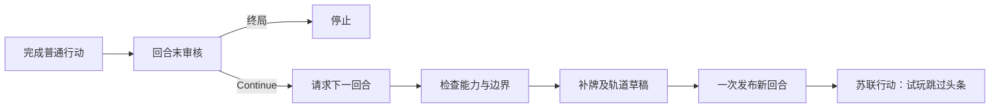

# 连续回合试玩

> description: 查结算后下一回合的权威入口、补牌与轨道复用、跨回合收据ID、UI和不支持的阶段。

先读[模块JSON](../Descriptors/continuous-turn-playtest.module.json)，再按CanBeginNextTurn/PlanNextTurn及WithNextPracticeTurn定位源码。设计与边界见[接口说明](../Architecture/continuous-turn-playtest.md)。本批目标播放器为`Builds/ContinuousPlaytest/ColdWarStruggleDemo.exe`，是否已构建/鼠标验证以[报告](../Testing/continuous-turn-playtest.validation.json)为准。

全部普通行动完成→结算本回合→军事/扣留审核Continue→“下一回合（跳过头条）”。命令不接受卡牌、国家、回合号或客户端牌库；任一固定身份可请求已经到达的阶段。地图、VP、手牌剩余实体及历史保留，不重建初始局面。

核心只组合已有服务：Calendar目标→DEFCON改善→军事重绑已归零值→Space.BeginNextTurn保留轨道与历史并重置次数→TurnDeal补牌和时代加入→空的新回合OPS→苏联ChooseCard。全部字段及随机快照经一次GameState发布；溢出/牌不足不产生部分状态。Military.InitialEarned用于初始局面，下一回合沿Reset结果；测试特意将两者设置不同。

太空/普通与对手政变/计分slot及行动上下文含Turn和本回合行动序号。历史收据保留，新回合相同槽不会被当旧请求。客户端命令ID防重仍由Host按固定身份处理，不能用内部slot代替。

存在活动根、Resolving、事件、部署、未审核或终局时拒绝。China背面/OPS未清/军事未归零等不一致状态不自动修复。达到日历最后回合时停止，不建立回合11或伪造最终计分。有太空额外行动时连玩配置的审核先停止；有未接期末弃牌能力时不推进下一回合。

界面仅展示公开资格/计数和本人手牌；完整TurnDealPlan从不投影到客户端。顶部回合号变化，结算报告中的按钮标明跳过头条。旧TurnEndPlaytest二进制保持原状；新构建和源码装配启用连续模式，未启用NextTurnEnabled的旧定义不改变。

本版仍无头条、额外行动/太空期末选择、最终计分、完整事件/存档/联网/AI；某些手牌路线因事件未支持而停止。因此可连续测试若干回合，但不是完整正式整局。

测试包括真实默认12行动→审核→第二回合→新行动、两身份私有投影、重试与过期，以及跨回合相同槽的太空和政变收据。实际数量/构建/鼠标证据分别记录，不以单元测试代替视觉验收。

2026-10-15源码增量：PublicPracticeView保留TurnEndError/NextTurnError，按钮仍以相同Core资格为准；TurnEndPrompt与TurnEndMessage分别说明额外行动、期末弃牌、最终计分边界。这里不新增任何回合末能力。五个新用例已在独立.NET 8托管环境完成RED→GREEN，相关托管回归通过；Unity许可证失效导致EditMode/新播放器/鼠标验收未运行，旧Localized播放器没有更新。见[增量验证](../Testing/turn-end-feedback.validation.json)。
