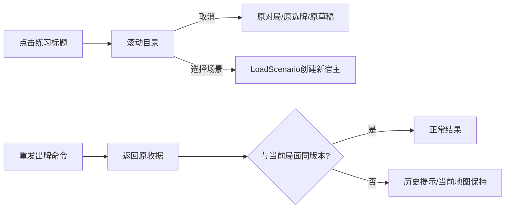

# 练习列表与历史命令提示

> description: 查找 Demo 练习列表、取消时保留对局、选择时创建新宿主，以及旧命令回执不会冒充当前阶段的显示规则。

这是表现层功能，不增加规则或新场景。顶部练习标题打开目录滚动列表，直接使用 `DemoScenarioOption` 的标题与稳定 ID。打开和取消只改变界面；点击任一列表项明确重新开始，包含当前场景。列表显示时不绘制手牌、地图和动作按钮，避免点击穿透。地图画风仍通过 `IMapView` 替换。

先读[模块描述](../Descriptors/demo-navigation-feedback.module.json)，再按需要定位：

- `DemoView.OpenScenarioPicker / CancelScenarioPicker / SelectScenario`：列表生命周期、索引验证和现有 Reset 接口。
- `DemoView.DrawScenarioPicker`：滚动列表和“选择会重新开始”的提示，绘图不接触权威状态。
- `DemoController.CardResultHistoryMessage`：比较原收据与最新玩家视图的 GameId/Version；不同版本只展示历史提示。原收据仍保持不变，重发仍走固定会话的幂等接口。
- `DemoView.DrawPracticeControls`：历史出牌结果替代旧阶段指令；同版本待选择保留正常提示，新的影响力/事件提交结果沿用原有显示优先级。

只处理当前出牌回执的过期提示；不等于实现全局日志、存档或联网重连。测试覆盖真实独立红色政权完成后重发与待选择时重发，以及列表取消、重新开始、非法索引。自动测试、构建及鼠标验证见[验证记录](../Testing/demo-navigation-feedback.validation.json)。

[返回索引](index.md)
