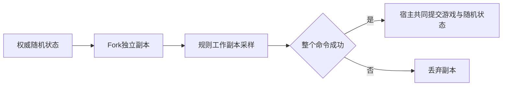

# 可恢复随机状态

> description: 查PCG32版本、范围采样、完整快照、事务副本和精确JSON；本模块已实现，初始发牌已使用事务副本，GameState已持有快照；消费随机数的游戏命令与完整存档仍待实现。

## 接口与边界

Core的`IRandomProvider`只提供`NextInt`、`Capture`、`Fork`。`Pcg32Random.FromSeed(seed, stream)`接受64位种子和63位流编号；版本固定为`pcg32-xsh-rr-v1`。`RandomSnapshot`不可变，包含AlgorithmId、State、奇数Increment及DrawCount。初始化的两次状态转换不计入游戏输出。

`NextInt(min, max)`下限包含、上限不包含，支持整个int跨度。拒绝采样避免直接取模的偏差；被拒绝的原始输出也计入DrawCount。宽度1仍消费一个原始输出。`NextUInt32`主要用于兼容性测试与底层采样，不绕过计数。

区间错误不推进状态；计数溢出即使发生在多次拒绝采样中间，也不发布部分结果。算法需要64位模运算，转换使用显式unchecked。流编号高位超出范围明确拒绝，不静默折叠到另一流。

## 调用与流程

上图是调用方接入约定。初始发牌已按此隔离，GameState成对保存牌区/随机快照；后续消费随机数的游戏命令仍待接入。`Capture`不消费随机结果；从快照构造恢复当前序列，不能用seed重新开始。实例是可变且非线程安全，可信宿主串行使用。该算法供确定性游戏模拟使用；初始种子产生属于外围，Core不调用时间、Guid或Unity随机。隐藏状态不得进入正常玩家投影或公共日志。

## JSON v1

`RandomSnapshotJson.Serialize/Deserialize`位于Infrastructure/Serialization，只处理字符串，不读写路径。字段严格为`schema_version`、`algorithm_id`、`state`、`increment`、`draw_count`；后三项为固定16位小写十六进制字符串，避免64位整数经过JSON消费者时丢精度。未知版本/算法、额外/缺失/重复键、格式不符、偶数增量均拒绝。沿用ContractJson的尺寸/深度边界。

这只是随机快照的编码。完整存档还必须包含GameState、数据版本、牌区、待选择、命令收据等；本批不宣称具备保存整局功能。

## 定位与验证

先读[模块描述](../Descriptors/deterministic-random.module.json)，再定位Core/Random与Infrastructure/Serialization入口。测试为Pcg32RandomTests及RandomSnapshotJsonTests；报告见[验证记录](../Testing/deterministic-random.validation.json)。作者公开seed42/stream54六个输出作为外部固定向量，另覆盖恢复、Fork、拒绝样本与溢出回滚、大范围和JSON错误。

算法来源：[作者使用文档](https://www.pcg-random.org/using-pcg-c-basic.html)、[pcg-c-basic源文件](https://github.com/imneme/pcg-c-basic/blob/master/pcg_basic.c)。C#转换标注改动并保留版权，见[第三方说明](../References/ThirdParty/pcg32.md)与[Apache-2.0全文](../References/ThirdParty/Apache-2.0.txt)。
