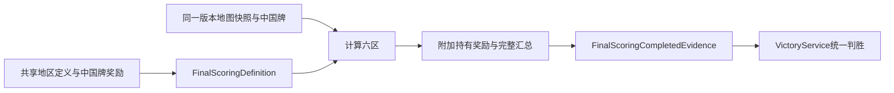

# 最终计分基础

> description: 读六区最终汇总、中国牌持有奖励、欧洲优先与零分平局接口；与真实第10回合命令/UI边界分开。
> 当前：纯C#核心与正式加载2386项原生回归通过，宿主未接。

先看[模块JSON](../Descriptors/final-scoring.module.json)，按entrypoints读需要的函数；规则依据与设计见[设计](../Design/2026-10-16-final-scoring-foundation.md)。

## 已实现接口

`FinalScoringDefinition`同时校验完整六区及基础规则固定地区ID；`FinalScoringService.CalculateUnmodified`内部从同一快照计算，不允许外界拼接结果。`FinalScoringCompletedEvidence`交`VictoryService.Evaluate`一次判胜。结果持有各地区、SnapshotId/StateVersion、ChinaOwner/ChinaVpForUS、NetVpForUS与EuropeControlWinner，字段只读。

东南亚属于亚洲，不再执行独立SEA权重。全部地区后才能判断总分正负；暂时达到20不提前结束。欧洲Control给独立赢家，净数值为null，胜负服务保留原VP；零分明确是Finished且Winner=null。中国牌朝向不影响奖励，计算不翻牌。累加采用long中间值，最后检查Int32范围。

## 接入边界

纯服务不检查回合号/用户身份，不提交状态或移动卡牌；宿主须完成第10回合全部期末步骤、军事/扣留审核并确认尚未终局，使用同一状态版本的地图与China，再做事务/防重。任何活动计分修正均拒绝，不能把台湾决议等默默忽略。当前播放器没有最终计分按钮；不因此声称完整10回合可玩。

测试入口：FinalScoringTests.cs（完整地区/SEA/所有权/正负零/欧洲/越线反转/不可变/输入保护/溢出）；FinalScoringLoaderTests.cs覆盖正式数据、共享参数读取与严格校验。计划见[任务清单](../Plans/2026-10-16-final-scoring-foundation.md)。

## 正式数据加载

`FinalScoringDefinitionLoader.LoadSubset(regionJson,regionSchema,chinaJson,chinaSchema,map,cards)`先校验可信仓库契约，再核对来源ID/URL、基础牌目录和全部地区。奖励读取`scoring-card-parameters.json`，最终地区读取`region-scoring.json`的`include_in_final`；新结构契约为`Docs/Contracts/scoring-card-parameters.schema.json`。加载器不会联网下载规则，也不把可变JSON文字当授权。来源核对不等于加密认证；未来RulePack摘要绑定仍待实现。

2026-10-16：本批新增66项（核心32+加载34），全套2386/2386，0失败/跳过；证据见[验证报告](../Testing/final-scoring-foundation.validation.json)。

审查补强：即便调用方直接构造通用Map/Region定义，也不能用未知地区替换欧洲或其他基础地区。固定ID属于基础游戏领域身份；分值、奖励与显示布局仍由共享数据维护。其他地图变体需要独立规则契约，不以换画风为由改变地区身份。
