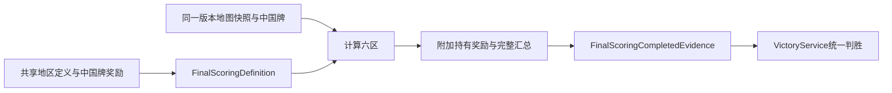

# 最终计分

> description: 读六区最终汇总、中国牌持有奖励、欧洲优先与零分平局接口；与真实第10回合命令/UI边界分开。
> 当前：核心、正式加载、宿主、场景与界面2443项原生回归通过；独立FinalScoringPlaytest已构建并完成鼠标验收。

先看[模块JSON](../Descriptors/final-scoring.module.json)，按entrypoints读需要的函数；规则依据与设计见[设计](../Design/2026-10-16-final-scoring-foundation.md)。

## 已实现接口

`FinalScoringDefinition`同时校验完整六区及基础规则固定地区ID；`FinalScoringService.CalculateUnmodified`内部从同一快照计算，不允许外界拼接结果。`FinalScoringCompletedEvidence`交`VictoryService.Evaluate`一次判胜。结果持有各地区、SnapshotId/StateVersion、ChinaOwner/ChinaVpForUS、NetVpForUS与EuropeControlWinner，字段只读。

东南亚属于亚洲，不再执行独立SEA权重。全部地区后才能判断总分正负；暂时达到20不提前结束。欧洲Control给独立赢家，净数值为null，胜负服务保留原VP；零分明确是Finished且Winner=null。中国牌朝向不影响奖励，计算不翻牌。累加采用long中间值，最后检查Int32范围。

## 接入边界

纯服务不检查回合号/用户身份，不提交状态或移动卡牌；`CanCompleteFinalScoring`已验证第10回合全部普通行动、军事/扣留审核、太空边界及同一回合参数；`CardActionKind.FinalScoring`经LocalGameHost提交，保存原TurnEnd报告并一次发布最终收据/VP/Ended。重发同ID返回原收据；旧版本、重复新ID和数值溢出均不再计分。任何活动计分修正均拒绝，不能把台湾决议等默默忽略。独立FinalScoringPlaytest已接最终计分按钮并完成构建/鼠标验收，旧Headlines Player仍保留；不因此声称所有事件与完整10回合已可玩。

测试入口：FinalScoringTests.cs（完整地区/SEA/所有权/正负零/欧洲/越线反转/不可变/输入保护/溢出）；FinalScoringLoaderTests.cs覆盖正式数据、共享参数读取与严格校验。计划见[任务清单](../Plans/2026-10-16-final-scoring-foundation.md)。

## 正式数据加载

`FinalScoringDefinitionLoader.LoadSubset(regionJson,regionSchema,chinaJson,chinaSchema,map,cards)`先校验可信仓库契约，再核对来源ID/URL、基础牌目录和全部地区。奖励读取`scoring-card-parameters.json`，最终地区读取`region-scoring.json`的`include_in_final`；新结构契约为`Docs/Contracts/scoring-card-parameters.schema.json`。加载器不会联网下载规则，也不把可变JSON文字当授权。来源核对不等于加密认证；未来RulePack摘要绑定仍待实现。

2026-10-16：本批新增66项（核心32+加载34），全套2386/2386，0失败/跳过；证据见[验证报告](../Testing/final-scoring-foundation.validation.json)。

审查补强：即便调用方直接构造通用Map/Region定义，也不能用未知地区替换欧洲或其他基础地区。固定ID属于基础游戏领域身份；分值、奖励与显示布局仍由共享数据维护。其他地图变体需要独立规则契约，不以换画风为由改变地区身份。

## 宿主与初始化

`PublicPracticeView.FinalScoring`仅暴露六区公开结果、前后VP、中国牌归属/奖励及赢家，不包含牌库/随机数/规则实例。零分使用IsDraw，不依赖Winner非空判断游戏是否结束。`ActionPracticeState.CreateAtTurn`只建立可信测试场景的起始状态，没有已完成动作或审核历史；第2回合以后可显式StartPractice，第1回合仍必须完成部署。它不是存档恢复接口。

本批Task1新增22项，原生2408/2408、0跳过。后续场景/界面证据逐项写入本批验证报告，不能沿用基础批次结果宣称新Player通过。

## 独立练习装配

`WithFinalScoringScenario`最后装配，保留原14场景对象，为原头条场景复制并保留全部能力后补充FinalScoring，再附加第16个人工场景。`LoadBound`逐项比较通用计分参数（包括SEA权重），复用已有RegionScoringDefinition引用，防止普通/最终计分各持一份不一致定义。

[场景描述](../../Data/Descriptors/final-scoring-scenario.data.json)定位JSON。fixture显式声明第10回合、地图影响力、初始VP、中国牌和14张普通手牌；组装校验后用StartPractice及14次Influence/FinishInfluence真实命令准备到Version29、尚未审核。没有伪造军事收据或最终结果，不代表真实玩过九回合。此场景不用太空/掷骰，不消耗RNG。

## 结算显示

`CompleteFinalScoringAsync`复用固定身份SendCard与generation隔离。`FinalScoringPanelFrame`从公开报告生成六区基础/战场/邻接分项、净分、中国牌奖励和最终公式；欧洲直接获胜保留原VP、净分不伪造，零分显示平局。`DemoView.FinalScoring`提供地图区明细页和右侧摘要，固定状态栏继续显示VP/DEFCON/军事/太空，切图和中英文名称不写规则状态。新报告可返回终局地图、重发命令和切身份查看；新场景默认观察仍关闭。

`BuildFinalScoringPlaytest`输出独立Builds/FinalScoringPlaytest；Editor和Player接相同正式JSON，新增3项载荷由既有SynchronizeData验证复制。本批9项展示测试已通过，另外补4项特殊太空门禁回归；最终2443项原生测试通过。实际构建/UI证据见下。

## 已验收的试玩入口

打开 `Builds/FinalScoringPlaytest/ColdWarStruggleDemo.exe`；默认第15个头条场景，点一次“下一个”进入第16个最终计分人工练习。依次“结算本回合”→“执行最终计分”，当前示例审核VP2、欧洲−1、中美洲−1、其他四区0、中国牌美国+1，最终VP1美国获胜。重发仍版本31/序号31；地图、国家名和身份切换均不改变局面。终局普通手牌与中国牌选择禁用，地图仅查看/复盘。

源码构建点 `a0f7f40`；45份构建载荷逐字节一致；[验证报告](../Testing/final-scoring-playtest.validation.json)保存27份源码哈希、XML和构建日志哈希及截图。[结算画面](../Images/final-scoring-report.png) / [只读地图](../Images/final-scoring-readonly-map.png)。真实鼠标只覆盖本示例美国胜，苏联胜/零分平局/欧洲控制由原生测试覆盖，不扩称整局或全卡牌验收。

2026-10-16更新：[太空期末弃牌](space-end-turn-discard.md)已接Core/固定身份会话。军事与扣留审核后生成私有选择，处理后才允许下一回合或最终计分；第8格额外行动仍未接。新界面/Player尚待本批后续，历史验收数仅代表各自构建。
