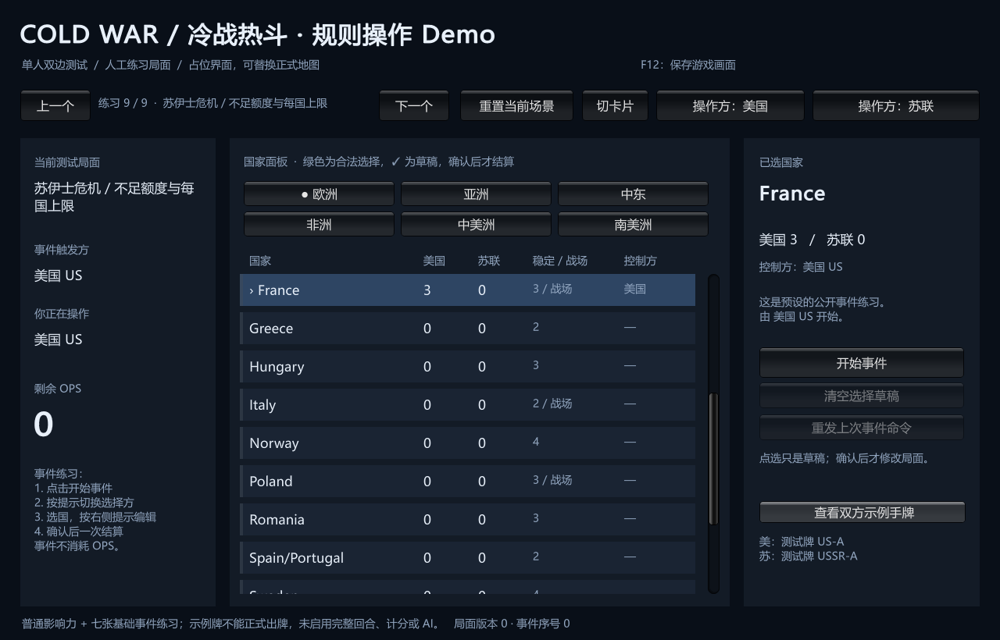
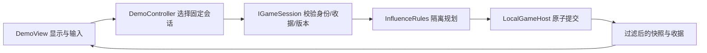

# 第一个影响力 Demo

description：运行单窗口双边测试，定位影响力规则、固定身份、幂等、数据加载及 Unity 构建入口。先读模块 JSON，再定位对应函数。

状态：2026-10-13，真实 Unity 工程与 Windows 构建已建立；295 项 EditMode 测试通过。已通过游戏自身导出真实渲染并检查字体/布局；computer-use鼠标实测仍受窗口激活失败影响，不能把截图当成点击验收。

共有九个场景，顶部“上一个/下一个”切换。前两个是普通OPS，后七个是公开事件的人工练习。

## 运行与尝试

最新九练习版本：`E:\TwilightStruggle\Builds\FirstDemo\ColdWarStruggleDemo.exe`。用户已打开的旧PreviewDemo窗口保留，未被关闭；运行中的旧窗口不会自动变成新版。运行需要保留同目录的 `_Data`、`UnityPlayer.dll`、`MonoBleedingEdge` 等文件，不能只复制 exe。构建目录不进 Git；源码可重建。

从 Git 检出后，用 Unity **6000.6.0f1** 打开项目，选择 **ColdWarStruggle → Play First Demo**。菜单 **Build Windows Demo** 输出FirstDemo，**Build Side-by-side Preview** 输出PreviewDemo；标准 Unity Build 也会执行数据校验和同步。先打开已跟踪的 `Assets/ColdWarStruggle/Scenes/FirstDemo.unity`，不要构建空场景。

1. 默认美国练习，目标 France（法国），美国 0 / 苏联 3，稳定度 3，预算 4 OPS。
2. 点“一次提交 3 点”：费用应为 **2 + 1 + 1**，美国影响力变为 3，剩余 OPS 为 0，版本变为 1。
3. 点“重发上次命令”：同一收据返回，影响力、版本和事件序号不再增加。
4. 重置后切换“操作方：苏联”，仍是美国的行动上下文；提交会被拒绝。要测试苏联的合法行动，点“下一个”进入练习2。
5. 关闭“查看双方示例手牌”后，只显示当前身份自己的标签和对手数量。两份手牌仅测试投影，不能出牌。

国家面板按六个地区排列，绿色边条表示此刻可投放。所有 84 国都可查询；它是诊断面板，尚无地理轮廓、镜头缩放、正式主题或卡牌拖放。

## 模块与流程

| 要解决的问题 | 描述入口 | 实际符号 |
|---|---|---|
| 读取地图、验证正式版本 | [map-data.module.json](../Descriptors/map-data.module.json) | `MapDefinitionLoader.Load`、`MapDefinition.GetCountryNeighbors` |
| 计算每点费用和控制权 | [influence-core.module.json](../Descriptors/influence-core.module.json) | `InfluenceRules.PlanPlacement`、`OperationsContext.FromRoundStart` |
| 身份、版本、重试与隐私 | [local-session.module.json](../Descriptors/local-session.module.json) | `IGameSession`、`LocalGameHost.ReadLocalTestSnapshot` |
| UI 与测试场景 | [demo-presentation.module.json](../Descriptors/demo-presentation.module.json) | `DemoCatalog.Load`、`DemoController.SubmitAsync`、`DemoView.Initialize` |
| 构建和权威数据复制 | [demo-build.module.json](../Descriptors/demo-build.module.json) | `DemoBuild.SynchronizeData`、`DemoBuildPreprocessor.OnPreprocessBuild` |

Core/Application/Infrastructure 没有 UnityEngine 引用。Core 不读文件；Bootstrap 和 Editor 读取源文件，Infrastructure 校验并构造定义。Presentation 只读视图、发送意图，不获得可写局面。`IMapView` 同步诊断子集现已实现，国家区可在卡片/列表间切换；正式布局、主题资源和异步加载仍未实现。详见[实际接口](replaceable-map-view.md)。

## 唯一数据与边界

- 普通费用：[influence-placement.json](../../Data/Rulesets/deluxe-2015/influence-placement.json)，业务数值不写在 UI 或重复的 C# 常量里。
- 人工场景：[influence-scenarios.json](../../Data/Demo/influence-scenarios.json)，明确 `scope=fixture`；不冒充正式初始布置。
- 地图：[world.json](../../Data/Maps/deluxe-2015/world.json)；独立 [world.profile.json](../../Data/Maps/deluxe-2015/world.profile.json) 锁定原有审核版本。批准摘要忽略排版和对象键顺序，保留数组顺序；修改定义后要重新审核 profile，构建不会替候选文件自行批准。
- 名称：[en-US.catalog-names.json](../../Data/Localization/en-US.catalog-names.json)，国家暂用英文名称，界面提示为中文。
- `Assets/StreamingAssets/ColdWarStruggle` 是生成的十三文件副本，被 Git 忽略；每次构建先验证权威源再同步。编辑副本不能改变权威数据。

运行门禁只批准当前地图定义，**没有返回完整 RulePack**。完整注册表的102个处理器仍为planned；现有七牌算法和人工事件事务不能冒充正式出牌生命周期。没有完整开局、发牌、回合、计分、DEFCON、军事行动、太空、存档、联网或 AI。`OperationsMode` 的政变/调整枚举不代表这些行动已实现。人工手牌标签不是完整卡牌实体。

合法高亮不是授权，实际提交重新校验。命令拒绝不修改局面；此前成功的其他命令保留。相同身份和命令编号重发返回原收据；改 payload 明确拒绝。取消已经结束的等待不会撤销已提交局面。

## 验证与后续

真实测试入口：`Assets/ColdWarStruggle/Tests/EditMode`。运行 Unity EditMode，筛选 `ColdWarStruggle.Tests`；当前 295 项通过。详细 RED/GREEN、构建和实际限制见 [数量Demo工作记录](../Worklogs/2026-10-13-allocation-demo.md)。旧的有限 Python 设计检查不能计入 C# 测试数。

七张基础事件、国家集合和数量分配界面已实现；下一批优先建立权威回合上下文，随后衔接正式出牌。地图布局与主题可并行演进，但沿用稳定 CountryId 和会话边界。

[返回索引](index.md)

## 画面导出

F12只导出游戏当前渲染帧到本机 `Application.persistentDataPath/DemoCaptures`，使用唯一文件名，不覆盖原图，不导出桌面。Windows通常位于用户AppData/LocalLow/ColdWarStruggle/ColdWarStruggle First Demo。显式 `--capture-demo` 在初始化后导出一帧并退出：初始化与捕获均成功0、错误1；用于渲染验收，不自动改变局面。需要正常显示窗口，隐藏/无图形模式没有可导出的帧时明确失败。此诊断功能不是存档或回放。

可追加 `--demo-scenario=demo.event.decolonization`，只选择目录里已有的练习。未知/重复选择会报告加载错误，CLI捕获退出1且不生成PNG；不会加载外部路径、修改规则或自动提交事件。默认仍从第一个普通影响力练习开始。

## 五张事件练习

场景事实来自 [event-scenarios.json](../../Data/Demo/event-scenarios.json)，卡牌算法参数来自 [共享五牌定义](../../Data/Cards/deluxe-2015/early-influence-batch1.parameters.json)。通过 `DemoCatalog.WithEventScenarios` 装配，零OPS、无活动干预，人工手牌标签仍不能正式出牌。

1. 切到练习3至7，按“开始事件”。菲德尔、罗马尼亚退位、纳赛尔直接结算。
2. 杜鲁门主义/去殖民化进入等待；左侧显示规则要求的选择方。点击右上角相应“操作方”按钮，切换固定会话。
3. 点绿色国家编辑草稿，重复点已选国取消。去殖民化可跨非洲与亚洲页中的东南亚国家；四国都属于同一完整选择，换地区页不清空。
4. “确认完整选择”仅在草稿数量满足时可点；规则宿主仍重新检查身份、版本和全部目标。非法提交不会部分加点。
5. “清空选择草稿”只改本地草稿；“重发上次事件命令”返回原收据；“重置当前场景”创建新GameId并清空旧命令/草稿。

`DemoController.Events.cs` 只编辑意图，`DemoView.Events.cs` 只显示投影。草稿绑定GameId/Version/DecisionId/操作方；这些值变化就失效。玩家切换身份不会改变PhasingPlayer/Owner或OPS Actor。完成状态永久保留在本次人工实例中，不能通过新命令重复触发。

本批实际报告 [event-demo.validation.json](../Testing/event-demo.validation.json) 记录149项测试、Windows构建、九份源数据与播放器逐字节一致及真实渲染截图。computer-use重新定位后仍无法激活窗口；未把渲染导出或控制器测试称为鼠标实测通过。

地图接口批次曾追加21项回归（当批总170），包括公开帧、生命周期、实际适配器与审查修复，见[地图验证报告](../Testing/replaceable-map-view.validation.json)。顶部“切列表/切卡片”保留同一对局和草稿；启动可选`--demo-map=tiles|table`。

## 两张数量分配练习

练习8为社会主义政府，练习9为苏伊士危机。新数据见 [allocation-scenarios.json](../../Data/Demo/allocation-scenarios.json)，仅提供人工初始局面；总额、每国上限和地区条件仍读第二批共享参数。

1. 按“开始事件”，再切换为规则要求的苏联操作方。
2. 点国家定位，在右侧用−/+调整该国移除数量。地图点击只选国家；右侧显示分配总量与当前国家容量。
3. 社会主义政府练习可选奥地利2、法国1；芬兰2保持。苏伊士练习只能分配法国2、英国1，按已确认短缺解释移除3点，法国保留1。
4. 完整分配后按“确认移除分配”。确认前局面版本与影响力不变，确认后一次结算；重发返回原收据。
5. 切卡片/列表保留同一草稿；切操作方、换场景或权威版本变化则清空草稿。清空按钮只影响本地选择。

数量入口先读 [Demo描述](../Descriptors/demo-presentation.module.json)，再定位 `DemoController.Allocation.cs` 的 `ChangeEventAllocation`、`CanChangeEventAllocation`、`AllocationDraft`；确认仍经 `DemoController.Events.cs` 的 `ConfirmEventAsync`。UI根据 `Query.Kind` 选择控件，不根据卡名写规则。

卡牌文件只作为 [效果引用索引](card-effect-reference-index.md) 的来源，索引返回102个ID并不表示102个处理器可执行。东欧动荡现已在规则与会话层接入权威时代，尚未新增Demo场景。

实际 [295项验证报告](../Testing/allocation-demo.validation.json) 记录6次测试运行与中间失败、13份规范源/播放器字节一致、Windows构建和Ready阶段真实游戏帧。图中事件尚未开始；不据此声称数量按钮或鼠标实测通过。

后续时代规则批次已通过371项EditMode；当前可运行九练习播放器仍为295项通过时的allocation-demo构建。二者范围分别记录，见[时代批次报告](../Testing/era-removal.validation.json)。
