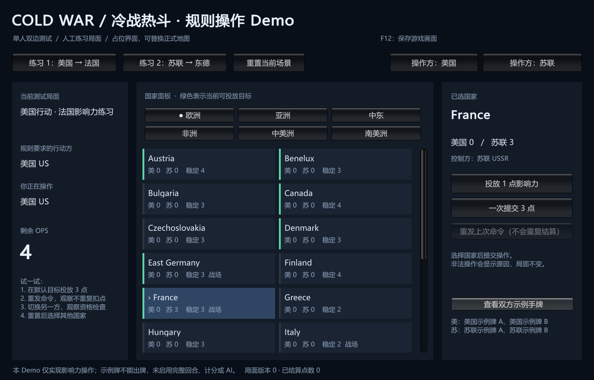
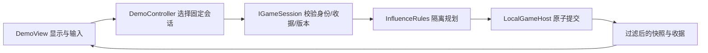

# 第一个影响力 Demo

description：运行单窗口双边测试，定位影响力规则、固定身份、幂等、数据加载及 Unity 构建入口。先读模块 JSON，再定位对应函数。

状态：2026-10-13，真实 Unity 工程与 Windows 构建已建立；52 项 EditMode 测试通过。已通过游戏自身导出真实渲染并检查字体/布局；computer-use鼠标实测仍受窗口激活失败影响，不能把截图当成点击验收。

## 运行与尝试

本机双击 `E:\TwilightStruggle\Builds\FirstDemo\ColdWarStruggleDemo.exe`。运行需要保留同目录的 `_Data`、`UnityPlayer.dll`、`MonoBleedingEdge` 等文件，不能只复制 exe。构建目录不进 Git；源码可重建。

从 Git 检出后，用 Unity **6000.6.0f1** 打开项目，选择 **ColdWarStruggle → Play First Demo**。菜单 **Build Windows Demo** 生成 Windows 版；标准 Unity Build 也会执行数据校验和同步。先打开已跟踪的 `Assets/ColdWarStruggle/Scenes/FirstDemo.unity`，不要构建空场景。

1. 默认美国练习，目标 France（法国），美国 0 / 苏联 3，稳定度 3，预算 4 OPS。
2. 点“一次提交 3 点”：费用应为 **2 + 1 + 1**，美国影响力变为 3，剩余 OPS 为 0，版本变为 1。
3. 点“重发上次命令”：同一收据返回，影响力、版本和已结算点数不再增加。
4. 重置后切换“操作方：苏联”，仍是美国的行动上下文；提交会被拒绝。要测试苏联的合法行动，选择“练习 2”。
5. 关闭“查看双方示例手牌”后，只显示当前身份自己的标签和对手数量。两份手牌仅测试投影，不能出牌。

国家面板按六个地区排列，绿色边条表示此刻可投放。所有 84 国都可查询；它是诊断面板，尚无地理轮廓、镜头缩放、正式主题或卡牌拖放。

## 模块与流程

| 要解决的问题 | 描述入口 | 实际符号 |
|---|---|---|
| 读取地图、验证正式版本 | [map-data.module.json](../Descriptors/map-data.module.json) | `MapDefinitionLoader.Load`、`MapDefinition.GetCountryNeighbors` |
| 计算每点费用和控制权 | [influence-core.module.json](../Descriptors/influence-core.module.json) | `InfluenceRules.PlanPlacement`、`OperationsContext.FromRoundStart` |
| 身份、版本、重试与隐私 | [local-session.module.json](../Descriptors/local-session.module.json) | `IGameSession`、`LocalGameHost.ReadLocalTestSnapshot` |
| UI 与测试场景 | [demo-presentation.module.json](../Descriptors/demo-presentation.module.json) | `DemoCatalog.Load`、`DemoController.SubmitAsync`、`DemoView.Initialize` |
| 构建和权威数据复制 | [demo-build.module.json](../Descriptors/demo-build.module.json) | `DemoBuild.SynchronizeData`、`DemoBuildPreprocessor.OnPreprocessBuild` |

Core/Application/Infrastructure 没有 UnityEngine 引用。Core 不读文件；Bootstrap 和 Editor 读取源文件，Infrastructure 校验并构造定义。Presentation 只读视图、发送意图，不获得可写局面。`IMapView` 的完整提案仍未实现，当前 `DemoView` 可以单独更换；后续正式地图适配不得把规则搬进 UI。

## 唯一数据与边界

- 普通费用：[influence-placement.json](../../Data/Rulesets/deluxe-2015/influence-placement.json)，业务数值不写在 UI 或重复的 C# 常量里。
- 人工场景：[influence-scenarios.json](../../Data/Demo/influence-scenarios.json)，明确 `scope=fixture`；不冒充正式初始布置。
- 地图：[world.json](../../Data/Maps/deluxe-2015/world.json)；独立 [world.profile.json](../../Data/Maps/deluxe-2015/world.profile.json) 锁定原有审核版本。批准摘要忽略排版和对象键顺序，保留数组顺序；修改定义后要重新审核 profile，构建不会替候选文件自行批准。
- 名称：[en-US.catalog-names.json](../../Data/Localization/en-US.catalog-names.json)，国家暂用英文名称，界面提示为中文。
- `Assets/StreamingAssets/ColdWarStruggle` 是生成的六文件副本，被 Git 忽略；每次构建先验证权威源再同步。编辑副本不能改变权威数据。

运行门禁只批准当前地图定义，**没有返回完整 RulePack**。102 个事件处理器仍为 planned；没有完整开局、发牌、回合、计分、DEFCON、军事行动、太空、存档、联网或 AI。`OperationsMode` 的政变/调整枚举不代表这些行动已实现。人工手牌标签不是完整卡牌实体。

合法高亮不是授权，实际提交重新校验。命令拒绝不修改局面；此前成功的其他命令保留。相同身份和命令编号重发返回原收据；改 payload 明确拒绝。取消已经结束的等待不会撤销已提交局面。

## 验证与后续

真实测试入口：`Assets/ColdWarStruggle/Tests/EditMode`。运行 Unity EditMode，筛选 `ColdWarStruggle.Tests`；当前 52 项通过。详细 RED/GREEN、构建和实际限制见 [本批工作记录](../Worklogs/2026-10-13-first-demo.md)。旧的有限 Python 设计检查不能计入 C# 测试数。

下一批先增加可复用的事件选择与影响力效果，接入 Fidel / Decolonization 等已设计案例，再逐步衔接出牌和回合。地图布局与主题可并行演进，但沿用稳定 CountryId 和会话边界。

[返回索引](index.md)

## 画面导出

F12只导出游戏当前渲染帧到本机 `Application.persistentDataPath/DemoCaptures`，使用唯一文件名，不覆盖原图，不导出桌面。Windows通常位于用户AppData/LocalLow/ColdWarStruggle/ColdWarStruggle First Demo。显式 `--capture-demo` 在初始化后导出一帧并退出：成功0、错误1；用于渲染验收，不自动改变局面。需要正常显示窗口，隐藏/无图形模式没有可导出的帧时明确失败。此诊断功能不是存档或回放。
