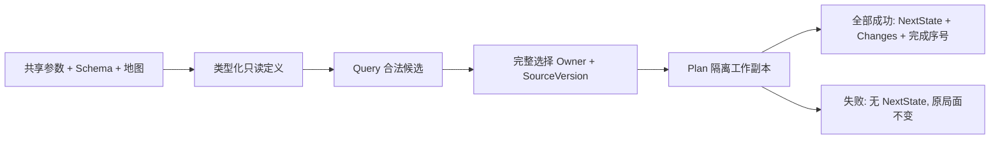
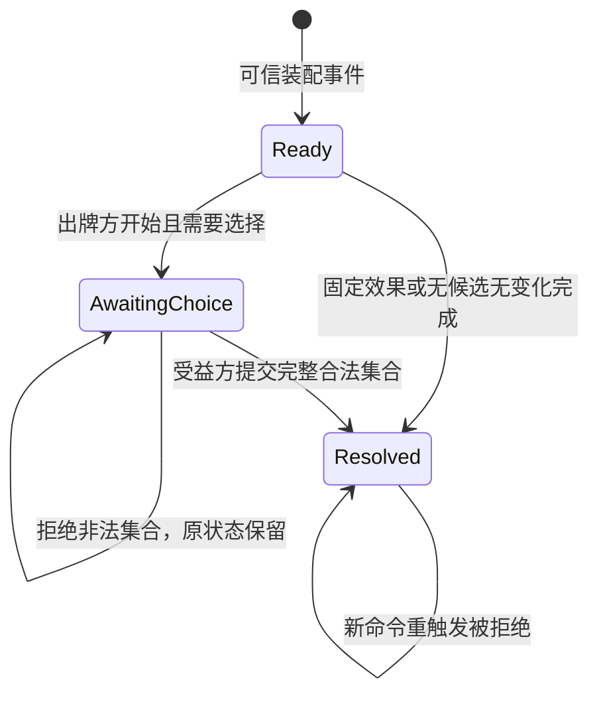

# 首批影响力事件的实际实现

description: 定位五牌类型化参数、纯效果规划、选择和测试；纯Core规划和宿主等待事务已实现，事件演示尚待接入。

先读 [模块描述](../Descriptors/influence-event-planners.module.json)，需要规则含义再读 [早期第一批](early-influence-batch1.md)。参数事实仅来自 `Data/Cards/deluxe-2015/early-influence-batch1.parameters.json`；正式卡牌注册表仍为 planned，不能据此开启完整 RulePack。

## 当前边界

| 入口 | 文件（Assets/ColdWarStruggle/Scripts/ 下） | 职责 |
|---|---|---|
| EarlyInfluenceCatalogLoader.Load | Infrastructure/DataLoading/EarlyInfluenceCatalogLoader.cs | 结构、版本、来源、模板、地图引用检查，生成只读类型化定义 |
| InfluenceEventRules.Query | Core/Effects/InfluenceEventRules.cs | 当前合法国家、受益方选择拥有者、数量或具名停止原因；不写状态 |
| InfluenceEventRules.Plan | 同上 | 校验完整选择，在隔离副本中规划全部变化或整条拒绝 |
| InfluenceEventSelection | Core/Effects/InfluenceEventPlan.cs | 防御复制目标、Owner、SourceVersion；技术上限128，不是牌面数值 |
| InfluenceMutation.Complete | Core/Effects/InfluenceMutation.cs | 内部工作副本产生一次新版本，变化序号后追加完成序号 |

Fidel、Romanian Abdication 共用清对手后补控制；Nasser 先加点再移除旧美国影响力的向上取整份额；Truman 选择双方都未控制的欧洲国家，零苏联影响合法；Decolonization 从非洲及东南亚并集中完整选择四国。具体数值和固定国家不嵌入处理器。

直接事件不读取OPS可达性，不消耗OPS、不收敌控费用，不顺带执行计分、DEFCON或军事行动。未知干预默认 RequiresRuling；明确禁止返回 Blocked。选择短缺没有确认规则时保持待裁定。零变化事件仍得到完成状态、新版本和完成序号。

## 数据契约支持范围

`ContractJson` 是仓库专用的有界校验器，不是完整 JSON Schema 引擎。仅支持代码 `KnownKeywords` 与 `KnownTypes` 声明的集合；items/properties/$defs 使用对象，additionalProperties 使用布尔；不支持布尔Schema、远程引用或递归引用。`$ref` 只解析根部 `#/$defs/name`。预检所有分支的关键词和值形状，避免 anyOf 已匹配后跳过未知类型或同级约束。解析拒绝重复字段和尾随文档；深度、体积与工作量有上限。

## 验证与后续

实际运行和XML摘要见 [验证报告](../Testing/first-influence-events.validation.json)。规则测试在 `Tests/EditMode/InfluenceEventTests.cs`，契约回归在 `ContractReferenceTests.cs`。涵盖完整选择、错误身份和版本、溢出整体失败、零变化、无OPS成本及只读结果。

宿主事务已按实施计划任务2实现，见下节。下一步为任务3的人工事件练习。纯Plan及可信事件实例仍不等于正式出牌/弃牌/移出，玩家不能上传任意效果定义。

## 同一宿主的事件事务

先读 [事件会话描述](../Descriptors/influence-event-sessions.module.json)。`GameState.InfluenceEvent` 保存可信装配器预装的一个公开事件；`InfluenceEventFlow.Begin/Resolve/QueryDecision` 位于 Core/Effects。它是人工练习的继续状态，不能代替设计中的整套卡牌结算栈。

- Ready 与 AwaitingChoice 都阻挡普通OPS，Core与宿主查询/提交都执行这条检查。
- 请求选择写入一个新版本、DecisionId、DecisionSourceVersion和请求序号，不提前加点。完成时全部变化、完成标记和新版本作为一个结果提交；无变化也完成。
- 会话固定身份；Begin检查PhasingPlayer，Resolve与候选查询检查受益方Owner。选择命令不携带可修改的Owner/额度/效果定义。
- `IGameSession.SubmitEventAsync/QueryEventTargets` 对接同一LocalGameHost。GameId、ExpectedVersion、事件实例和决策标识分别验证，重置局面必须生成新GameId。
- 两类命令使用同一 `(PlayerSide, CommandId)` 收据表。合法格式的拒绝也保存收据；同ID同内容返回原对象，即使后续状态已经前进；改内容或改命令类型返回CommandIdConflict。未通过格式校验和提交前取消不占收据。
- 收据里的View是当时快照，界面需要刷新时重新ReadView；不能把旧收据当作当前版本。对手手牌仍不可见，PublicEventView仅包含已公开事件与决策信息。
- Core纯转换不执行回调，宿主锁内只计算、替换状态、记录收据；动画和界面不进入事务。

对应测试 `InfluenceEventFlowTests`、`EventSessionTests` 和原 `SessionTests`，实际报告 [influence-event-sessions.validation.json](../Testing/influence-event-sessions.validation.json)。尚未实现保存/加载收据、完整出牌生命周期、持续效果系统或网络身份认证。
