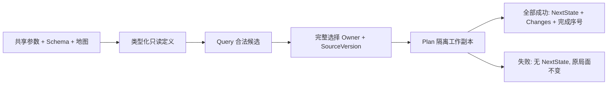
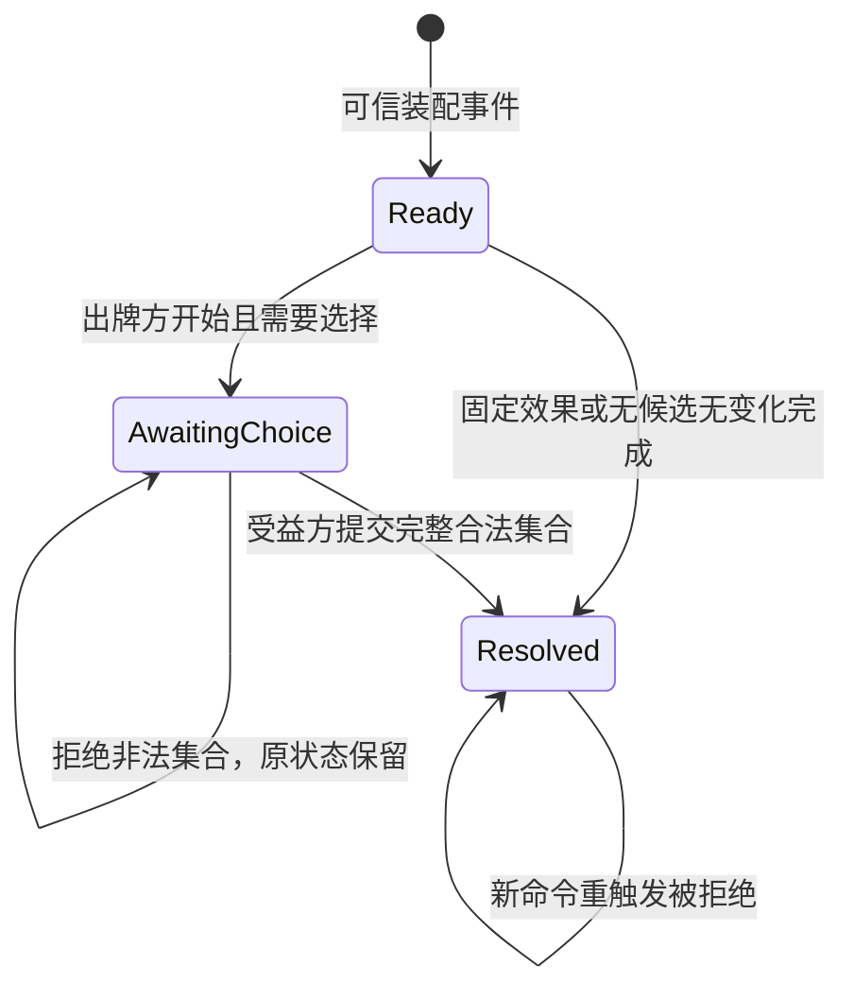

# 首批影响力事件的实际实现

description: 定位八牌基础规划、参数与选择事务；八牌有Demo，东欧动荡有时代上下文、宿主与对照练习。

先读 [模块描述](../Descriptors/influence-event-planners.module.json)，需要规则含义再读 [早期第一批](early-influence-batch1.md)。参数事实仅来自 `Data/Cards/deluxe-2015/early-influence-batch1.parameters.json`；正式卡牌注册表仍为 planned，不能据此开启完整 RulePack。

## 当前边界

| 入口 | 文件（Assets/ColdWarStruggle/Scripts/ 下） | 职责 |
|---|---|---|
| EarlyInfluenceCatalogLoader.Load | Infrastructure/DataLoading/EarlyInfluenceCatalogLoader.cs | 结构、版本、来源、模板、地图引用检查，生成只读类型化定义 |
| InfluenceEventRules.Query | Core/Effects/InfluenceEventRules.cs | 当前合法国家、受益方选择拥有者、数量或具名停止原因；不写状态 |
| InfluenceEventRules.Plan | 同上 | 校验完整选择，在隔离副本中规划全部变化或整条拒绝 |
| InfluenceEventSelection | Core/Effects/InfluenceEventPlan.cs | 防御复制目标、Owner、SourceVersion；技术上限128，不是牌面数值 |
| InfluenceMutation.Complete | Core/Effects/InfluenceMutation.cs | 内部工作副本产生一次新版本，变化序号后追加完成序号 |

Fidel、Romanian Abdication 共用清对手后补控制；Nasser 先加点再移除旧美国影响力的向上取整份额；Truman 选择双方都未控制的欧洲国家，零苏联影响合法；Decolonization 从非洲及东南亚并集中完整选择四国。具体数值和固定国家不嵌入处理器。

直接事件不读取OPS可达性，不消耗OPS、不收敌控费用，不顺带执行计分、DEFCON或军事行动。未知干预默认 RequiresRuling；明确禁止返回 Blocked。选择短缺没有确认规则时保持待裁定。零变化事件仍得到完成状态、新版本和完成序号。

## 新增两牌额度纯规划

社会主义政府和苏伊士危机现在共用 `BudgetedRemovalEffect`，通过 `InfluenceEventSelection.Allocate` 提交数量分配。查询返回只读逐国容量和总量；规则、参数加载与实际验证见[第二批](early-influence-batch2.md)。这两牌已接入宿主数量命令和Demo数量草稿；旧五牌继续使用国家集合。界面根据查询Kind分派，不把总额当成国家数量。

## 数据契约支持范围

`ContractJson` 是仓库专用的有界校验器，不是完整 JSON Schema 引擎。仅支持代码 `KnownKeywords` 与 `KnownTypes` 声明的集合；items/properties/$defs 使用对象，additionalProperties 使用布尔；不支持布尔Schema、远程引用或递归引用。`$ref` 只解析根部 `#/$defs/name`。预检所有分支的关键词和值形状，避免 anyOf/oneOf 已匹配后跳过未知类型或同级约束；oneOf 必须恰有一个分支匹配。解析拒绝重复字段和尾随文档；深度、体积与工作量有上限。

## 验证与后续

实际运行和XML摘要见 [验证报告](../Testing/first-influence-events.validation.json)。规则测试在 `Tests/EditMode/InfluenceEventTests.cs`，契约回归在 `ContractReferenceTests.cs`。涵盖完整选择、错误身份和版本、溢出整体失败、零变化、无OPS成本及只读结果。

宿主事务已按实施计划任务2实现，见下节。任务3的人工事件练习已接入，参见first-demo.md。纯Plan及可信事件实例仍不等于正式出牌/弃牌/移出，玩家不能上传任意效果定义。

## 同一宿主的事件事务

先读 [事件会话描述](../Descriptors/influence-event-sessions.module.json)。`GameState.InfluenceEvent` 保存可信装配器预装的一个公开事件；`InfluenceEventFlow.Begin/Resolve/QueryDecision` 位于 Core/Effects。它是人工练习的继续状态，不能代替设计中的整套卡牌结算栈。

- Ready 与 AwaitingChoice 都阻挡普通OPS，Core与宿主查询/提交都执行这条检查。
- 请求选择写入一个新版本、DecisionId、DecisionSourceVersion和请求序号，不提前加点。完成时全部变化、完成标记和新版本作为一个结果提交；无变化也完成。
- 会话固定身份；Begin检查PhasingPlayer，Resolve与候选查询检查受益方Owner。选择命令不携带可修改的Owner/额度/效果定义。
- `IGameSession.SubmitEventAsync/QueryEventTargets` 对接同一LocalGameHost。GameId、ExpectedVersion、事件实例和决策标识分别验证，重置局面必须生成新GameId。
- 两类命令使用同一 `(PlayerSide, CommandId)` 收据表。合法格式的拒绝也保存收据；同ID同内容返回原对象，即使后续状态已经前进；改内容或改命令类型返回CommandIdConflict。未通过格式校验和提交前取消不占收据。
- 收据里的View是当时快照，界面需要刷新时重新ReadView；不能把旧收据当作当前版本。对手手牌仍不可见，PublicEventView仅包含已公开事件与决策信息。
- Core纯转换不执行回调，宿主锁内只计算、替换状态、记录收据；动画和界面不进入事务。

对应测试 `InfluenceEventFlowTests`、`EventSessionTests` 和原 `SessionTests`，实际报告 [influence-event-sessions.validation.json](../Testing/influence-event-sessions.validation.json)。尚未实现保存/加载收据、完整出牌生命周期、持续效果系统或网络身份认证。

## 数量分配会话

`EventTargetsResult.Kind` 区分 `CountrySet` 与 `Allocation`；后者公开 `RequiredAmount` 和只读 `Capacities`。只有当前Owner能成功查询；错误查询返回空容量与零总量。界面不得把RequiredTargets为零当作“无需选择”，应以Kind和事件Stage驱动。

数量响应调用 `EventCommandEnvelope.Allocate(id,game,version,execution,decision,allocations)`，随后仍通过 `IGameSession.SubmitEventAsync`。宿主验证固定身份和完整上下文后调用 `InfluenceEventFlow.ResolveAllocation`；该方法与旧Resolve共用阶段/Owner/Decision检查，再由纯规则验证精确总额和逐国容量。一次提交同时写入国家变化、Resolved状态、新版本及收据。用户不能提交规则上限、预算或活动策略。

新增ResolveAllocation和旧Begin/Resolve共享同一收据表。精确相同载荷重发返回原对象；改金额、国家、数组顺序、类型或版本而复用同ID则冲突。语义相同但顺序不同的分配可以各自规划出同一规范结果，不代表它们是同一请求。格式错误与预先取消不记收据，合法格式但规则拒绝会记收据；修正时使用新ID。

实际21项新增端到端测试与原有测试共256项通过，见 [数量会话验证](../Testing/allocation-event-sessions.validation.json)。此报告只验证会话功能；随后数量草稿与两个人工练习已接入，最新[Demo报告](../Testing/allocation-demo.validation.json)为295项回归与构建证据，鼠标实测仍单独标记。

东欧动荡现可用`EraRemovalCatalogLoader`与`EraCountryRemovalEffect`装配人工实例，复用CountrySet命令；权威时代见[回合日历](turn-calendar.md)，逐国短缺与实际371项回归见[第二批](early-influence-batch2.md#东欧动荡实际实现)。完整出牌生命周期仍待实现。
