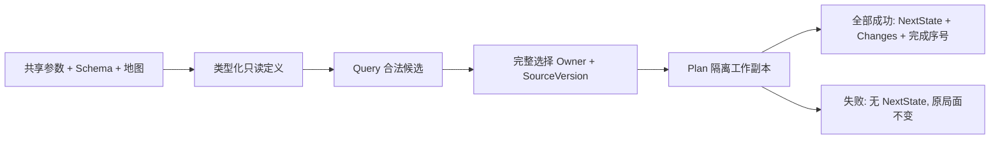

# 首批影响力事件的实际实现

description: 定位五牌类型化参数、纯效果规划、选择和测试；当前已实现纯Core规划，宿主等待事务与事件演示尚待接入。

先读 [模块描述](../Descriptors/influence-event-planners.module.json)，需要规则含义再读 [早期第一批](early-influence-batch1.md)。参数事实仅来自 `Data/Cards/deluxe-2015/early-influence-batch1.parameters.json`；正式卡牌注册表仍为 planned，不能据此开启完整 RulePack。

## 当前边界

| 入口 | 文件（Assets/ColdWarStruggle/Scripts/ 下） | 职责 |
|---|---|---|
| EarlyInfluenceCatalogLoader.Load | Infrastructure/DataLoading/EarlyInfluenceCatalogLoader.cs | 结构、版本、来源、模板、地图引用检查，生成只读类型化定义 |
| InfluenceEventRules.Query | Core/Effects/InfluenceEventRules.cs | 当前合法国家、受益方选择拥有者、数量或具名停止原因；不写状态 |
| InfluenceEventRules.Plan | 同上 | 校验完整选择，在隔离副本中规划全部变化或整条拒绝 |
| InfluenceEventSelection | Core/Effects/InfluenceEventPlan.cs | 防御复制目标、Owner、SourceVersion；技术上限128，不是牌面数值 |
| InfluenceMutation.Complete | Core/Effects/InfluenceMutation.cs | 内部工作副本产生一次新版本，变化序号后追加完成序号 |

Fidel、Romanian Abdication 共用清对手后补控制；Nasser 先加点再移除旧美国影响力的向上取整份额；Truman 选择双方都未控制的欧洲国家，零苏联影响合法；Decolonization 从非洲及东南亚并集中完整选择四国。具体数值和固定国家不嵌入处理器。

直接事件不读取OPS可达性，不消耗OPS、不收敌控费用，不顺带执行计分、DEFCON或军事行动。未知干预默认 RequiresRuling；明确禁止返回 Blocked。选择短缺没有确认规则时保持待裁定。零变化事件仍得到完成状态、新版本和完成序号。

## 数据契约支持范围

`ContractJson` 是仓库专用的有界校验器，不是完整 JSON Schema 引擎。仅支持代码 `KnownKeywords` 与 `KnownTypes` 声明的集合；items/properties/$defs 使用对象，additionalProperties 使用布尔；不支持布尔Schema、远程引用或递归引用。`$ref` 只解析根部 `#/$defs/name`。预检所有分支的关键词和值形状，避免 anyOf 已匹配后跳过未知类型或同级约束。解析拒绝重复字段和尾随文档；深度、体积与工作量有上限。

## 验证与后续

实际运行和XML摘要见 [验证报告](../Testing/first-influence-events.validation.json)。规则测试在 `Tests/EditMode/InfluenceEventTests.cs`，契约回归在 `ContractReferenceTests.cs`。涵盖完整选择、错误身份和版本、溢出整体失败、零变化、无OPS成本及只读结果。

下一步按 [实施计划任务2](../Plans/2026-10-13-first-influence-events.md) 接入同一 LocalGameHost：可信装配器提供事件实例，出牌方开始，受益方响应决策；共用命令收据和权威状态。当前纯Plan不能当作已经执行出牌/弃牌/移出，也不能由玩家上传任意效果定义。
