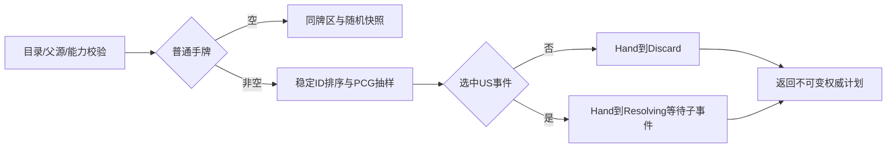

# 五年计划随机弃牌基础

> description: 先查权威能力，后在PCG快照上选牌；保留父源并返回子事件交接，不是可玩接线。

状态：基础实现与正式装载完成，2834项原生回归通过；独立整批审查无Critical/Important/Minor。先查[模块JSON](../Descriptors/five-year-plan-foundation.module.json)，再按入口读取所需函数。[方案](../Architecture/five-year-plan-foundation.md)与[计划](../Plans/2026-10-17-five-year-plan-foundation.md)限定本批范围。

FiveYearPlanDefinition绑定真实印刷目录与已Bound参数引用。FiveYearPlanRules.Plan要求本牌在唯一Resolving源位置，只从苏联普通手牌选候选。所有可能US事件预先得到权威能力覆盖，否则整份计划在随机之前拒绝。能力集合不能由UI提交，未来调用方必须以实际已注册处理器生成。

非US和计分牌均普通弃置，不自动触发或计分；US牌只进入待执行状态，星号不会提前移出。父五年计划不移位，不产生额外根行动或OPS；RandomBefore/Before保留事务输入，计划对象含隐藏牌区，不得直接序列化给玩家。空手不抽随机；单候选一次bounded调用。

FiveYearPlanDefinitionLoader读取正式手牌参数；与Blockade共用内部HandEventContract，核对封闭profile、四个来源及分支Verified引用。运行时另检查每个五年计划策略字段，避免只依赖外部Schema的常量约束。

尚未完成：子事件状态机/返回点、会话命令幂等、公开结果投影、Demo。验证见[分阶段报告](../Testing/five-year-plan-foundation.validation.json)。不要把参数Bound或本基础Plan当作完整运行时覆盖率。
