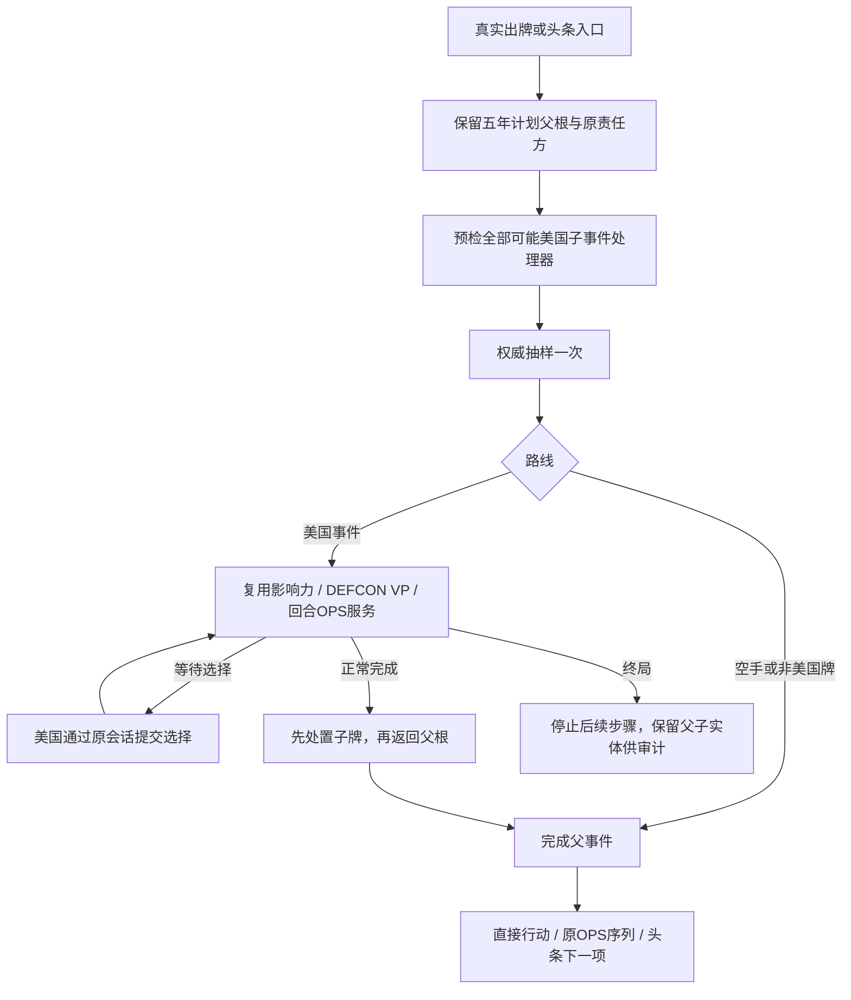

# 五年计划可玩续接

> description: 一次抽样、父根与美国子事件的返回点、窄公开摘要和第24人工练习；构建与真实UI验收以验证报告为准。

先查[模块JSON](../Descriptors/five-year-plan-play.module.json)，再按其中的符号读取代码。基础选牌算法及正式参数装载见[基础模块](five-year-plan-foundation.md)；本批不新增卡文解释。[方案](../Architecture/five-year-plan-play.md)、[实施计划](../Plans/2026-10-17-five-year-plan-play.md)、[验证报告](../Testing/five-year-plan-play.validation.json)分别说明边界、任务和实际证据。

## 运行路径

`FiveYearPlanExecution`保留真实父根与已接受的选择。`ActiveCard`与`Actor`仍是父牌和根责任方；子事件有独立执行ID，选择权为美国。子事件不创建新行动名额，也不给额外印刷OPS。正常完成依印刷星号处理子牌，再按直接、对手OPS或头条返回原流程；父五年计划进入弃牌。核战责任继承父根。后续收尾失败只丢弃本次草稿，不撤销之前已经接受的抽样命令。

## 会话与界面

`PublicFiveYearPlanResult`只复制父牌、抽中牌、根责任方与结果四个值。内部Selection含隐藏牌区与随机快照，不能传给玩家。等待快照可跨身份显示已抽中的牌，但只有美国会话可以选择目标。CardAction、EventCommand和HeadlineStep都保留对应摘要；政变后接事件仍有两份结果。

重复父命令返回原抽样结果，重复选择返回原选择结果，不重复消耗随机数或推进名额。旧结果对应版本落后于当前局面时，界面显示“历史事件结果”。换身份清除未确认草稿；重置人工场景清除命令重试入口。

## 第24练习

数据入口：[场景描述](../../Data/Descriptors/five-year-plan-scenario.data.json)。苏联持五年计划与独立红色政权，原牌移入结算区后只有一个抽样候选，专门保证能稳定体验子事件选择；这不是自然发牌或随机分布演示。南斯拉夫美1苏3，选择后美方追平至3。可直接发动，也可用对手事件先行路线后返回原OPS。前23个练习保留；地图接口与规则核心无依赖。

## 范围和验证

已接子服务为当前登记的纯影响力、DEFCON/VP和回合OPS。马歇尔计划、北约、CIA等未装配美国处理器仍在抽样前返回不支持；不能据此声称完整牌库可玩或经过生产联网隐私审计。没有新增正式存档、任意层数事件解释器或美术资源。

Core、流程、会话与场景的四组测试入口见模块JSON；测试报告保存每轮实际计数和XML摘要，包括编译失败及夹具修正。原生测试、构建、载荷一致性、真实鼠标与分支审查分别验收，不能相互替代。此前BlockadePlaytest不包含本牌新流程。

当前验收：2908/2908原生、55份载荷与独立Player构建通过；直接发动、先事件再OPS、重发/历史提示、切图、重置和24目录已实际点击。入口 `Builds/FiveYearPlanPlaytest/ColdWarStruggleDemo.exe`。独立审查0 Critical/0 Important/1 Minor：不经过选择界面的头条子事件摘要未显示，下一批处理；政变+轨道长反馈未单独鼠标矩阵验收。
