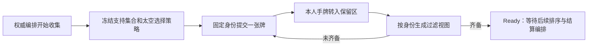

# 头条基础服务

> description: 查权威秘密选择、独立保留牌区、太空先看后选与身份过滤；纯服务已实现，共享参数驱动的普通排序已实现，完整编排/Host/Demo未接。

先读[模块摘要](../Descriptors/headline-foundation.module.json)，再按Begin、PlanSelection、CanChoose、HeadlineSelectionView.Create、HeadlineParametersLoader.Load与BuildOrdinaryOrder定位函数。完整接线计划见[接口审计](../Architecture/headline-runtime-integration.md)。

Begin校验牌目录/分区、空保留及空Resolving，复制权威支持集合；通过SpaceAbilityRules读取本阶段选择策略，没有复制太空阈值。普通双方均可提交，太空能力拥有方须等对手先锁牌。PlanSelection成功只将本人的一张手牌转入HeadlineReserved；每方锁定一次，不执行事件，不发OPS，不增加普通行动。

正常投影始终可看自己的选择和候选。普通模式下，对手第一张只显示已锁定；双方齐备后公开牌。太空拥有方可在自己选择前看先方牌。候选只取本人手牌与权威支持集合交集，无候选时停留并明确不可选，不能作为跳过或判负依据。

核心结果包含完整权威状态，失败也返回原状态供服务器保持事务；它绝不是可直接发送给客户端的响应。未来Host必须从固定身份调用投影，执行版本/阶段/幂等门禁，并只发布过滤视图和公共错误码。Create(viewer)本身不认证身份，不宣称当前已经支持联网安全或隐藏存档。

Ready仅表示双方选齐；并不表示事件完成。普通排序与特殊取消要在后续编排分别处理，Defectors不能直接套印刷OPS候选序列作为最终执行顺序。

15个牌区、28个选择与36个排序/加载新用例完成托管RED/GREEN；最终可用托管集合1933项全过，证据在[验证记录](../Testing/headline-foundation.validation.json)。Unity许可证仍阻断EditMode/构建/鼠标；旧Localized播放器仍跳过头条。

普通排序读取共享turn-flow headline的计分值和平手方，事件只读CardDefinition.PrintedOps；先揭示再冻结普通次序，之后事件的普通OPS修正不重新排序。PlayedBy是出牌方，不因卡牌阵营改变。加载器复用TurnCalendarLoader的版本/profile门禁并严格检查headline字段；拒绝重复字段、尾随JSON、未知策略或越界数值。

本批首次全量补充运行1932过/1失败是测试把纳赛尔的印刷OPS误写为2；核对正式cards.json为1后修正断言，生产排序与卡牌数据没有改写。失败及修正后的XML均保留，不能隐藏失败记录。
