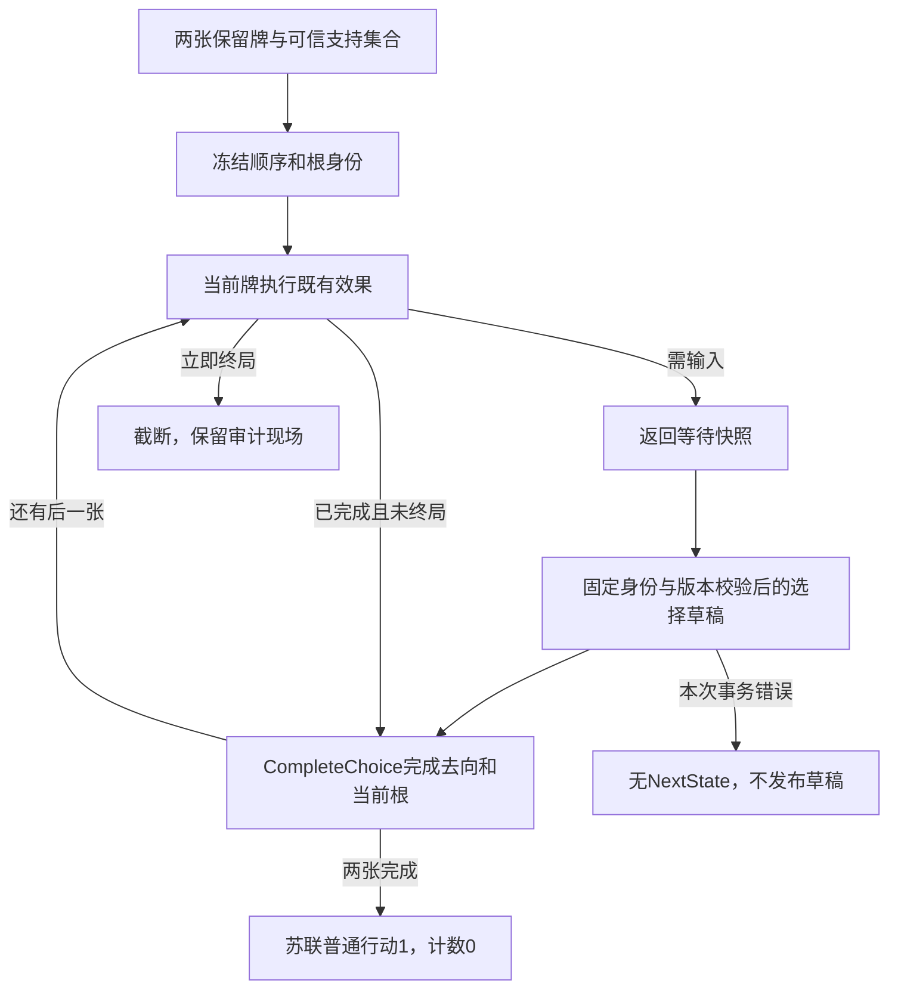

# 有限头条事件结算

> description: 查冻结队列、头条根责任与事件收尾的运行边界；游标和有限事件编排已实现，选择继续入口已实现，Host/UI尚未接。

先读[模块摘要](../Descriptors/headline-resolution.module.json)。CreateOrdinary要求双方已保留且无人正在Resolving，复核目录后冻结普通印刷值顺序；AdvanceAfterResolution仅接受当前牌与出牌方一次，不改变原快照。CurrentResolutionId按回合及出牌方区分，避免两张头条复用普通action0身份。

游标推进不等于事件执行；编排仍须完成当前实体去向、等待选择和终局判断后才能调用。Defectors等特殊优先不能直接用普通候选顺序替代。18个新增RED→GREEN及79个既有头条检查通过，共97；Unity原生/Host/UI未验。[实施计划](../Plans/2026-10-15-headline-event-resolution.md)记录后续根接线与选择恢复。

Begin只接受双方已保留、普通行动尚未开始的稳定权威状态，支持集合由已装配服务推导（当前真实配置12事件+7计分）。Advance至多逐张处理到下一个选择/终局/两张完成；即时分支复用原事件与计分计算，Next依据头条根推进游标而不增普通行动。所有同回合Practice副本携带队列，下一回合显式重置。

Actor在头条期间读取Current.PlayedBy；影响力Owner仍从事件定义读取，核战责任取出牌方。手牌、HeadlineReserved、Resolving三个实体来源在共享Move中区分，不把头条塞回手牌。当前步骤失败不返回任何同批成功草稿；CompleteChoice验证等待前已发布的前缀保持，而本次选择后失败不发布草稿。正常两张结束后苏联行动1，预算0；首张终局不执行后张。

Task2新增31项先RED后GREEN，全部可用托管1982项通过。无Unity、构建或鼠标验收。源码含完整权威结果，只能由未来Host过滤投影，不作为可直接传输的响应。

CompleteChoice只接受真正Resolved且带DecisionId/DecisionSourceVersion的头条选择结果，调用共享CompleteEventAction处理实体与当前根，再推进后续牌。普通事件、仍在等待、错误执行ID均拒绝。原始InfluenceEventTransition与步骤中的GameState是权威草稿，不能先发布再完成头条；纯服务不替代Host的版本/幂等门禁，拿旧快照重新规划不是被授权重放。

最终新增18+31+17=66项按批RED→GREEN，全部可用托管1999项通过；Unity原生160项仍未运行。下一批才接秘密收集、Host命令/过滤/幂等与开局入口；这里没有偷偷启用旧Demo。

源码检查点经整批独立审查无阻塞或Minor；16源码/8证据摘要一致。main与播放器仍等待Unity授权及原生门禁，审查不改变此限制。
