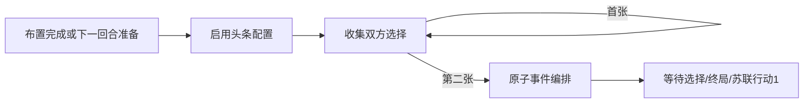

# 头条收集与本地会话

description: 查可选回合入口、收集权威牌区和原子提交；核心及固定身份Host/公开投影已实现，等待选择继续接线待完成。

先读[模块描述](../Descriptors/headline-session.module.json)。Definition的HeadlineParameters由可信工厂装配，默认null沿用旧Demo跳头条。启用后StartPractice或BeginNextTurn完成原准备，再进入CollectingHeadline；收集不会另发牌或改善DEFCON。GameState.Cards必须与HeadlineSelection.Cards同引用，选择与结算队列互斥；即使尚无保留牌也拒绝普通行动。

BeginCollection仅供可信回合编排，不是客户端跳阶段命令。Submit复用支持集合/身份和空间能力选择策略：首张锁定只提交一次；第二张选齐清除收集并调用既有头条结算，整体返回到下一等待/终局/普通行动。失败无部分状态或Steps；保留上次已发布的首张锁牌。零合法候选停留明确边界，不跳过/判负。

18新增RED后GREEN；最初跨回合测试误用全时代夹具被正确拒绝，修正夹具后补充回归2017通过。Unity160项原生用例、构建/鼠标未执行。现有Demo未启用，完整会话与UI不能据此称已完成。

SubmitHeadlineAsync固定到PlayerSession.Side，共用宿主锁与跨命令收据。Command只含ID/GameId/ExpectedVersion/Card；取消在收据前停止；相同内容回历史收据，换内容同ID冲突。两方同版本竞争一成功一过期，失败收据也缓存，刷新后用新ID重交。普通CardAction与Headline共享ID命名空间。

PublicHeadlineView收集时只投影自己的牌/候选和对方锁定，双方齐备才有公开Order；太空先看后选复用已有投影。Resolving区分PlayedBy与WaitingOwner，Completed保留两张公开历史直到下一回合。PublicHeadlineStep仅含牌/出牌方/等待/终局及既有公开效果摘要，不含中间View或权威GameState。LocalTestSnapshot.ReservedHeadlines只在显式启用观察时可读且不可改。

Task2新增18项先RED后GREEN，公开JSON秘密检查/双并发/历史收据/跨类型冲突/取消均通过；可用托管2035通过。Host等待选择的最终继续尚待Task3，旧Demo仍未启用。
