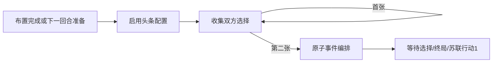

# 头条收集与本地会话

description: 查可选回合入口、收集权威牌区和原子提交；Task1核心已实现，Host/过滤结果与事件选择继续待接。

先读[模块描述](../Descriptors/headline-session.module.json)。Definition的HeadlineParameters由可信工厂装配，默认null沿用旧Demo跳头条。启用后StartPractice或BeginNextTurn完成原准备，再进入CollectingHeadline；收集不会另发牌或改善DEFCON。GameState.Cards必须与HeadlineSelection.Cards同引用，选择与结算队列互斥；即使尚无保留牌也拒绝普通行动。

BeginCollection仅供可信回合编排，不是客户端跳阶段命令。Submit复用支持集合/身份和空间能力选择策略：首张锁定只提交一次；第二张选齐清除收集并调用既有头条结算，整体返回到下一等待/终局/普通行动。失败无部分状态或Steps；保留上次已发布的首张锁牌。零合法候选停留明确边界，不跳过/判负。

18新增RED后GREEN；最初跨回合测试误用全时代夹具被正确拒绝，修正夹具后补充回归2017通过。Unity160项原生用例、构建/鼠标未执行。现有Demo未启用，完整会话与UI不能据此称已完成。
