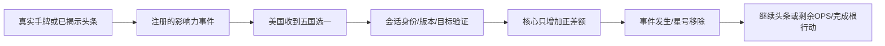

# 独立红色政权运行时

> description: 查找五国选一、只补正差额的独立红色政权事件、共享追平效果、真实手牌/头条接线和人工试玩入口。
> 状态：C# 与会话集成已实现；实际构建、审查、鼠标验收以 [验证记录](../Testing/independent-reds.validation.json) 为准。

美国选择参数名单中的一个国家；核心令 US = max(US, USSR)，苏联数值保持。允许选美国已经领先或双方相等的国家，零变化仍是发生过的星号事件。苏联打牌时，根行动仍属苏联，选择权属于美国。这里只接入独立红色政权；同一数据文件的经互会尚未绑定，短缺裁定仍待定。规则来源与解释见 [第三批设计](early-influence-batch3.md)。

## 先读哪些入口

- `IndependentRedsCatalogLoader.Load`：按既有封闭 JSON 契约验证版本、印刷牌引用、五国名单和资料状态，只返回本牌定义。
- `MatchOpponentInfluenceEffect`、`InfluenceEventRules.Query/Plan`、`InfluenceMutation.MatchOpponentByAdding`：不可变名单、全部合法候选和原子影响力变更。规则不读取地图坐标或稳定度来计算差额。
- `DemoCatalog.WithIndependentReds`：扩展所有已有出牌场景的影响力注册表，保持头条、最终计分、中国牌、连续回合等服务。已有诊断场景保持独立。
- `DemoCatalog.WithIndependentRedsScenario`：追加第 22 个人工局面；数据决定五国当前值，印刷牌库负责完整物理分区，不复制卡牌事实。
- `DemoBuild.BuildIndependentRedsPlaytest`：构建独立 Player。Editor、Player 和标准构建预处理读取同一权威数据。

地图沿用现有国家选择和 IMapView；替换地图画风不改变事件逻辑。事件决策、错误身份拒绝、重复提交、对手事件两种顺序和头条继续均由原有公共流程处理。

## 试玩和验证边界

`demo.practice.independent_reds` 是第 2 回合的人工场景：苏联持本牌，美国持奥运会。罗马尼亚从 US1/USSR4 追平至 4/4；保加利亚 US6/USSR2 可合法零变化完成。它没有模拟之前的自然对局历史。

测试入口：`MatchOpponentInfluenceTests`、`IndependentRedsCatalogTests`、`IndependentRedsPlayTests` 和 `DemoBuildTests` 的数据一致性案例。存档、联网、全部事件与未知持续效果组合尚不在该实现范围。

[模块描述](../Descriptors/independent-reds.module.json) · [返回索引](index.md)
