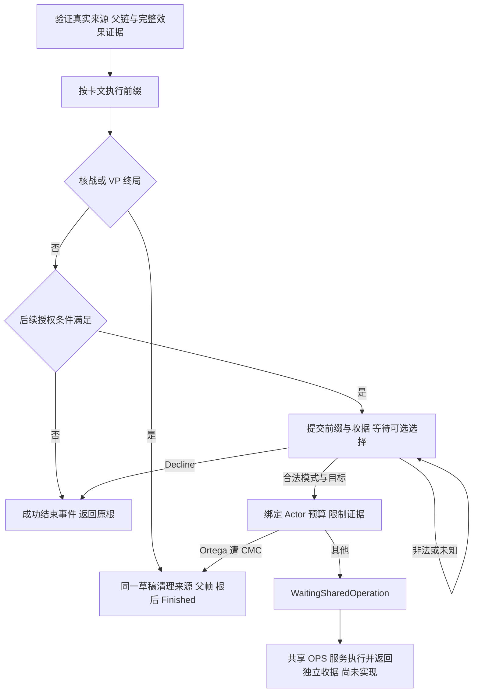

# 晚期事件的受限行动授权

description：KAL-007、Glasnost、Ortega 的不可回滚前缀、固定阵营、来源树、可选行动、共享 OPS 交接和历史收据。

状态 2026-10-13：verified-subset 参数与契约设计；所有 C#/Unity 处理器、真实鉴权、持久化和共享行动消费者仍 planned。先读[数据描述](../../Data/Descriptors/late-event-operations-batch1.data.json)，再按需读[参数](../../Data/Cards/deluxe-2015/late-event-operations-batch1.parameters.json)、[Schema](../Contracts/late-event-operations-batch1.schema.json)与[案例](../Design/late-event-operations-batch1.cases.json)。依赖[事件行动模块](../Descriptors/event-operations.module.json)、[回合流程](turn-flow.md)及[原子事件前缀](junta.md)。不涉及地图画风或视觉资源。

## 三张卡的顺序与权限

| 事件 | 必须先提交的前缀 | 可选授权 |
|---|---|---|
| KAL-007 #89 | DEFCON 降 1 → 立即核战检查 → US 得 2VP → 完整 VP 批次胜负检查 | 此时 US 控制南韩才给 US 视同 4OPS；仅 Influence / Realignment |
| Glasnost #90 | USSR 得 2VP → 完整 VP 批次胜负检查 → DEFCON 升 1 并按共享上限截取 | 已验证 Reformer 活动实例才给 USSR 视同 4OPS；仅 Influence / Realignment |
| Ortega #91 | 清除 Nicaragua 全部 US 影响力，保留 USSR 影响力 | USSR 可选一次邻国免费 Coup；基值读取源牌 printed_ops，再用适用 Actor 修正 |

依据 [GMT 英文卡](https://www.gmtgames.com/nnts/TS_Cards_Deluxe.pdf) PDF p13 #89、p14 #90/#91，已重新目视英文卡面。KAL 与 Glasnost 不提供 Coup 或 Space；不能把“视同 OPS”当成全部普通模式。KAL 的 DEFCON=2 在 US 原有 18VP 时先发生核战，不能先加 2VP 让 US 赢。Glasnost 原有 USSR 18VP 时先到 VP 终局，不能再改善 DEFCON。顺序检查沿现有 OrderedEvents/TerminalAtCheckpoint 工程政策，未声称另有三牌专门 FAQ。

Ortega 直接清除影响力不受可达性、OPS 花费或 Chernobyl 限制。零 US 影响也完成这一步，并继续提供可选行动。邻接必须查正式规则图，不能按现实地理或视觉位置猜测；目前 Nicaragua 邻国包含 Costa Rica、Honduras 和 Cuba。Cuba 是战场，其合法免费政变仍可能降 DEFCON 并致核战。

LEO1-D01：对 Ortega 的具名邻接行动沿既有地区事件的 DEFCON 地理豁免政策，只豁免地理禁区；这是 FAQ p16 #96 一般地区事件说明的具名范围推导，并非找到专门 Ortega 裁定。三个实际邻国均位于中美洲，普通 DEFCON 地理表本就不禁止它们；不得扩大为其他目标、条约豁免或战场不降级。

## 前缀与共享服务的边界

`LateEventOperationsService.BeginPrefix` 计划负责卡文顺序、条件采样和首次授权；`EventOperationsService.ResolveChoice` 计划验证 Decline 或模式/目标并交接共享行动。有限 Python 投影只执行前缀、基本门禁、致命 CMC 与交接请求，**不执行影响力投放、政局调整或普通政变掷骰**。`WaitingSharedOperation` 不是行动完成或事件完成，必须保留源牌 InResolution、未完成事件帧及原根。真正的共享服务返回、逐次 Realignment、模式锁、放弃剩余额度和最终清理列入运行验收，不伪造成功回调。

合法交接生成 `operation_request`，绑定 GrantId、完整当前状态摘要、来源摘要、RootActionId、PhasingPlayer、Actor、目标、允许模式、普通报价和共享预算政策。客户端不能自行提供预算、骰点、豁免或完成结果。未返回受验证的共享收据前，禁止再发第二个行动、消耗根名额、移除源牌或宣告事件结束。真实返回接口要验证操作 ID、原请求/前状态、实际 OPS 花费与目标历史、随机前后游标、仅准许的状态变化及终局清理；尚未实现的消费者不得仅凭 outcome=true 完成事件。

固定前缀和授权在首次合法等待点一起提交。其后非法选择不撤销前缀，Decline 也不能返还 VP、DEFCON 或 Nicaragua 影响力。同命令重试走原收据，不能把选择当作重新发动事件。

## Actor 报价、影响力起点和干预

KAL/Glasnost 的 4 来自卡文 `VerifiedEventLiteral`；Ortega 从源牌定义 `printed_ops` 读取，不在多个脚本各放一个常量 2。共享普通上下限、红色恐怖/清洗、遏制、勃列日涅夫数值均从参数解引用。冻结的是授权创建时 Actor 的效果证据。根玩家可能是另一方，不能用根玩家的修正替换 Actor 修正。

`ordinary_budget` 是不含有条件地区奖励的普通报价。真实共享服务仍须从 grant 的 base_ops 与冻结效果、实际目标历史重新依共享 FloorAfterRegionalBonus 政策报价；不能先把普通预算压到最低值，再把越南奖励简单相加。源牌不是 China，不能获得中国牌自身奖励。本批并未验证真实地区奖金消费者或行动预算消耗。

普通根行动轮的 Influence 起点只接受实际 Actor 的 RootActionRoundStart 快照，不能拿授权时当前局面或任意 named 字符串替代。Headline／特殊 FYP 子来源缺少独立具名起点时只将 Influence 标为 RequiresRuling，Realignment 或 Decline 仍可继续；若具名起点经独立提供者核实，可交共享 Influence 服务再验证可达性、敌控价格与完整花费历史。有限模型中的 baseline proof 是合成前提，不是完成了该证明服务。

[FAQ v5](https://www.gmtgames.com/nnts/FAQv5.pdf) PDF p15 #90 明确 Glasnost 的额外 OPS 受普通影响力规则与 Chernobyl 限制，p16 #94 区分直接事件加影响与 OPS 投放。Chernobyl 尚未绑定其消费者时，本批遇到有关活动实例仅阻止受影响 Actor 的 Influence 交接，保持已提交前缀与 Realignment／Decline；不把这次 OPS 误当作直接事件影响力。以后绑定指定地区规则后才可细分合法目标。

Ortega 的免费 Coup 军事信用读取共享 `FreeCoup=None`，模型及交接请求均为 0，不借免费授权绕过 CMC、条约、敌方影响或战场 DEFCON。先核实身份、预算、基本目标与相关限制，再接受致命 CMC 政变；败者是实际 Coup Actor，且发生在随机、军事、影响与 DEFCON 变化前。普通战场核战败者仍是 RootPhasingPlayer。其他相关但未核实的干预停止对应交接，不把“免费”解释成免检。

## 来源树、终局和收据

支持 RootEvent、OpponentCardEvent、HeadlineEvent 与已核实 Five Year Plan 的 US 子事件。只有 KAL 关联 US，可进入 FYP 子路线；Glasnost/Ortega 关联 USSR，不可进入。FYP 父事件控制者固定读取现有 US 关联定义，父根可能属于 USSR。父选择收据必须绑定所选实体、卡 ID 与当前子帧；父已完成或已有成功事实不可重做。

源实例、基础单牌 CardId、FrameId、ResolutionId 全部唯一。实际源实体必须位于绑定事件帧的 InResolution，另一个实体占用该帧、源牌仍在 Hand、父根已完成、根槽已计入或任意未知父余项都在前缀前拒绝。独立 dispatch 对照真实 root/event/parent 与允许的父余项，不能用一个自称 true 的布尔值授权未知清理。

运行态必须无 winner、VP 未终局且 DEFCON 严格高于核战等级并不超过共享上限。普通非终局结束时若父根仍有已接受 Operations，保留源牌 InResolution 和原根，不能提前星号移除或再计根槽。FYP 子源可先完成自己的星号去向，再完成 FYP 事件事实；父源是否移动仍取决于真正根余项。终局必须在同一草稿中记录已发生步骤、完成源与必要父／根清理、取消待执行根工作，最后标记 Finished；Headline 不计行动槽。

`receipt` 保存完整历史输入、完整结果和摘要，独立已接受 anchor 绑定 command/resolution、输入摘要与原收据摘要。读取会重演该有限历史并比对结果；替换历史后自行重算摘要也不能通过原独立 anchor。合法原命令即使后来地图、回合或 Finished 已改变，仍返回原完整结果并保持当前状态。新的选择要求当前状态与已接受等待点完全相符，跨卡中断后的未核实继续位置必须另建合法迁移协议，不能直接放行。

proof、ledger 和 anchor 在离线检查中是合成的权威前提，不代表已实现鉴权、防篡改存储、真正原子提交或网络幂等。12 项运行层验收仍未运行。本批只报告新检查，不自称完成全仓回归、可运行整局或正式 Git 发布。

[返回索引](index.md)

整合状态：[验证报告](../Design/late-event-operations-batch1.validation.json)记录185新＋3788旧＝3973离线检查，93 Bound/9 Unresolved，102处理器planned。另114独立探针全过，不重复累计；12运行验收未执行，游戏runtime0。
