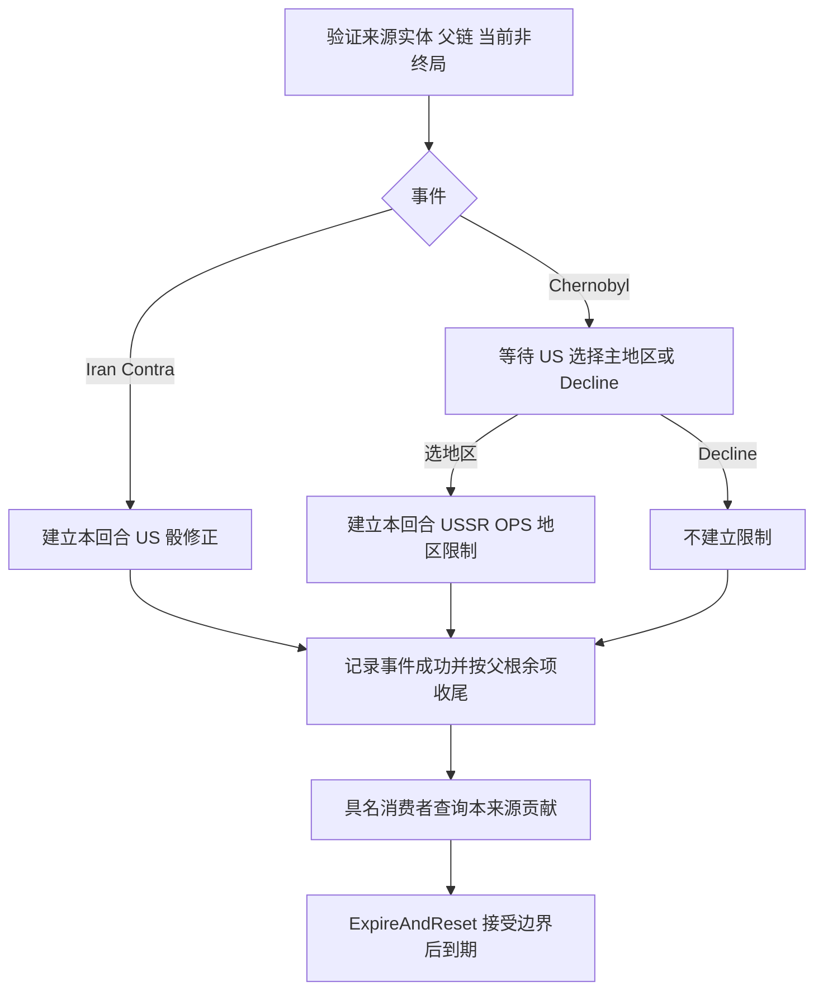

# 晚期当回合限制牌

description：伊朗门按 US 骰方修正；切尔诺贝利按实际 USSR OPS 行动者限制指定主地区；来源、选择、到期与收据边界。

状态 2026-10-13：两牌 verified-subset 数据/契约；所有 C#/Unity、随机、持久化与真实行动消费者仍 planned。先读[描述](../../Data/Descriptors/late-restrictions-batch1.data.json)，再查[参数](../../Data/Cards/deluxe-2015/late-restrictions-batch1.parameters.json)、[契约](../Contracts/late-restrictions-batch1.schema.json)、[案例](../Design/late-restrictions-batch1.cases.json)。本页只报告本批新检查，不报告全仓累计或正式发布。

## 伊朗门：修改 US 骰方

#93 为 USSR 关联、2 OPS、晚期、星号；发生后，本回合所有 US Realignment 掷骰受到 -1。这里按 DieSide=US 匹配，**不是 Actor=US**：USSR 发起调整时，US 仍掷自己的防守骰，也受到 -1；USSR 的骰不因该牌改变。影响力数量、发动者、根 PhasingPlayer 不替代骰方。

`RealignmentModifierService.QueryContribution` 拟定返回该来源的 delta 和来源实例；不改 OPS、政变、战争或太空骰，不额外记军事。真实调整服务合并普通邻接等已经验证的修正，再计算结果差值。原始骰范围只读共享 [standard-dice](../../Data/Rulesets/deluxe-2015/standard-dice.json)；修正后不重新夹到 1–6，例如原始 US 骰 1、其他修正 0 后得到 0。有限参考对传入骰值演示算式，没有真实取样、预算扣除或影响力移除。

## 切尔诺贝利：主地区与实际 OPS 行动者

#94 为 US 关联、3 OPS、晚期、星号。US 选择一个主地区后，本回合实际 USSR Actor 不能在那里用 OPS 投放影响力。普通 OPS 与 Glasnost 等 as-if OPS 都在限制范围；根 PhasingPlayer 即使为 US 也不改变实际 USSR 的限制。US 自己投放不受这张牌限制。

候选直接读取共享地图 `regions` 中 `parent_id=null` 的六个主地区。R2015 §2.1.1 区分六 Regions 与东欧、西欧、东南亚 sub-regions；§2.1.2 说明 Europe/Asia 包含所属子区，因此不能另选东南亚或西欧，选择 Asia 会覆盖 Vietnam 等东南亚国家。国家所属只查询 `primary_region_id`，不维护第二份名单，不用现实地理或画面坐标判定；加拿大、土耳其属于 Europe，利比亚、埃及属于 Middle East。

英文卡文的 `may designate` 提供明确 Decline。LR1-D01 将“不选地区”组合为事件完成但不创建限制实例，并按 §5.2 正常处理星号；这是卡文与通用事件去向的具名推导，未声称有专门 FAQ。没有提交选择前只是 `AwaitingRegion`，不得执行后续普通行动或提前创建默认地区；非法选择保留等待状态。

[FAQ v5](https://www.gmtgames.com/nnts/FAQv5.pdf) PDF p15 #90 明确 Glasnost 的 OPS 影响力受限制；p16 #94 明确直接事件影响力、政局调整与政变仍可进行，政变成功增加 USSR 影响力也允许。`OpsInfluenceRestrictionService.QueryContribution` 只给出 `BlockedByChernobyl` 或 `NoRestrictionFromLR1`；后者不代表行动整体合法，仍须经过其他条约、DEFCON、可达性和预算服务。未知来源或相关覆盖证据不完整，返回 RequiresRuling。

## 激活、选择与来源

支持 RootEvent、OpponentCardEvent、HeadlineEvent 与已验证 FYP 的 US 关联子事件；只有 Chernobyl 可走 FYP US 子路线。FYP 父事件控制者仍是 US，根可能属于 USSR。源牌必须在指定事件帧的 InResolution；基础 CardId、实例、frame、resolution 和已接受选择都核对，重复/别名或已完成根先拒绝。未知父余项或未知嵌套提供者不猜测。

事件成功事实绑定来源卡、实体、帧、resolution、固定控制者与回合。普通对手事件若根仍有合法 OPS，事件帧完成后源卡保留 InResolution，刚建立的限制已适用于随后 OPS；不能提前星号移出或多计根槽。FYP 子 Chernobyl 完成自己的星号去向和父 FYP 事件事实，再按根余项处理父源牌。Headline 不计行动槽。

`ActiveEffectService.Activate/ExpireAtBoundary` 继续作为生命周期入口；本批参数不建立 UI、地图场景或动画依赖。同一张牌已经成功发生后再以新 resolution 触发，保持 RequiresRuling，不默认叠加、刷新、换地区或重复扣骰。同原命令只走原收据重放。

## 查询与到期证据

活动实例记录来源、原激活 `source_kind` / `source_phase`、激活回合、所选地区及到期边界 ID；它必须对应已接受事件成功事实、已完成事件帧和合法根状态。原激活阶段独立于查询时的阶段保存。普通来源保留根 OPS 只允许行动轮的对手牌事件；FYP 来源还检查父事实、父实体和去向，保留根 OPS 必须来自行动轮且根控制者与 US 父事件控制者相反。本人事件不能通过把已完成根改写成 Active / OperationsAfterEvent 获得这条续段。

查询逐张核对所有 InResolution 实体：实际物理帧必须存在，并匹配实体 ID 和 CardId；逻辑 RootCard 包装不是第二个物理牌位。已完成事件或 FYP 父帧仍持牌，只在其合法根 OPS 尚待执行且该牌确为根来源时成立。无关的新合法活动帧不会被一概拒绝；原对手根随后完成并正确处置源牌，也不使本回合限制失效。

仅看牌区、效果名称、一个布尔值或一个自称权威的字符串不足以在真实引擎证明效果。本模型将 dispatch、成功事实、原激活上下文、查询证据和 accepted anchor 视为外部已核实的**合成前提**。哈希用于有限模型内的一致性绑定；如果调用者伪造整套一致历史和证据，这些字段并不提供密码学鉴权。真实来源提供者、权威存储与鉴权尚未实现，也不由本批查询替代。

查询绑定完整当前快照与具名请求，区分 Actor、DieSide、channel、placement kind、目标和版本。在 Chernobyl 尚等待选择时禁止继续查询普通动作；已有终局、陈旧 Active 回合、损坏来源或已记录到期却仍 Active 都拒绝。两牌同时生效时各自只贡献所属通道，不互相修改。

ExpireAndReset 只接受回合服务的匹配边界证据，并要求本回合源根和选择完成。它把本回合 Active 实例改为 Expired，记录边界 ID/回合/版本；不推进回合、重置其他轨道或执行下一行动。已有本回合到期事实的快照不得回到同回合 ActionRound 或 Headline 后查询/激活；即使所有实例已是 Expired 也拒绝。实际下一回合查询旧 Expired 实例仍须有匹配到期记录；缺失记录不静默按“没生效”处理。

## 收据和验证范围

激活、地区选择、到期各保存完整历史输入和完整结果。独立 accepted anchor 绑定原 command、resolution 或边界、输入摘要和收据摘要。重放重新核对有限历史，修改结果后自哈希或替换历史仍无法匹配原锚；后来地图、回合、VP 或 Finished 改变不影响合法原命令返回旧完整结果，也不允许旧 after 覆盖当前状态。新的选择必须对应当前已接受等待点。

本批 275 项 = 10 数据、108 契约形状、157 有限参考检查通过。最初 118 行为检查失败，补齐投影后通过；再增加等待选择查询/到期记录/源父链等 10 个边界案例，其中 7 个先失败后修正通过。独立审阅随后在 137 个额外探针中发现 15 个失败，分为物理帧、根 OPS 角色和同回合到期重入三类；作者先保留并重现失败，再加入 17 个拒绝案例（含同回合 Headline 变体），全部先失败后修复。另有原来源上下文、合法后续根完成及无关活动帧等 9 个行为控制和 4 个字段形状案例。作者复跑原 137 探针通过，不代替独立复审，也不把重复检查累加为新覆盖。

契约形状不等于来源及生命周期领域证明。10 项真实集成验收未运行；不宣称执行了整局、真实 OPS、随机服务、并发存储或全仓回归。独立复审由主工作流另行安排。

资料：[GMT 英文卡](https://www.gmtgames.com/nnts/TS_Cards_Deluxe.pdf) PDF p14 #93/#94；[R2015](https://www.gmtgames.com/nnts/TS_Rules-2015.pdf) §2.0/2.1.1–2/5.2/6.1–2/7.4.3；FAQ p15–16。官方站限定检索未找到专门的重复或不选地区回答，未采用策略网站替代规则。关联设计：[普通行动](operations.md)、[持续修正](persistent-effects-batch2.md)、[回合流程](turn-flow.md)。

整合状态：[验证报告](../Design/late-restrictions-batch1.validation.json)记录275新＋4133旧＝4408离线检查，97 Bound/5 Unresolved，102处理器planned；10运行验收未执行。独立探针另外计数，不重复累计。
