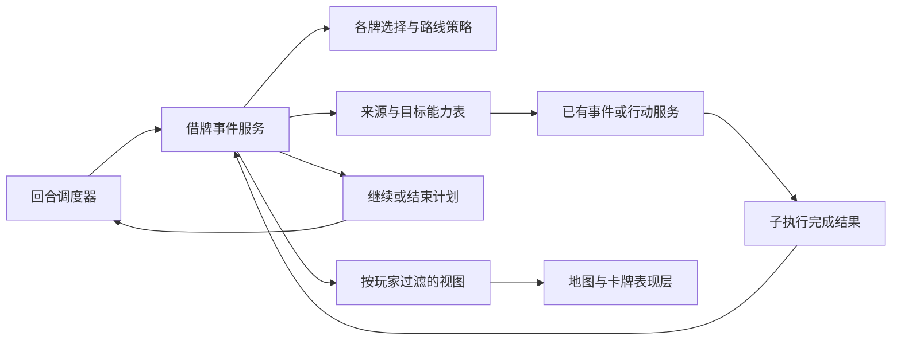

# 借用卡牌与父子事件模块

description：查 Star Wars、Grain Sales、Missile Envy 共用的选择、子调用和继续机制，以及各牌保留的不同规则。这里是设计，正式代码尚未开始。

三张牌都需要调用另一张牌，但取得方式和允许路线不同。模块只共用实体身份、执行帧、合法路线、完成结果与视图边界；弃牌堆选择、随机借牌、最高 OPS 交换分别由卡牌策略决定，不用一串隐藏的特殊条件塞进回合控制器。

箭头表示运行信息流；静态模块依赖仍单向：回合调度消费借牌服务的计划，借牌服务不调用回合调度器。子结果交回 Application 校验并提交后，调度器决定后续步骤。

选择者、原持牌者、实际出牌者、事件控制方、OPS行动者、根行动方是不同角色。美国通过 Star Wars 选择苏联事件时，选择者仍为美国，事件决定仍可能由苏联作出。借用实体牌也不会重设根行动方或新增一个普通行动轮。

合法候选和消费者支持分开。某张弃牌符合 Star Wars 的卡文，但其新来源尚未接入时，仍属于合法候选，只是本次设计暂不能执行；不能将它忽略后误用“无候选”政策。能力表须注明具体覆盖、来源证据、案例以及运行实现状态。

父帧等待时保存明确继续位置。有效子结果才能推动继续；错误回调不重复已接受的取牌、弃牌或随机选择。历史命令重放返回当时结果，不覆盖后来状态，也不刷新后来才出现的私有信息。终局处理与剩余玩法动作分开；不声称有限收据模型已实现存储或真实鉴权。

表现层只读取合法选择、状态投影和领域事件。地图、卡面、动画或整体画风变更，不影响候选算法、隐私权限和卡牌清理。样例消费者的有限通过，只证明其列明范围，完整来源能力表和运行实现仍有后续工作。

检索顺序：[模块描述](../Descriptors/nested-card-events.module.json) → [Star Wars](star-wars.md) → 对应参数中的 consumer_registry → 下游模块描述和相关函数。正式代码不存在时，不把 planned_entrypoints 当成可调用函数。
