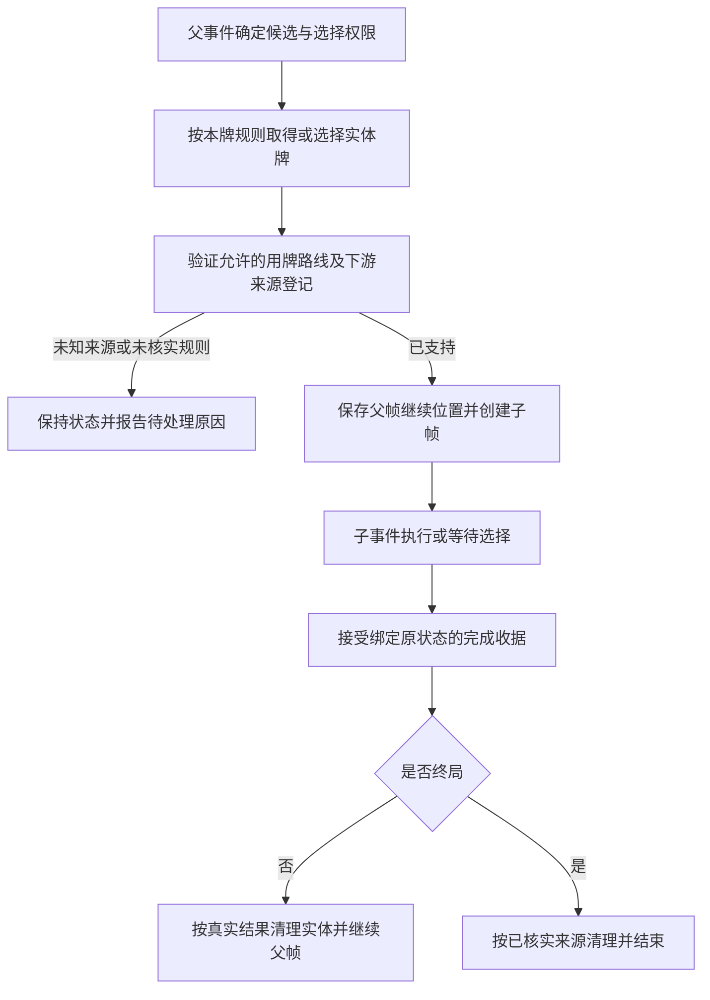

# 调用其他卡牌的事件：下一阶段计划

本页是设计路线，不是已经实现的通用执行器。先看[JSON 摘要](../Design/nested-card-sources.plan.json)，再按其中的卡牌与依赖读取已有契约。三张牌在各自设计通过并完成登记前仍保持未绑定；本页不改变该状态。

建议顺序是 Star Wars → Grain Sales → Missile Envy。第一张只从公开弃牌堆选择非计分牌并执行事件；第二张增加随机取得对手实体牌、私有察看与使用或退回；第三张再加入交换及下一行动轮的强制义务。按这个顺序，可以逐步验证共用部分。

共用的是执行帧与继续机制。根行动轮、父事件、子事件各有身份，选牌者、实际用牌者、OPS 行动者、事件控制方也分别记录。卡牌实体的移动、选择权限与事件效果各自负责，不能用一个 CurrentPlayer 代替这些角色。

下游处理器必须明确登记新来源。已有牌的参数标为 Bound，只说明它自己的参数已连接；这不能证明它接受 Star Wars、Grain Sales 或 Missile Envy 发起的任何路线。下一步需要一张来源与目标的能力矩阵，逐行列出允许路线、控制方、去向、父帧继续方式、来源证据和案例。未登记组合保持 RequiresRuling 或明确未支持。

先覆盖普通影响力事件，再核对 Grain Sales 的计分与太空路线、Defectors 的头条时间窗、UN 与 WWBY、Wargames 即时终局、Ask Not 的等待抽牌，以及 Missile Envy 的后续强制义务。完整对局测试要等真实服务实现后进行；有限设计模型不能证明真实鉴权、随机性或存储正确。

尚未确认的规则边界单列在 JSON 中，例如 Star Wars 无合法弃牌、Missile Envy 比较修正后的 OPS 与跨回合强制用牌。继续核实官方资料；仍不能确认且需要决定时再向用户提出具体选择。本计划不提前采纳默认答案。

显示层只接收按玩家过滤的状态、合法选择和领域事件。更换地图画风、卡面、弹窗或动画时，不需要改变这里的选牌与结算规则。

关联入口：[回合状态机](turn-flow.md)、[手牌事件](hand-events-batch1.md)、[UN 双牌](un-intervention.md)、[Defectors](defectors.md)、[延后奖分](deferred-vp-events-batch1.md)。资料定位与版本见 JSON 的 sources；没有新增规则通过数量或游戏运行测试。

扩大这些来源的覆盖前，先逐项核验已确认的 Draw 终局与现有完整 live snapshot 契约是否兼容。Ask Not 与拉美债务危机已修复并发布；其余八组已完成逐项核查并修补全局结果域，原参考重放本身均成功。实际范围见[全局结果契约](draw-global-contracts.md)。局部竞赛赢家与全局终局赢家须区分，不能批量放宽枚举；回归需要包含后来 Finished/Draw 时重放旧收据，以及 Running/Draw 仍被拒绝。
