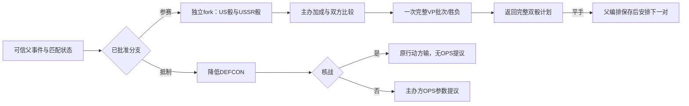

# 奥运会比赛与抵制基础

> description: 按正式D6/卡牌参数计算比赛，独立fork双骰原子计划与抵制核战判断；供可信事件编排复用。
> 当前：3299原生全通过（新增86），独立整批审查进行中。奥运会尚未进入玩家出牌流程。

先读[模块JSON](../Descriptors/olympic-contest-foundation.module.json)，再定位所需函数。完整分支、来源与恢复设计在[奥运会知识](olympic-games.md)，本批[设计](../Architecture/olympic-contest-foundation.md)划定实际实现范围。

`StandardDieDefinitionLoader.Load`读取共享标准D6；`OlympicGamesDefinitionLoader.Load`验证参数/schema、来源、类型、共享引用和真实#20卡牌绑定。规则值由数据载入，兼容性门禁只允许已核实profile。旧战争/太空骰声明未迁移，不宣称全部随机消费者已改为此定义。

`PlanPair`只处理一对，没有重掷循环或次数上限。主办方修正后可以超过6，对手也可获奖；平手`RequiresAnotherPair=true`。先检查双方可能奖金溢出，再独立fork并逐次验证骰范围/游标/stream；第二骰异常不会写入第一骰，原随机源与输入始终不变。调用方可用新快照继续下一对，但必须自己防止完成事件重复运行；基础函数不等于幂等玩家命令。

`PlanBoycott`保存Sponsor和rootPhasing的区别：降DEFCON后通过共享核战检查；到核战值判rootPhasing输，不提供行动点。存活则返回主办方及卡文BaseOps，不抽骰、不奖VP。`OlympicOperationsOffer`只是参数，不能当作玩家行动授权；普通修正、模式/目标、军事、影响力起点仍须由后续行动编排验证。

本批不持有军事实例/地图/手牌，不改变这些数据，也不完成源牌、根行动或其它头条。Host选择、分支锁、摘要链、有限工作片段、保存恢复与UI尚未实现；OG1-OPEN-01仍待裁定。Player仍为SpaceEventPlaytest。

真实测试和源码哈希见[验证报告](../Testing/olympic-contest-foundation.validation.json)，计划见[任务清单](../Plans/2026-10-17-olympic-contest-foundation.md)。
