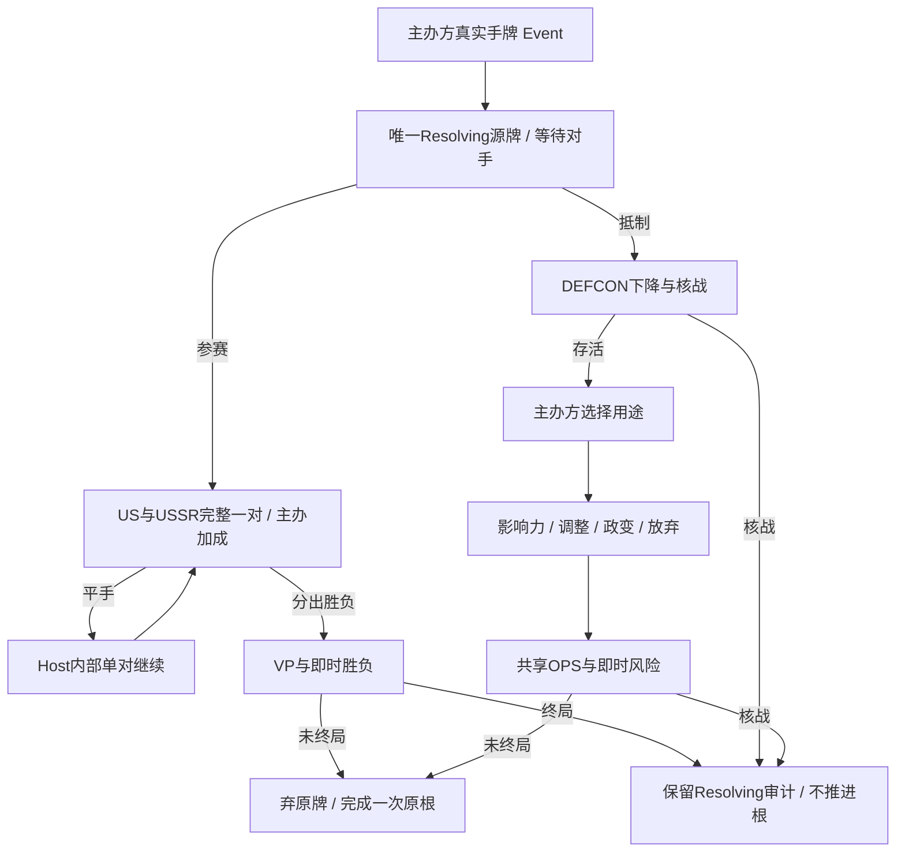

# 奥运会正常手牌试玩

> description: 查真实奥运会出牌、参赛/抵制、自动平手续跑、三种事件OPS、固定身份回执与四个人工练习。
> 当前：3457项原生测试通过；独立Player构建、实际界面验收及整批审查进行中，详见[验证报告](../Testing/olympic-play.validation.json)。

先读[模块JSON](../Descriptors/olympic-play.module.json)或[练习数据JSON描述](../../Data/Descriptors/olympic-scenarios.data.json)，再按entrypoints定位所需函数；数字来自共享奥运会参数、D6、OPS、DEFCON/军事/胜负定义。地图通过现有IMapView/玩家快照/命令接口，无奥运会专用国家显示算法。

- `ActionPracticeRules.Olympic`绑定真实局、根、牌区、角色和版本。`CanRespondToOlympic`只准对手选择；平手后不能改分支。
- `ActionPracticeRules.OlympicOps`经`QuoteAsIfCard`读取事件基值和当前主办方修正。`CanContinueOlympicOperations`保护地图直接投放入口；逐次绑定当前版本/序号/已花点数/地图/RNG，合法操作才更新；锁模式、无额外用牌、无中国牌奖励。影响力可达性用原根快照，费用随当前控制权；调整/政变共用既有算法与限制。
- `LocalGameHost.AdvanceInternalOlympic`是可信宿主方法，不在IGameSession。每次最多一对，UI Update驱动；构建公开结果后才提交。重发原响应返回原回执，不重掷、不倒退当前局面。
- `OlympicContracts`只含公开数据，不投影完整Flow、手牌或RNG。抵制后政变结果取最终实际DEFCON/胜者，不能使用抵制历史快照冒充最终状态。
- `DemoCatalog.WithOlympicEvents/WithOlympicScenarios`负责装配和人工局面。`BuildOlympicPlaytest`目标为`Builds/OlympicPlaytest/ColdWarStruggleDemo.exe`，旧SpaceEventPlaytest保留。

边界：首批仅普通行动轮，本牌头条/特殊嵌套未注册（OG1-OPEN-01保留）；Linked Flow仅内存历史，完整来源摘要链/序列化恢复/网络尚未实现；普通OPS/太空仍按本牌印刷值，只有抵制授权使用事件基值。当前活动修正是已实现的普通Flat OPS效果。

验证入口：OlympicPlayTests（24）、OlympicOperationsTests（39）、OlympicSessionTests与OlympicPresentationTests（13）、OlympicDemoTests（19）。共95个新增用例；RED/GREEN、源码/数据SHA、Player证据与审查范围统一记录在报告。规范见[设计](../Architecture/olympic-play.md)、[计划](../Plans/2026-10-17-olympic-play.md)与[工作记录](../Worklogs/2026-10-17-olympic-play.md)。
