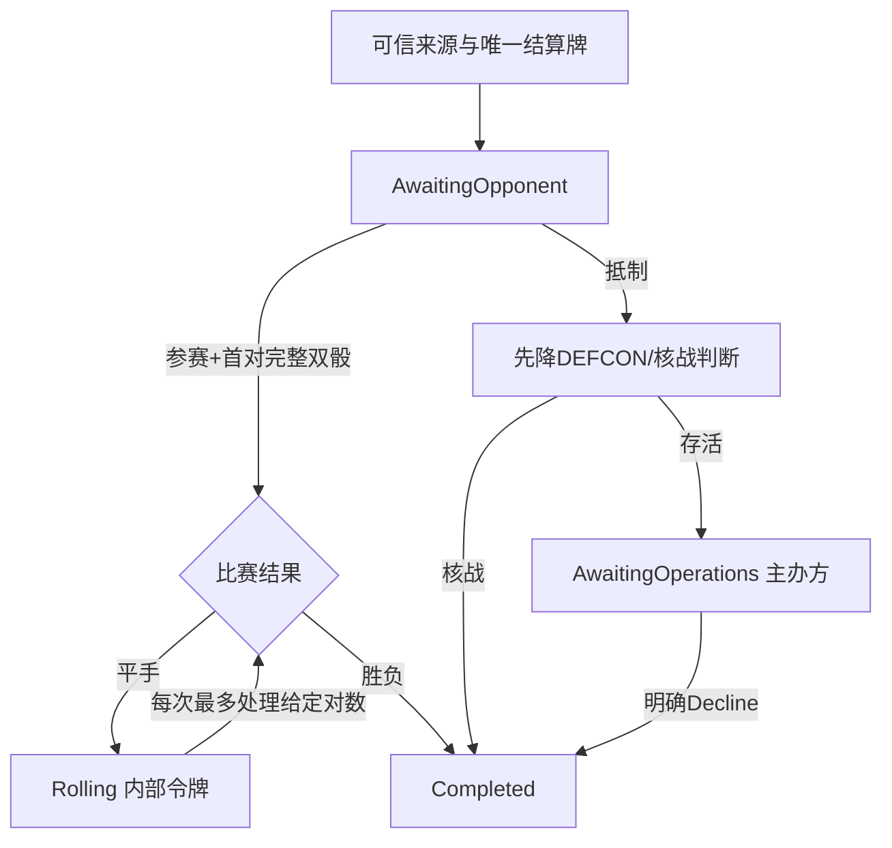

# 奥运会选择与续跑

> description: 可信父事件使用的内存状态组件，固定对手选择，按完整双骰分片继续；不等于玩家可调用处理器。
> 当前：3362项原生全通过（本批新增63），独立整批审查通过（0 Critical/Important/Minor）。

先读[JSON描述](../Descriptors/olympic-resolution-flow.module.json)，再按函数定位代码。数值与双骰原子计算复用[基础模块](olympic-contest-foundation.md)。

`Begin`要求正式定义与CardZones使用同一目录，唯一Resolving牌为奥运会，VP/DEFCON仍可继续。当前只支持普通根/本牌头条，Sponsor=rootPhasing；对手成为PendingOwner。真实持牌、GameState/帧与触发权限必须由后续父适配器验证，不能让客户端直接调用本接口。

`Respond`绑定Owner/DecisionId/Revision，参与分支与第一对一起返回。第二骰异常不产生新状态，原选择仍可响应。第一对平手后清空玩家选择，只能用当前`OlympicContinuation`对象继续。旧/跨事件令牌拒绝。每个结果追加一个`OlympicPairReceipt`，Previous保存前对；不会每次复制全部历史。旧状态可只读，不会被后续计划修改。

`PlanSlice`是惰性计划枚举器，创建它和取得enumerator不会取样；每次MoveNext生成一个完整快照。调用方必须先原子提交本次快照，再要求下一次；本组件不自动提交。maxPairs仅为本片工作预算，不是游戏重掷上限。dispose不消费后续骰；异常向上传递，已返回/已提交的先前快照保留。`CommittedRevision`是采用该计划时的预期版本，不是“此函数已写入Host”的证明。

抵制存活后只提供Sponsor/BaseOps参数。`DeclineOperations`明确放弃并关闭事件内部状态，保留已下降DEFCON；没有提供OPS执行API。核战及VP终局没有可继续令牌；源牌仍Resolving，父回合收尾尚待接线。头条/嵌套影响力起点OG1-OPEN-01未自动裁定。

这是纯内存子集：没有持久化JSON/SHA链、没有网络/幂等Host、没有GameState与UI，也没有源牌去向/根推进。旧[完整奥运设计](olympic-games.md)中的这些内容仍是设计。当前Player仍为SpaceEventPlaytest。

见[证据报告](../Testing/olympic-resolution-flow.validation.json)、[计划](../Plans/2026-10-17-olympic-resolution-flow.md)、[工作记录](../Worklogs/2026-10-17-olympic-resolution-flow.md)。
