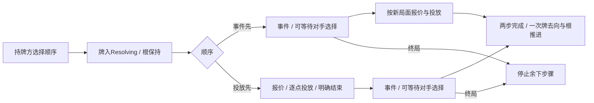

# 对手事件与影响力OPS试玩

> description: 用已实现的对手阵营牌选择事件/投放先后；区分事件受益方、根操作方与当前继续步骤。

先读[JSON模块摘要](../Descriptors/opponent-event-influence.module.json)，再定位OpponentOpsSequence与ActionPracticeRules.OpponentOps。数据沿用现有牌/效果定义，没有另存一套OPS/影响力常量。

此页记录Influence专用兼容入口；最新界面与通用三模式入口见[opponent-ops-modes](opponent-ops-modes.md)。以下描述原OpponentEventPlaytest批次。

默认真实发牌下，苏联可选择Duck and Cover，右侧“先事件后投放”或“先投放后事件”表示两条明确用途。仍可选择直接事件或满足条件的太空。尚未实现的对手事件（如NATO）不会因此放行；对手牌政变/调整也未开放，避免漏结事件。

根据[GMT2015 §5.2](https://www.gmtgames.com/nnts/TS_Rules-2015.pdf)，行动方决定事件与OPS顺序，对手实施自己的事件。程序先将同一实体牌放入Resolving，之后串行完成两步。事件要求选择时只切换选择者；根Actor不变，不消耗额外行动槽。事件在先时，之后的OPS报价与投放可达性从事件后的最新局面建立。纳赛尔先减半再投放与先投放再减半应得到不同结果。

已发生但无数值变化的事件仍算发生，星号只在完整两步后移出。核战由原PhasingPlayer负责，VP达到终局也截断剩余OPS；沿用本试玩终局审计策略：保留Resolving与未推进根，序列停留在被终局截断的步骤。EventOccurred是已完成事件步骤的标志，不表示终局中每个效果子步的历史。

每个命令在不可变草稿上运行，完整成功才由Host发布。重复CommandId返回原收据；同ID改顺序冲突。事件结束/最终移牌溢出时，本命令无变化，但此前已接受的投放不会回滚。公开进度不暴露手牌、随机状态或定义；两会话仍固定身份。

独立输出 `Builds/OpponentEventPlaytest/ColdWarStruggleDemo.exe`。原14场景与World/Tiles/Table保持，不修改地图接口。完整头条/回合末、嵌套卡牌、取消/前置条款、地区OPS与存档待接。实际证据见[报告](../Testing/opponent-event-influence.validation.json)和[工作记录](../Worklogs/2026-10-14-opponent-event-influence.md)。初始画面不等于操作按钮/选择画面/鼠标验收。
