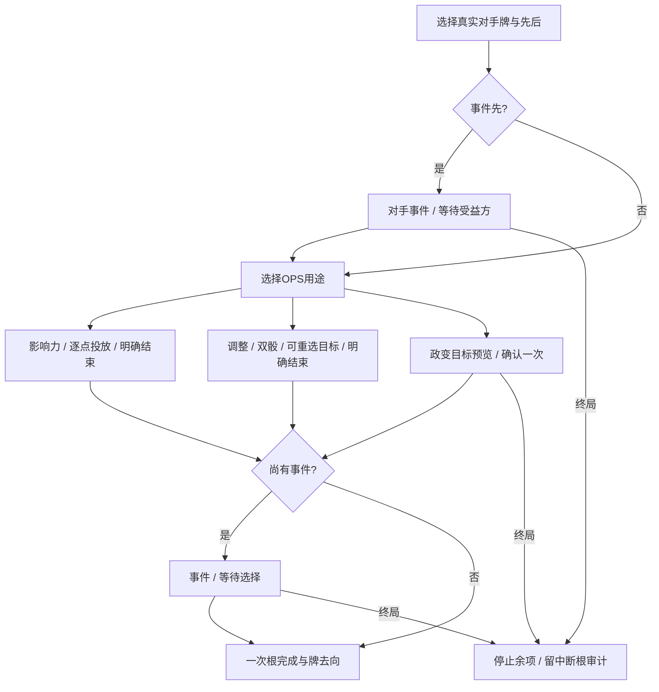

# 对手事件与三种 OPS 用途

> description: 先定事件/OPS顺序，到OPS步骤再选投放、政变或调整；以最新局面查询目标，保持单根和原子收据。

先查[模块JSON](../Descriptors/opponent-ops-modes.module.json)，需要时读取SelectMode、PlanOpponentOperations与PlanOpponentCoup。复用原牌/OPS/政变/调整数据，不新增常量副本。地图仍通过原IMapView/MapFrame与会话查询工作，画风可独立替换。

根据[GMT2015 §5.2、§6](https://www.gmtgames.com/nnts/TS_Rules-2015.pdf)，对手事件与OPS按根操作方选定顺序执行。本批通用入口先确定顺序，事件在先时先完成事件或对手选择，之后才决定OPS用途；事件造成的DEFCON/影响力变化会影响当下合法目标。此前Influence专用API保留兼容，界面改用通用顺序入口。

ChoosingOperations预算为0，Sequence.Mode为空；实际选定后不可混用。预览政变目标只改变客户端意图，若零合法目标仍能改选投放/调整。确认政变时用权威ActiveCard、当前版本与根身份；普通Coup旧命令不能绕过新流程。星号在事件与OPS均完成后移出；无效果但合法发生的事件仍按已发生处理。

政变后接事件可能同时产生两份结果，CardActionResult保留Coup及Event/DefconVpEvent/ActivatedOpsEffect；界面显示组合摘要。Host在整次命令成功后才发布，后续事件/收尾溢出会撤销当前命令草稿的掷骰、军事和影响力，但此前已接受的投放/调整不回滚。重复CommandId返回原收据，改目标/用途冲突。终局责任保持原根Actor，立即停止余项。

独立输出 `Builds/OpponentOpsPlaytest/ColdWarStruggleDemo.exe`。默认入口可选苏联手里的Duck and Cover，先选事件或OPS，到OPS步骤选用途，再点地图目标；直接事件/太空和普通本方/中立牌用途保留。另可切到美国操作其对手事件牌，事件需要苏联选择时再切换。

仍只接已有十二张事件处理器；NATO等未知前置牌继续拒绝。中国牌、特殊事件内OPS/嵌套、头条、完整回合末与存档待接。终局留牌/根审计策略与前批一致。实际测试/构建/渲染/鼠标证据分别见[报告](../Testing/opponent-ops-modes.validation.json)和[工作记录](../Worklogs/2026-10-14-opponent-ops-modes.md)。

等待事件选择面板通过`DemoController.EventPanelCoupMessage`读取公开政变摘要；摘要只含公开文本并绑定GameId/ExecutionId/AwaitingChoice，切换固定身份保留，事件完成或重载不再显示。完整CardActionResult仍随身份切换清除，避免旧OwnHand视图留存。审查修复后1874/1874通过，验证局面的鼠标证据详见工作记录。
