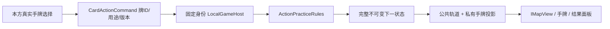
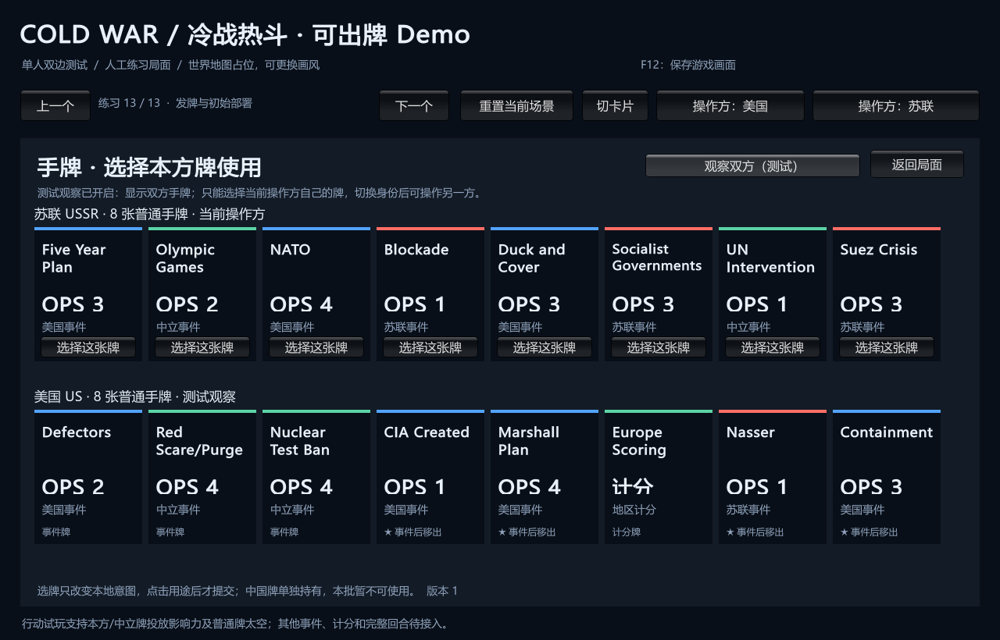

# 真实手牌行动试玩

> description: 查部署后真实选牌、影响力/太空使用、物理牌去向、行动槽、公共轨道投影及重发边界；不是完整头条/回合状态机。

先读 [模块JSON](../Descriptors/playable-card-actions.module.json)。独立输出 `E:\TwilightStruggle\Builds\PlayableDemo\ColdWarStruggleDemo.exe`，Unity菜单 Build Playable Actions Demo。旧版本窗口不会自动更新。

1. 默认真实发牌练习：苏联在东欧分配6点，美国在西欧分配7点。
2. 部署后点“苏联开始行动试玩（跳过头条）”。这一步明确进入无活动效果的练习，不自动结算头条。
3. 打开手牌，点本方一张牌，再选择影响力或太空。观察者可看双方，但不能用当前身份操作另一方的牌。
4. 影响力：本方/中立普通事件牌按OPS报价获得预算；地图绿圈是合法国，点国家后投放。点击“结束行动”弃牌、交给另一方；可以明确放弃剩余OPS。
5. 太空：普通非计分牌满足门槛/次数时直接掷骰；成功或失败都弃牌，不触发事件。顶部显示太空与VP，右侧显示骰子/变化。星号牌用于OPS或太空仍弃置，不移出。
提示：这份固定手牌建议把对手事件牌用于太空，保留本方/中立牌执行OPS。若用本方牌太空，后面可能只剩尚未支持的对手事件而无法继续，需要重置；当前不保证任意路线都走满12行动。

6. 按提示切换操作方。普通行动数由共享日历读取；完成后停止，不进行尚未实现的回合末审核。

## 接口与流程

`ActionPracticeState`是显式单回合练习组合器。牌区和随机状态只有GameState一份权威记录；SpaceAttemptState保留其自身次数与收据。一般影响力的Apply/With复制保留Practice；结束出牌再整体推进槽。太空的内部收据包含随机值，不能直接传给UI；`PublicSpaceResult`只显示骰子、轨道与VP差量。

`CanPlay`只查询资格，不抽样；提交再次检查。命令编号跨类型共用收据，同ID同载荷返回旧结果；界面始终读取最新快照，不用旧结果覆盖地图。当前身份、GameId或版本变化会丢弃本地选牌。

范围：计分、中国牌、对手事件用于OPS、活动干预、头条、政变、完整事件、回合末与胜负编排尚未接入此试玩。原八种事件诊断仍在其他练习内。VP目前仅太空结果；不是完整积分系统。地图没有改变规则边，表现继续可替换。

共享值：正式cards目录、persistent-effects-batch1的OPS子集、space-race及turn-flow。没有新增规则数值副本，也没有为一次性开发工作新增脚本。

验证见 [报告](../Testing/playable-card-actions.validation.json)：1599项通过，包括真实牌守恒、重复请求、双方隐私、失败太空消耗、12行动边界、已结束/溢出与旧练习回归。窗口交互/构建证据单独记录，不用测试代替实际试玩。

构建成功并核对28份载荷。此截图是初始化手牌面板，不代表鼠标出牌验收；窗口控制重新定位后仍激活失败。
