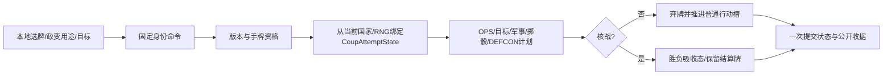

# 手持牌政变与风险 Demo

> description: 查手牌政变如何同时提交影响力、军事、DEFCON、牌区、RNG和胜负，以及大地图操作路径；测试/构建证据独立记录。
> 入口：[模块 JSON](../Descriptors/playable-coup-actions.module.json)。最新实际验证：[报告](../Testing/playable-coup-actions.validation.json)。

目标构建为 `E:\TwilightStruggle\Builds\RiskDemo\ColdWarStruggleDemo.exe`。1621项回归通过、构建与32份载荷一致性已验证；最终独立审查状态查报告；原PlayableDemo和PreviewDemo文件不自动更新。

在第13个真实开局场景完成苏联/美国部署，再点击“苏联开始行动试玩（跳过头条）”。打开手牌选择本方/中立事件牌，可用于影响力、政变，普通事件牌也可送太空。选择政变用途后，地图绿色显示合法目标；点国家再点击右侧“确认政变”。只有最后确认才出牌和掷骰。切换身份、换牌、重置会清除旧目标模式。

顶部固定显示当前行动方/轮、VP、DEFCON、双方军事累计和太空位置。选择用途时地图扩大到左侧信息栏空间；切换世界/卡片/列表继续使用IMapView，不改变国家规则/邻接。军事显示累计值，可超过5，不把此前“军备竞赛比较封顶5”的解释扩展到整个存储。

普通政变一并提交：手牌移除→当前可信OPS决定强度及军事信用→隔离RNG掷骰→影响力改变→战场DEFCON下降→弃牌→下一行动。目标只需符合既有政变规则，不使用影响力投放的可达范围。即使失败，仍按规则记军事和战场降级。

核战例外：DEFCON降至1立即由VictoryService判对方赢，GameState.Ended吸收后续新命令。源卡保留在结算区，行动槽不完成；这是终局时的审计状态，不继续普通清理。旧命令仍返回旧收据；新命令/不同目标的同ID均不会再次掷骰。

`PracticeRiskState.BindCurrent`只临时组装旧服务的输入，保留军事和政变历史；国家/RNG由GameState唯一保存。命令不能传入骰子、OPS、军事量或责任方。公共结果只含骰点、强度、差额、影响力变化和DEFCON变化。

边界：无活动效果的普通政变。本方/中立事件OPS可用；对手事件、中国牌、计分牌、条约及危机、事件额外行动未接入。无头条、期末军事审核或下一回合；12个普通行动槽结束只是练习结束。用户选择不同用牌路线仍可能提前没有受支持的牌，下一批接已有事件和地区计分。不能把有核战判胜的练习称为完整游戏。

共享数据分别来自coup.json、defcon.json、military-operations.json、victory.json；与OPS/地图一样在装配时严格读取，构建载荷不复制业务常量到UI。当前真实数据不会像核战测试fixture那样额外给尼日利亚影响力。

实际部署画面：[截图](../Images/risk-demo-deployment.png)。窗口工具激活失败；尚未完成政变与大地图的真实鼠标验收。

独立审查允许合并，0阻塞项。延后Minor：尚缺“政变→实际投放→政变”的完整交错回归；当前代码读取最新GameState，未发现状态回退。其他边界裁定及成本见本批工作记录。

2026-10-14后续：[真实计分牌与公开预览](playable-scoring-actions.md)已接入手牌、净VP和终局，普通太空也接入VP判胜；本页此前未接线描述是历史批次。活动修正、头条/期末/最终计分仍未接。
