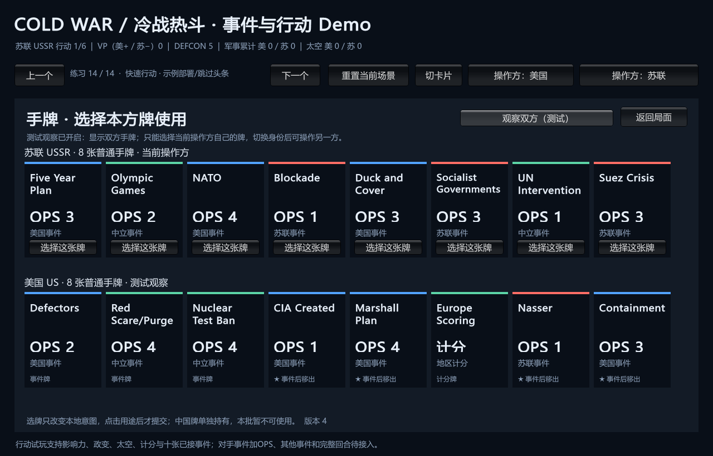

# 两张 DEFCON 与胜利点事件试玩

> description: 查询 Duck and Cover / Nuclear Test Ban 的实际运行顺序、核战归责、VP终局、真实手牌接线与公开结果。
> 状态：1729项回归、37份载荷与构建通过，初始地图/手牌已目视；独立审查无问题，鼠标未验收。
> 入口：[模块JSON](../Descriptors/playable-defcon-vp-events.module.json) → 对应入口函数；数值仍来自[共享参数](../../Data/Cards/deluxe-2015/defcon-vp-events.parameters.json)。

| 事件 | 实际顺序 | 终局截断 |
|---|---|---|
| 掩蔽与逃避 Duck and Cover | DEFCON降低 → 固定美国按新等级获VP | 核战由根Phasing承担，跳过VP；VP达胜利后终止 |
| 禁止核试验 Nuclear Test Ban | 控制者按旧DEFCON获VP → DEFCON改善并按共享上限夹限 | 若VP已获胜，不再改善DEFCON |

可从真实手牌直接发动这两张牌，也保留原八张纯影响力事件。军事实值/收据、既有政变收据、国家、RNG与太空不会被这两牌改动。选择普通OPS使用对手事件仍未接入，不能借Event入口同时取得OPS。

流程：CardActionCommand(Event) → 当前持牌资格 → 类型化catalog分发 → DefconVpEventService.Plan顺序调用Defcon/Victory服务 → PracticeRiskState保留旧历史并吸收计划 → 完整轨道/VP/牌去向/根槽单次Host提交。当前两个事件没有等待选择或插入点，所以一次原子提交；完整可恢复DV1编排仍是后续工作。DefconService用SetLevel执行已计算的直接事件目标，原因来自事件类型，不借政变豁免。

公开结果含牌ID、DEFCON前后、VP增量、奖励方、可空Award、实际步骤与终局标记。Award=0表示执行了零分批次，null表示核战后未执行奖分。DTO不含内部定义/随机状态/对手手牌。界面按实际步骤显示顺序；胜负沿既有独立状态面板。

终局保留源牌Resolving和ActiveCard、停止根完成与后续命令；旧合法命令仍返回原收据。非终局按印刷星号弃置或移出、推进一个根槽。错误版本/身份/定义或溢出不发布中间状态。

默认快速场景试玩路线：苏联发动Duck and Cover（DEFCON5→4，美国+1VP）→ 切美国发动Nuclear Test Ban（按4得2VP，DEFCON4→5）→ 总VP美国+3、两张牌弃置、完成两个行动槽。前置部署仍明确为示例，头条显式跳过。

构建目标：`E:\TwilightStruggle\Builds\DefconEventPlaytest\ColdWarStruggleDemo.exe`。支持两个新数据载荷，Editor/播放器共用同一参数与Schema。How I Learned数据接受整体结构核验但不注册其处理器，必须等等级选择机制后再开放。

[验证报告](../Testing/playable-defcon-vp-events.validation.json) / [工作记录](../Worklogs/2026-10-14-playable-defcon-vp-events.md)。自动化测试、实际初始截图与真实鼠标分别记录，不互相替代。

