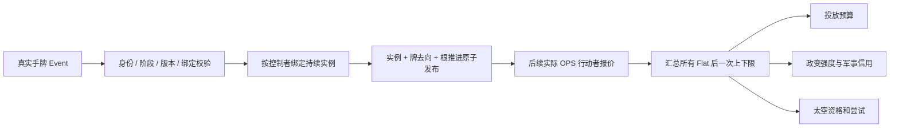

# 真实手牌持续 OPS 事件

> description: 遏制政策与红色恐怖／清洗的有限回合持续实例、真实出牌、统一 OPS 报价及公开界面；先读 JSON，再按符号定位。

[模块摘要](../Descriptors/playable-flat-ops-events.module.json) → [数据摘要](../../Data/Descriptors/persistent-effects-batch1.data.json) → [参数](../../Data/Cards/deluxe-2015/persistent-effects-batch1.parameters.json)。完整持续效果设计仍见 [persistent-effects](persistent-effects.md)。

## 对象与边界

`TurnOpsEffectDefinition` 存可信 Flat 修正与受影响方策略；`PracticeTurnOpsCatalog` 只装配已核验的两牌，核对印刷事件绑定并拒绝与其他事件目录冲突。`TurnOpsEffectInstance` 保存来源、控制者、影响方、回合、序列与 ExpireAndReset 边界；`TurnOpsEffectState` 不可变，返回报价贡献或激活计划。客户端不能传 delta、效果定义或伪造 OPS。

遏制政策固定影响美国；清洗影响事件控制者的对手。事件控制者在本批直接 Event 路径就是当前根行动者；未来对手 Event + OPS 必须显式分离这些身份。本批没有沿牌面阵营推测控制者。星号牌移出与效果到期是不同的生命周期。

`ActionPracticeRules.QuoteCard` 是实践唯一报价入口，复用 OpsGeneralRules，不改写 CardDefinition。开始投放时固定预算，普通逐点投放继续使用既有影响力费用。已知 Flat 不改变直接事件加点、VP、DEFCON、地区计分或骰子。相关服务的 NoActiveInterference / 空风险干预表示其职责范围内没有未处理的干预；实践的类型和装配边界不允许其他活动效果进入。

同一结算 ID 和完整请求重试返回旧实例；同 ID 改内容冲突；不同 ID、同回合同效果同影响方返回 EventRequiresRuling，整次事件不提交，不偷偷叠加。Host 首先按命令收据重放，避免牌被再次移动。失败和计数溢出不会提交半个效果。

## 公开反馈与可换地图

PublicTurnOpsEffect 仅暴露公开效果摘要，不含内部定义、随机状态、结算 ID 或手牌。PublicPracticeView 向双方显示同样的持续效果；CardActionOption 只对当前会话自己的牌提供印刷 OPS、当前 OPS 和 Flat 总修正。即使另一方正在行动，数值也属于正在查看手牌的身份，按钮资格仍由权威 Actor 校验。计分牌无 OPS。

UI 只展示查询结果，地图 IMapView/布局/主题无需改变。界面显示本回合活动效果、卡牌印刷值与当前值；当前数值是 Flat 普通报价，地区奖励未接入，不宣称包含越南或中国牌奖励。

## 未实现

仍是跳过头条的单回合练习。普通行动结束停在 Complete，保留效果，不伪造到期、不开启下一回合。正式回合末才应在 ExpireAndReset 到期；跨回合查询当前有限状态会拒绝，不能继续沿用或静默删除。完整 ActiveEffectService、取消、存档迁移、地区奖励、越南、对手事件加 OPS、头条和整局编排另批实现。

## 验证

真实运行结果、构建和视觉证据以 [报告](../Testing/playable-flat-ops-events.validation.json) / [工作记录](../Worklogs/2026-10-14-playable-flat-ops-events.md) 为准。初始画面渲染不等于持续效果面板或真实鼠标验收。

2026-10-14运行时进展：[回合末结算试玩](turn-end-playtest.md)接军事净评估/计分牌审核，未终局才中国牌翻正和有限OPS到期；完整下一回合和特殊回合末能力仍待接。
