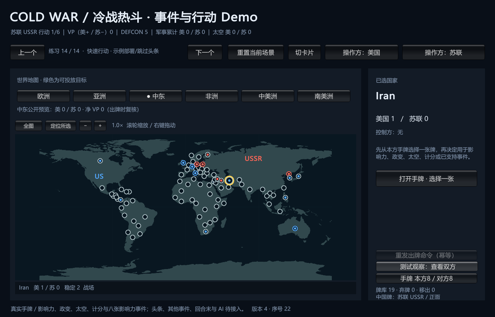
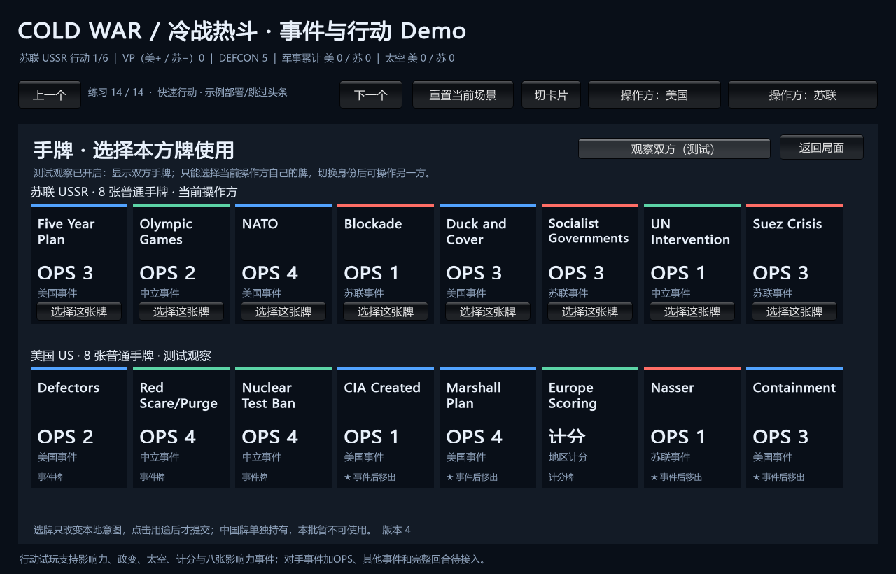

# 真实手牌中的八张影响力事件

> description: 查已实现影响力事件的真实出牌、受益方选择、星号去向、完成事务和Demo操作。
> 状态：1691项回归与构建通过，初始地图/手牌渲染已检查；独立审查无阻塞项，真实鼠标未验证。
> 入口：[模块JSON](../Descriptors/playable-influence-events.module.json)、[八牌规则/旧服务](first-influence-events.md)。

本批把已存在的处理器接入同一LocalGameHost和ActionPractice。事件定义来自early-influence-batch1/batch2参数与既有加载器，不复制每牌数值或在UI里写效果。PracticeInfluenceCatalog绑定同一Map/CardCatalog，核对CardId/EffectId/印刷阵营、已支持的纯影响力类型和地图引用；不能把仍未实现的任意效果当作空事件完成。

| 已接牌 | 复用机制 |
|---|---|
| Fidel / Romanian Abdication | 清对手后补到控制 |
| Nasser | 加点后按比例移除 |
| Truman Doctrine | 从双方均未控制的欧洲国家中选择 |
| Decolonization | 地区并集选不同国家加点 |
| Socialist Governments / Suez Crisis | 完整移除数量分配与逐国上限 |
| East European Unrest | 从有影响力国家选择，按权威时代移除 |

可以直接发动自己持有的已实现对手事件，效果仍给印刷受益方；不会同时得到OPS。对手事件加OPS的先后流程尚未接入。默认快速场景中，苏联的Socialist Governments/Suez Crisis可用；美国的Nasser可用。其余牌的Event按钮保持禁用，影响力/政变/太空/计分既有资格照常查询。

流程：CardActionCommand(Event) → 校验手牌与绑定 → 预备Resolving牌区/ResolvingEvent根状态 → InfluenceEventFlow.Begin → 固定或无变化经CompleteEventAction收尾；否则保存原DecisionSourceVersion等选择。选择命令由原EventCommand通道进入 → 纯Resolve/ResolveAllocation → CompleteEventAction → Host锁内一次提交。中间状态不发布。内部版本递增可以超过1，行动数量只看CompletedActions。

关键不变量：

- 待选时牌只在Resolving，根行动不推进；选择Owner是Beneficiary，PhasingPlayer仍是打牌方。不能在等待期间另开OPS或结束行动。
- 完成后按印刷星号进入Removed或Discard，清除事件，根槽推进一次；无变化也完成，最后普通槽进入Complete而不偷开下一回合。
- 任何验证/最终收尾溢出都丢弃整个计划，不先发布影响力。处理器不消耗OPS或RNG，不改变VP/军事/DEFCON/太空；原风险/太空收据保留。
- Host旧命令重发返回历史收据，不重复效果；界面重新读取当前快照，不能用历史View覆盖地图。
- 原人工事件练习没有Practice，CompleteEventAction透传，仍保留Resolved状态；不能为方便新界面清掉旧练习。
- PublicCardEventResult仅含公开牌ID、阶段、结果和影响力变化；不公开效果定义、随机状态或对手手牌。

地图选择仍由MapPresenter/IMapView处理；事件直接复用已有集合/数量草稿。事件需要另一方选择时显示切换按钮；确认选择后再提示当前行动方。所有画风更换继续只替换表现适配，不改规则。

边界：无活动效果，所以明确使用NoActiveInterference；本批不能产生Thatcher等持续干预。完整规则包、对手事件+OPS、头条、回合末、保存/回放仍待接线。现有中晚期参数存在不代表事件可执行。

验证定位：PlayInfluenceEventTests覆盖八牌、固定/无变化/选择、星号、溢出原子拒绝和最终槽；SessionTests覆盖选择身份、原子Host、幂等和公开结果以及程序化地图意图；CatalogTests覆盖相同绑定/错误输入、真实默认苏伊士分配→纳赛尔。后者是控制器/会话测试，不能冒充鼠标验收。

试玩入口：`E:\TwilightStruggle\Builds\EventPlaytest\ColdWarStruggleDemo.exe`。先选苏联手牌的苏伊士危机或社会主义政府，点击“发动事件”，按地图提示分配后确认；下一行动可切美国发动纳赛尔。不同阵营事件的选择方会显示独立切换提示。无须重新做部署，原手动入口仍保留。

证据：[验证报告](../Testing/playable-influence-events.validation.json)、[工作记录](../Worklogs/2026-10-14-playable-influence-events.md)。截图只证明初始渲染；程序化控制器/地图测试与真实鼠标验收分别记录。

已记录非阻塞反馈问题：切换双方并重发事件起始命令时，历史待选收据可能显示“完成/0项变化”，不影响已结算权威状态；详见工作记录，后续完善收据提示。

2026-10-14运行进展：Duck and Cover / Nuclear Test Ban现已接真实手牌，How I Learned等级选择仍未实现。最新构建与运行边界见[DEFCON/VP试玩](playable-defcon-vp-events.md)，本页原批次证据保留。
