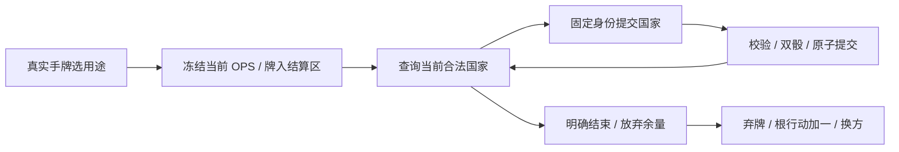

# 普通政局调整试玩

> description: 从真实手牌开始普通调整，逐次选国/双骰、读取修正与移除结果，余量放弃和结束弃牌；地图不执行规则。

先读[模块摘要](../Descriptors/playable-realignment.module.json)；骰面、每掷OPS费用和三类加值见[数据摘要](../../Data/Descriptors/realignment.data.json)。基础规则依据[GMT2015规则](https://www.gmtgames.com/nnts/TS_Rules-2015.pdf) §2.1.5、6.0、6.2.1–3、8.1.5。

`Builds/RealignmentPlaytest/ColdWarStruggleDemo.exe` 独立新版保留14个场景。默认快速局面苏联选Olympic Games→政局调整→选伊朗或其他绿色国家→调整一次→重新选国/结束调整。当前OPS决定预算；若选择遏制/清洗事件，其后续Flat修正只影响可用预算，不修正骰子。结束前不能改用投放/政变/太空。

每次双方各掷一次d6，固定显示美/苏骰；三类加值分别来自当前受控邻国、当地影响力严格较多及己方超级大国邻接。较高总数移除较低方的影响力，差额封顶现有量，平局不变，绝不新增影响力。自己也可能丢点。目标须有对方影响力且符合DEFCON地区限制，不要求己方在场或投放可达；不计军事且不降低DEFCON。

核心 `RealignmentRules` 只读完整快照计算，`ActionPracticeRules` 控制阶段/预算和权威PCG。固定身份Host按版本/上下文查询目标、按CommandId重放原收据；拒绝/溢出不消耗随机，重试不再次掷骰。公开DTO只含目标、骰、修正/邻国与移除摘要。Controller按Realigning阶段路由合法目标，World/Tiles/Table共享MapFrame，不改邻接/核心规则。

不含特殊免费事件调整、取消/拦截/骰修正、地区OPS、中国牌、对手事件加OPS或完整回合。单回合十二张Event的边界保持。源码测试、构建载荷、初始渲染与真实鼠标验收分别见[报告](../Testing/playable-realignment.validation.json)及[工作记录](../Worklogs/2026-10-14-playable-realignment.md)，初始截图不代表调整操作已鼠标验收。
