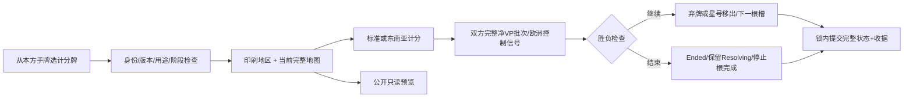
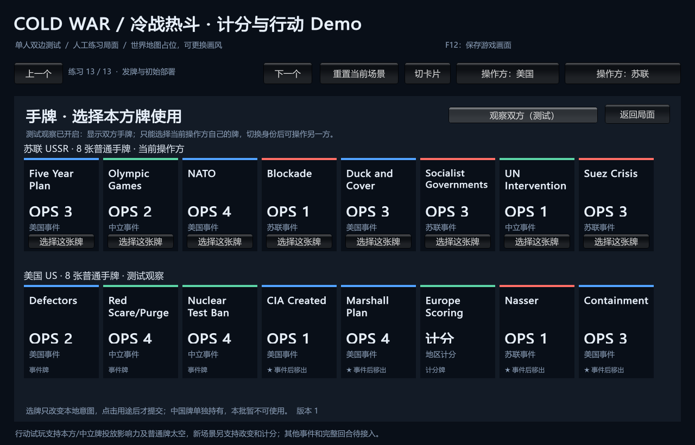

# 计分牌与公开地区预览

> description: 查真实手牌计分、净VP与终局、地区预览的无隐私依赖约束、计分牌去向及ScoringDemo入口。
> 先读[模块JSON](../Descriptors/playable-scoring-actions.module.json)，真实证据查[验证报告](../Testing/playable-scoring-actions.validation.json)。

最新构建：`E:\TwilightStruggle\Builds\ScoringDemo\ColdWarStruggleDemo.exe`。1648项EditMode通过、34份载荷一致；已有手牌渲染，计分按钮/行动地图/预览鼠标验收尚未完成。旧RiskDemo/PlayableDemo不会更新。

默认第13场景仍先完成双方部署，再显式跳过头条。苏联开始首个行动，之后美国可以从自己的手牌选“Europe Scoring”，右侧显示公开地图当前预览和“打出计分牌·立即结算”。单窗口可切换身份；看双方手牌不赋予替对方出牌的权限。

地图地区按钮下方显示该地区当前双方总分和净VP；任何一方都可看，即使手中没有计分牌。切换地区/国家控制变化后重新查询，旧版本请求拒绝。欧洲控制以“将直接获胜”的条件预览显示，不立即宣布赢家。真正出牌必须由宿主按最新权威状态重算。

## 规则与事务

CardDefinition.ScoringRegion唯一决定地区，RemoveAfterResolvedEvent决定已完成事件去向；没有另建七牌映射或每牌分值。地区服务按region-scoring.json及其Schema加载，正式地图的控制/战场/超级大国邻接决定事实；UI坐标不参与。

标准六地区共用档位与奖励算法；东南亚只按指定国家权重，不叠加标准奖励。欧洲控制不计算虚构大分、不对null作算术。双方得分先求净差再判断普通胜利线；不会先给美国加分、暂时越线就提前结束。零净差仍是完成的一次计分行动。

正常完成：普通计分牌弃置，东南亚计分按正式星号移出。终局：与核战相同，保留源牌在Resolving，停止根槽及后续牌清理；旧收据可以重发，新行动拒绝。因为此前地区分数可能接近胜利线，本批同时为太空接入ClosedVpBatchEvidence；太空得分触发胜利时同样停止，不能继续出牌。结束原因投影区分核战、地区计分与普通VP批次。

地区计分不掷骰；整个命令保留RNG、国家和既有军事/政变历史。出牌命令不能传入分数、地区或活动效果清单。预览只读公开地图/定义，不读取牌区或生成正式计分收据；公开结果只包含地区、双方分项、净VP与欧洲控制信号，不递归暴露Definition或内部快照。

## 代码定位

| 需要 | 入口 |
|---|---|
| 手牌/用途资格 | ActionPracticeRules.CanPlay |
| 计分与原子下一状态 | ActionPracticeRules.Scoring.cs: PlanScoring、AfterImmediate |
| 既有风险历史与终局信号 | PracticeRiskState.WithVictory |
| 固定身份出牌事务 | LocalGameHost.Cards.cs: SubmitCard |
| 公开预览，无手牌访问 | LocalGameHost.Scoring.cs: QueryScoring |
| 只读分项投影 | ScoringContracts.cs: PublicRegionScore |
| 可选配置装配 | DemoCatalog.WithPracticeScoring |
| 分离画面 | DemoView.Scoring.cs；地图仍IMapView |

范围：无台湾/穿梭等活动计分干预；无头条、期末、最终计分或整局。默认早期发牌只包含早期牌；中晚期计分牌用明确标注的全时代测试fixture验证服务，不能由此声称时代流转已经实现。任意用牌路线仍可能缺少受支持的下一张牌，八个已有事件处理器的真实手牌接线属于后续。

