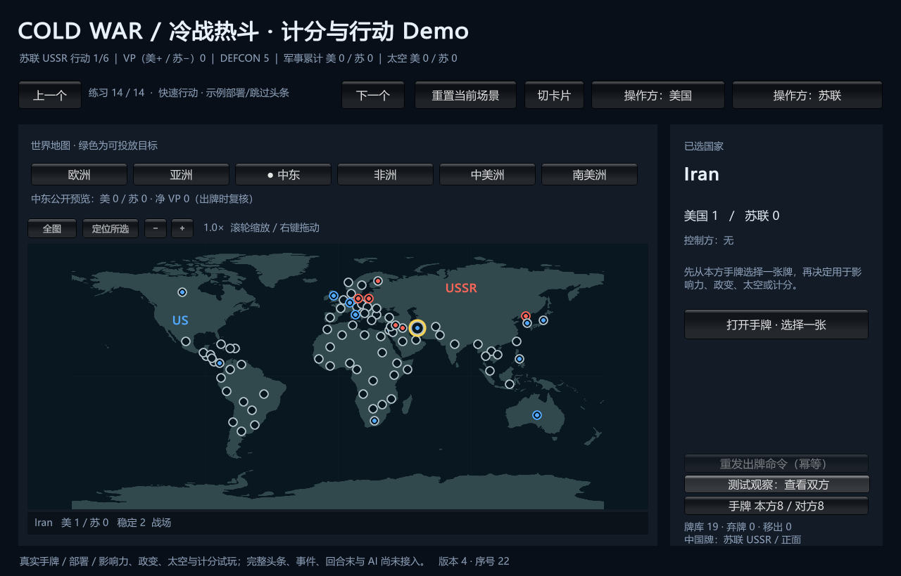
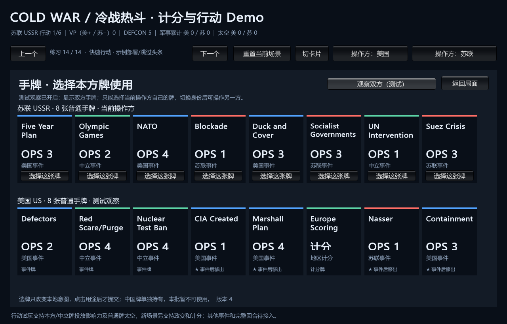

# 快速行动试玩

> description: 查询免手动准备的行动练习、示例部署数据、默认/手动入口、重置与真实试玩边界。
> 状态：1664项EditMode通过、独立构建和35份载荷核对通过；实际地图/手牌渲染已检查，鼠标未验收，独立审查待完成。

入口：[模块JSON](../Descriptors/quick-start-playtest.module.json)、[数据JSON描述](../../Data/Descriptors/demo-quick-start-scenario.data.json)。

用户要先得到方便游玩的Demo再交流感受。快速入口复用真实早期发牌、标准固定布置和部署资格，额外读取单独fixture分配并按苏联/美国顺序提交。示例分配为波兰6、西德4、意大利3；这些是`Data/Demo/quick-start-scenario.json`中的选择，不是官方强制值或最佳策略。自由额度和合法地区仍读取setup定义，装配时不合法就拒绝加载。

流程：WithQuickStartScenario → 保留源场景并追加 → CreateHost → InitialDeploymentFlow.Begin → 逐阶段Resolve → ActionPracticeRules.Plan(StartPractice) → 新LocalGameHost。全部校验在新状态上完成后才发布。不会提前打牌或掷骰。每次重置产生新GameId，同一fixture保留相同手牌/随机起点；不修改其他局面。

默认场景ID `demo.practice.quick_start`。上一个即真实发牌与手动部署；CLI `--demo-scenario=demo.setup.initial_deal`仍可直接选手动入口，未装配快开时保留旧默认。左右切换练习会创建新局，不能拿来返回之前进度。

试玩：默认苏联，打开手牌选择本方或中立牌，再选影响力/政变，或将普通牌用于太空；美国行动时用切换按钮。美国手里的欧洲计分可直接打出。地图地区条显示公开计分预览，地图/卡片/列表共用IMapView，不绑定画风。未实现的用途会禁用并解释。支持只读查看双方手牌。

这是无活动事件、跳过头条的单回合行动练习，尚无完整头条、事件生命周期、回合末、AI/联网/存档。某些手牌路线会提前无法继续，不宣称完整对局。原13个规则练习保留。

测试定位：QuickStartDemoTests核对源场景不变、坏fixture拒绝、真实政变→计分→重置、手动/自动结果及首次随机一致、默认优先与显式手动选择。实现定位：DemoCatalog.QuickStart.cs（装配/启动）、DemoCatalog.cs（工厂）、DemoLaunchOptions.ScenarioIndex（默认）、DemoBootstrap与DemoBuild（两端相同数据）。

运行 `E:\TwilightStruggle\Builds\PlaytestDemo\ColdWarStruggleDemo.exe`，窗口标题ColdWarStruggle Playtest。构建后恢复Editor原产品名。较早FirstDemo/PreviewDemo/PlayableDemo/RiskDemo/ScoringDemo的exe不会自动更新。

界面真实渲染，非设计图；鼠标激活工具仍失败，这些截图不能当作实际点击验收。
