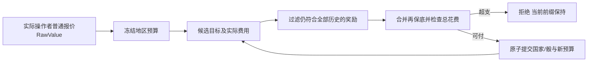

# 地区条件OPS预算

> description: 可复用的不可变地区奖励预算：冻结普通报价、按全部已接受目标保持奖励、逐点费用和超支原子拒绝；当前运行时装配中国牌，其他地区效果仍待接。
> status: implemented-subset；入口见 [模块JSON](../Descriptors/regional-ops-budget.module.json)。

先用`OpsGeneralRules.QuoteCard`按实际Actor汇总Flat修正，保留RawValue；`OpsRegionalBudget`冻结此报价和地图定义，读取可信奖励贡献。候选总额为`max(minimum, min(ordinaryMaximum, RawValue) + 仍满足条件的奖励)`。例如1−1+1=1，不能先把0保底为1再加地区奖励。

空目标时EffectiveBudget是可能达到的总额；HasTargets=false且UI显示“最多”。每个已接受目标都会永久过滤不适用的奖励。离开亚洲但仍能用普通预算支付时允许；以后回亚洲也不重新获得已失去奖励。花满普通预算后再选区外国家只拒绝该候选，既有前缀和奖励保持。

`TrySpend(target,cost,out after)`不修改输入；投放逐点按当前敌控费用计费，整批失败不发布任何局面/预算。`OperationsContext.RegionalBudget`可空，原有普通预算不变。GameState验证同一Map/Spent，Context验证Actor/用途/总额；新状态与新预算一起提交。调整每次掷骰前验证目标费用，无变化的骰仍消费额度/记录地区；Coup按单目标BudgetFor同时得到强度与军事信用；Space及OpsThreshold不得建立地区预算。

通用类型不会自动激活任何效果。中国牌从既有`persistent-effects-batch1.parameters.json#/source_bonuses/china`装配；未来越南起义应由真实Effect实例提供贡献，不能仅因类型存在就启用。

测试：OpsRegionalBudgetTests（地区/东南亚、1−1+1、普通封顶、多奖励独立失效、敌控2点、跨命令前缀、整批原子拒绝、溢出与Map/Actor/模式/Spent不变量）；中国牌整合与宿主测试见china-card-playtest。报告：[验证](../Testing/china-card-playtest.validation.json)。
