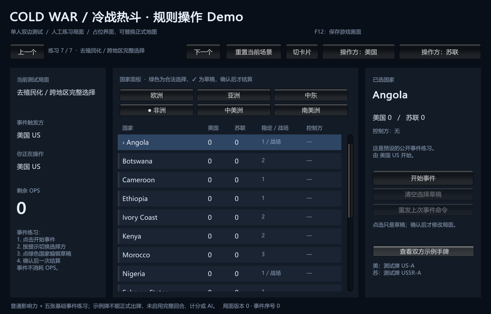
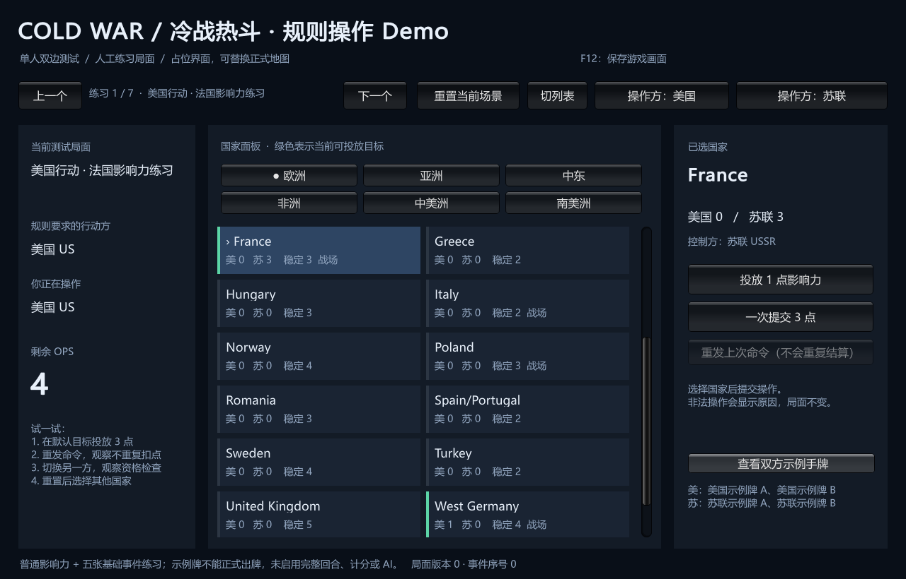
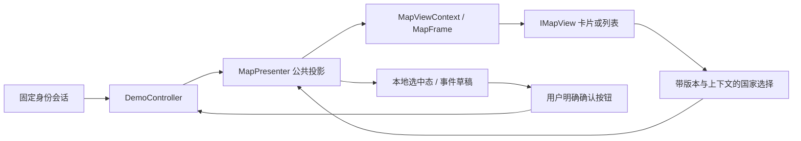

# 可替换地图视图：同步诊断子集

> description: 查找地图公开DTO、帧/视角过期保护、卡片与列表适配器；替换显示不重建对局，不让地图获得手牌或规则写入权限。
> 状态：170项真实EditMode回归通过，两种Windows渲染已检查；独立复审通过。正式地理布局、美术、异步资源加载和动画尚未实现。
> JSON入口：[map-view.module.json](../Descriptors/map-view.module.json)。

## 现在可以做什么

本机新版位于 `E:\TwilightStruggle\Builds\PreviewDemo\ColdWarStruggleDemo.exe`。顶部“切列表/切卡片”更换国家区显示；保留同一个GameId、版本、OPS、选中国家与事件草稿。旧FirstDemo窗口当时仍在运行，因此本批使用独立输出，未关闭旧窗口或覆盖其二进制。

启动时可使用 `--demo-map=tiles` 或 `--demo-map=table`，默认tiles；未知/重复值拒绝。它们是明确白名单，不能传任意脚本、类名或资源路径。构建菜单新增 **Build Side-by-side Preview**；原 **Build Windows Demo** 仍输出FirstDemo。

这两张截图来自游戏自身的显式捕获，证明实际构建渲染；不替代鼠标自动化验收。国家名字沿用已有英文名称字典，按钮和帮助为中文。

## 接口与数据流

| 实际入口 | 责任 |
|---|---|
| `MapContracts.cs::IMapView` | Initialize、Present、Intent、FocusOn、Clear、Dispose；无Unity类型 |
| `MapViewContext` / `MapNode` | 公开国家ID、名称、地区、稳定度、战场标记，初始化时复制只读集合 |
| `MapFrame` / `MapCountryFrame` | 同一状态版本的影响力、已计算控制方、合法/草稿/选中标记 |
| `MapIntent` | ContextId、Version、Sequence、InteractionKey、Country；没有预算/玩家授权/数值变更 |
| `MapPresenter.Attach/Refresh` | 读取玩家投影和合法查询，隔离旧视角，协调本地选择；地图拿不到控制器或会话 |
| `MapViewBuffer.Present/TrySelect` | 完整节点覆盖、序号/版本不倒退、只发已知国家输入；不计算规则 |
| `DiagnosticMapView.Create/Draw` | 两个IMGUI适配器共享协议，真实使用两列卡片与单列表格布局 |

DemoView继续管理手牌、状态与明确的操作按钮。MapPresenter当前通过已有DemoController接入本地测试会话，是诊断适配；未来网络会话的异步查询仍需单独实现。

## 过期输入与生命周期

每次换视图、改变操作者、重置场景都会换ViewContextId。控制器ViewGeneration还记录“切到另一方再切回来”，避免仅按当前身份/同一版本判断时放行旧点击。

地图帧有StateVersion和递增FrameSequence；同版本可更新本地草稿，旧序号不能重新切换选择。控制器InteractionRevision还会在草稿清空/增删和选中国家变化时递增，刷新前的旧输入也失效。InteractionKey区分普通行动上下文和事件实例/阶段/DecisionId。协调器收到输入后，再与控制器当前GameId、身份、generation、版本和操作键比较，未刷新画面期间的旧点击也被拒绝。

呈现拒绝或抛异常都先停用输入并退役视图。替换视图时取消旧监听并Dispose；即使旧适配器保留并调用旧委托，来源检查仍拒绝。Clear清除可点击帧但保留最高版本/序号，避免旧帧重新出现；重新Initialize换上下文，失败时清除旧映射。Dispose幂等，之后不能再初始化、呈现、聚焦或点击。

普通国家点击只更改选中态。事件合法国家点击只编辑完整选择草稿；错误拥有者可浏览国家，但没有合法提示，也不能改事件草稿。最终结算仍由原会话重新校验身份、版本、全部选择和收据。

## 范围和下一步

本轮是已加载内存数据的同步v1接口，没有用空的LoadAsync/PlayTransitions方法冒充资源加载或动画。正式MapLayout/ThemeDefinition、2D多边形/3D碰撞体、超级大国节点、镜头缩放、异步查询和动画取消沿用[设计边界](map-presentation.md)，待有对应资源/流程再实现。诊断视图只覆盖84个可操作国家，不冒称满足正式layout覆盖86节点的契约。

布局切换不写Core/MapDefinition，不改邻接，不产生RNG，不直接消耗OPS。两个适配器在相同输入下得到相同规则结果；完整RulePack、正式回合及出牌生命周期的未实现边界不变。

实际证据：[验证报告](../Testing/replaceable-map-view.validation.json) · [实施计划](../Plans/2026-10-13-replaceable-map-view.md) · [工作记录](../Worklogs/2026-10-13-replaceable-map-view.md)。

[返回索引](index.md)

鼠标验收补充：用户恢复前台后可读窗口；暂停人工操作后的点击仍返回`failed to activate captured window`，重新选择窗口并恢复一次仍失败。已停止点击，鼠标路径仍未核验，不阻塞独立代码/渲染工作。
