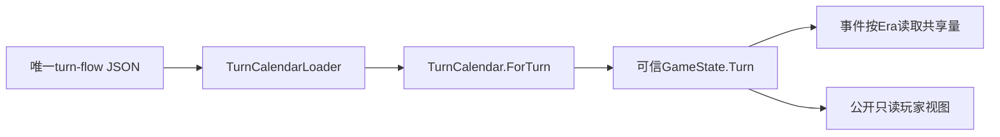

# 回合日历与权威时代

description：查询回合属于哪个时代、目标手牌和基础行动数；定位GameState.Turn如何在OPS与事件事务中保持。不是完整回合状态机。

状态：纯C#已实现，实际371项全量回归见 [验证报告](../Testing/era-removal.validation.json)。先读 [模块JSON](../Descriptors/turn-calendar.module.json)，再读所需入口。

| 问题 | 实际符号与文件 |
|---|---|
| 读取唯一规则数据 | Infrastructure/DataLoading/TurnCalendarLoader.cs：Load |
| 当前回合对应的时代 | Core/State/TurnCalendar.cs：ForTurn、GameTurnContext |
| 权威状态保存 | Core/State/GameState.cs：Turn、Apply、WithInfluenceEvent |
| 玩家公开信息 | Application/Sessions/SessionContracts.cs：PlayerViewSnapshot.Turn |

以上路径均位于 `Assets/ColdWarStruggle/Scripts/`。加载器只接受turn-flow schema3/content0.3.0/verified-subset/R2015标记；读取era_bands的五个封闭字段，拒绝未知时代、非法数值、缺口和重叠。三个时代按Early/Mid/Late连续排列，从第一回合开始；首末边界、手牌和行动数来自共享文件。当前第7回合为Mid，第8回合为Late。

`GameTurnContext`只能由日历查得，包含Number及不可变EraTurnParameters。初始可信装配器把它传入GameState；普通命令和事件响应不接受回合或时代字段。状态复制保留同一对象，公开视图可读它。旧人工练习保持Turn=null；时代无关操作继续可用，时代事件必须返回MissingTurnContext而非猜早期。

日历不改变回合、不发牌、不混入时代牌，不维护阶段、行动槽或回合末义务。完整编排仍见 [TurnFlow设计](turn-flow.md)。人工宿主指定第8回合只为测试，不能作为正式跳过前7回合的玩家命令。参数数据的来源标记不是整个规则包就绪证明。
