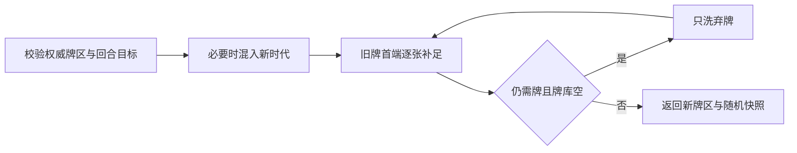

# 补牌与时代加入

> description: 从JSON摘要定位纯C#补牌服务，查普通补牌、跨时代洗牌、确定性随机与权威牌区边界。

[模块描述](../Descriptors/turn-deal.module.json) → `Core/Cards/TurnDealService.cs` 的 `Plan`；完整契约见[设计](../Architecture/turn-deal-service.md)。当前仅纯服务，尚未接下一回合按钮；可玩版本仍为TurnEndPlaytest。

`Plan(catalog,cards,turn,random)`返回不可变TurnDealPlan，含原/新牌区、目标回合、推进后的随机快照以及双方补牌数量。输入完整分区先按传入目录复核；卡牌仍在结算时拒绝。宿主负责判断已抵达TurnStart及原子提交结果，玩家不能传目标回合以越过规则。

手牌目标只读TurnCalendar；中国牌不计入手牌、保持Owner/Face。原普通手牌保留顺序，超额不丢弃，只补差额。USSR/US交替、跳过足额方，从牌库首端取牌。

新进入时代只能是连续下一时代的首回合；将该EraReserve按稳定ID追加到原Draw再洗，Discard暂不混入。已经进入的时代不会重复加入。继续发牌而Draw空时才洗当前Discard；Removed及未来Reserve排除。恰好满足手牌时不预先洗下一副牌，这是沿既有TURN-03的工程抽牌边界。

洗牌采用既有倒序Fisher–Yates，仅推进Fork；源牌区与源RNG始终不变。可用牌总量不足、目录/时代不符或随机耗尽时拒绝整个计划。牌不足属于工程失败边界，不冒称官方少发/弃局裁定。总需求用long计算，巨大目标也会在循环前拒绝。

相同输入和随机快照可重放；完成后对相同目标再次调用不重发、不重复时代洗牌。它不代替Host命令去重：调用方仍必须阻止在行动中补牌。

验证：`TurnDealTests`覆盖固定顺序、103牌目录、旧牌/弃牌边界、时代重复、超额/满额手牌、中国牌、Removed、Resolving、错误输入及随机失败；实际结果见[报告](../Testing/turn-deal.validation.json)。没有新增UI或独立播放器构建，不能把纯服务测试称为连续对局鼠标验收。

2026-10-14后续：[连续回合试玩](continuous-turn-playtest.md)将已审核Continue状态与补牌/DEFCON/太空重置接线；仍跳过头条并拒绝未接特殊能力/最终计分，具体构建状态见报告。
