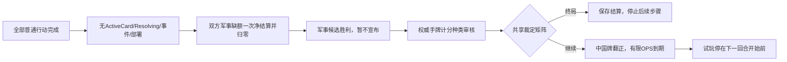

# 回合末结算试玩

> description: 查军事净罚分、扣留计分牌矩阵、结算门禁/幂等、未终局中国牌翻面及有限OPS到期；从本页和模块JSON定位函数。

源码接入完整普通行动结束后的显式“结算本回合”，验证/构建/鼠标状态以[报告](../Testing/turn-end-playtest.validation.json)为准。计划与工作记录为2026-10-14-turn-end-playtest；不是完整回合循环。当前最新独立构建目标是Builds/TurnEndPlaytest/ColdWarStruggleDemo.exe。

规则数值来自既有Military/Victory定义；不是UI写死20分或罚分。R2015§10.3.1优先于旧FAQ；CF003美国军事候选且双方扣留时按已确认项目解释判苏胜，普通双方扣留仍按原矩阵判美胜。详细来源见[risk-victory](risk-victory.md)。

本阶段没有行动方，任一固定身份可以请求同一无输入结算；CanAssessTurnEnd严格检查全部行动完成。相同命令重发读原收据，新ID再结算拒绝；未知裁定和溢出不发布任何中间变化。PracticeTurnEndReceipt保留原军事累计/DEFCON/缺额、VP前后、两方扣留布尔、候选与最终决定、翻面和到期数量。

公开PublicTurnEnd不持有权威手牌、抽牌堆或Random。切换身份仍从当前PlayerViewSnapshot读同一公开摘要；不可用上个身份的全量结果快照保持提示。地图仍复用IMapView。

代码入口：Core/Rules/PracticeTurnEndRules.cs的CanAssessTurnEnd/PlanTurnEnd；PracticeRiskState.WithTurnEnd；Application/Sessions/TurnEndView.cs；DemoController.AssessTurnEndAsync/TurnEndMessage；DemoView.TurnEnd.cs；DemoCatalog.WithPracticeTurnEnd。均位于Assets/ColdWarStruggle/Scripts，详见[JSON](../Descriptors/turn-end-playtest.module.json)。

边界：没有头条、下一回合补牌/时代加入/最终计分、额外行动或太空回合末弃牌。清理只针对已实现的遏制与清洗回合OPS实例。太空位置/尝试、DEFCON、Turn、普通牌区均保留；下一回合协调器必须显式处理后续步骤。

2026-10-14后续：[连续回合试玩](continuous-turn-playtest.md)将已审核Continue状态与补牌/DEFCON/太空重置接线；仍跳过头条并拒绝未接特殊能力/最终计分，具体构建状态见报告。
