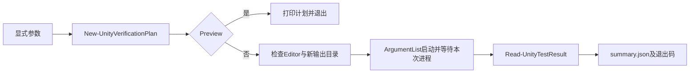

# Unity EditMode 验证工作流

> description: 按JSON描述查找固定的Unity验证入口；预览、本地版本校验、新目录运行、实际XML计数和失败证据保留。
> 状态：实现与正向集成已通过，独立复审通过。不是新的游戏规则。

先读 [脚本描述](../../Tools/Descriptors/run-unity-editmode.script.json)，参数由调用者明确提供，描述不授予执行权限。共享技术配置从 [数据描述](../../Data/Descriptors/unity-editmode.data.json) 定位；游戏常量仍留在各自规则数据中。

## 使用

Windows PowerShell 7中执行，UnityEditor必须匹配项目ProjectVersion的版本和修订。以下路径是本项目示例，工具内部没有硬编码个人目录。

```powershell
& 'E:/TwilightStruggle/Tools/Scripts/run-unity-editmode.ps1' -ProjectRoot 'E:/TwilightStruggle' -UnityEditor 'E:/unity6.6/6000.6.0f1/Editor/Unity.exe' -RunId 'example-new-run' -Preview
# 核对预览后，去掉 -Preview 执行；每次使用尚不存在的 RunId。
```

真实执行可能需要宿主放行Unity许可及项目写入。脚本不请求或自动扩大权限。已有Unity Editor进程时停止，不关闭用户编辑器。默认180秒，可指定30–1800秒；超时只终止本次创建的Editor，不终止共享许可服务或整个进程树。

## 流程和代码入口



- `Tools/Scripts/run-unity-editmode.ps1`：固定进程参数、时限、新目录、结果摘要；不含Git操作。
- `Tools/Scripts/unity-editmode-support.psm1::New-UnityVerificationPlan`：本地绝对路径、现存祖先重解析点、版本、技术配置和输出边界；不创建目录。
- `Tools/Scripts/unity-editmode-support.psm1::Read-UnityTestResult`：XML大小、禁止DTD、命名空间前缀、真实test-case结果/唯一ID/根计数、退出码及SHA256。
- `Tools/Tests/run-unity-editmode.tests.ps1`：全新自有目录内的文件系统/XML/真实脚本入口测试，不启动Unity。

## 边界

输出是 `TestResults/UnityRuns/<RunId>/results.xml`、`editor.log`、`summary.json`，失败保留已有产物。预检失败只输出JSON，不创建结果目录。退出0仅用于预览成功或真实测试全部Passed；预览的status是preview，不能当测试通过。缺失、零用例、跳过、不确定、失败、损坏、根计数矛盾、外部测试命名空间、非零退出都不成功。

只适用于可信本地项目、Editor和配置；Unity会执行项目中的测试与导入代码并写Library/Temp/meta，脚本不是执行不可信项目的沙箱。调用期间输入及目录祖先不得被并发替换；Fixed盘检测也不能证明后端没有远程存储。非本地路径、盘根和目录重解析点不支持。

超时处理已实现，但未故意挂住真实Unity做端到端超时试验；宿主强行终止整个PowerShell进程也不属于可保证的清理场景。不要将这些未测分支写成实际验证通过。

## 实际验证和复用依据

目前31项工作流合成测试通过；真实集成149项游戏测试通过。对真实集成再次使用原RunId，退出1并报告OUTPUT_ALREADY_EXISTS，三份证据的SHA保持不变。详见 [验证报告](../Testing/unity-verification-workflow.validation.json)。

脚本化依据是first-demo、first-influence-event-planners、influence-event-sessions、event-demo四个独立批次的实际Unity验证；不是将一次失败的重试计为四次。未来每批规则实现仍会调用这一流程，完整依据放在脚本JSON的scriptification_evidence。

[返回索引](index.md)
