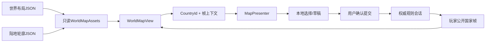
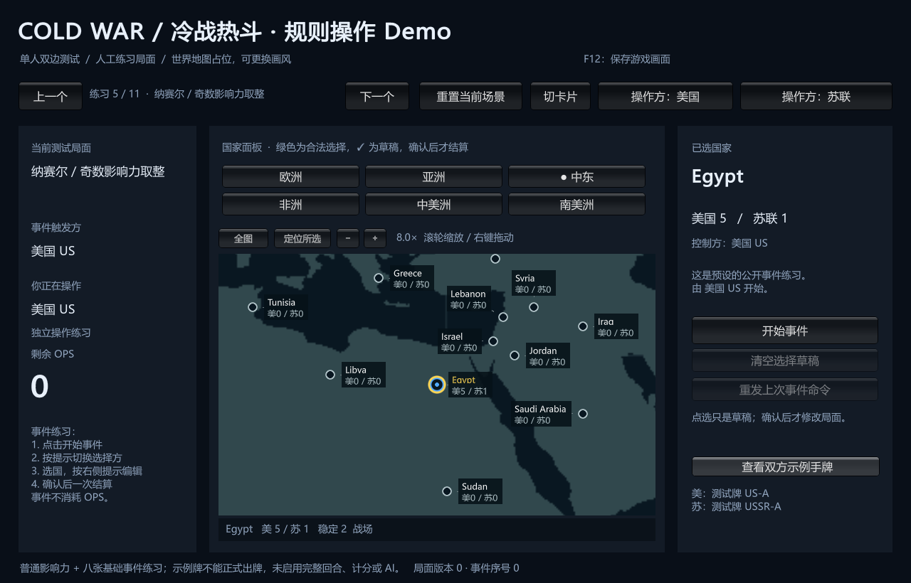

# 世界地图占位视图

> description: 平面世界轮廓、86节点布局、缩放/平移与按国家ID拾取；复用已有规则命令，替换画风不改Core。
> 状态：实现与自动测试已完成，构建/画面/审阅证据见本批报告。

这个版本仍是规则练习 Demo。新增真实地理轮廓让用户在地图上选国家；完整回合、计分、DEFCON与整局仍未装配。当前数据不决定最终画风。

## 先查摘要

- `Docs/Descriptors/world-map-view.module.json`：加载、镜头、拾取和渲染入口。
- `Data/Descriptors/world-layout.data.json`：84国家+2超级大国的显示坐标。
- `Data/Descriptors/world-land.data.json`：公共领域陆地轮廓；来源见[资源记录](../References/world-map-art-source.md)。

## 接口与调用

| 需要 | 符号 | 边界 |
|---|---|---|
| 装配显示资源 | `WorldMapAssets.Load(layoutJson, landJson, map)` | Presentation独立验证，输出只读数据；不更改MapDefinition |
| 变换镜头 | `MapViewport.Project/Unproject/ZoomAt/Pan/Focus/Reset` | 仅显示状态；缩放1–12，宽高比2:1 |
| 创建视图 | `DrawableMapView.CreateView(kind, assets)` | World、Tiles、Table；World需要有效资源 |
| 选国家 | `WorldMapView.HitTest/SelectAt` | 11逻辑像素圆形热点，最近距离、ID顺序确定并列；超级大国不可操作 |
| 展示/失效保护 | 既有`MapViewBuffer`与`MapPresenter` | 帧完整性、上下文、版本、身份与本地修订检查复用 |
| 启动/构建 | `DemoBootstrap.Awake`、`DemoBuild.SynchronizeData` | 同源读取与验证；构建复制17份载荷 |

## 操作

启动默认 World；`--demo-map=world|tiles|table` 可显式选择。顶部切换按世界→卡片→列表→世界循环；兼容的无世界资源调用只循环卡片/列表。滚轮围绕光标缩放；右键拖拽平移；“全图”复位，“定位所选”放大到当前国家；地区按钮每次点击都按该地区所有游戏节点重新定位。加拿大属于游戏欧洲，欧洲定位会包含加拿大。

圆点颜色显示控制方，绿圈是已有规则查询的合法目标，黄圈是选中，白圈/勾是草稿；悬停候选也会加白圈并置顶，底部显示对应名称，防止密集标记遮住实际点击目标。放大后显示国家名和双方影响力，底部信息条显示悬停或选中目标。信息条与地图拾取区域分离。

## 数据与范围

`layout.schema.json`设计覆盖更多类型，本加载器只接受fixture/Flat2D/marker.circle/空路线的已实现子集。拒绝Mesh3D、未支持拾取形状、路线覆盖和未知ID；不声称通用Schema验证。两份JSON都检查大小、深度、令牌数量、重复字段、数值、覆盖等。所有公共集合不可变。

底图纹理在首次Draw生成并在Dispose释放；国家相邻与否仍由规则地图定义。地图模块不持有GameState或手牌，换视图不会重建宿主或清掉事件草稿。

仍待完成：最终美术主题、更丰富的标注策略、规则邻接线、2D区域形状/3D资源、动画和更宽的游戏HUD。自动拾取测试不等同于原生鼠标操作验收；截图只验证画面。

显示资源只能由校验加载器创建。国家定位/地区定位先排队，`PrepareViewport`收到实际视口后消费一次；`VisibleMarkers`过滤视口外中心，并将同一HitTest的悬停候选最后绘制。

## 局部检查与文字避让

World可追加`--demo-focus=selected`启动时放大当前练习国家，或`overview`保持全图。仅显示参数；不接收任意国家/路径，不自动提交动作。未传参数时保持既有全图默认，非World显式焦点拒绝。

`MapLabelLayout.Arrange`是纯显示矩形规划，先安排悬停/选中，再有影响力国家，最后按稳定ID；避开全部热点、已放置文字和视口边缘。`WorldMapView.Labels`使用实际字体测量结果，标签不足位置时省略，热点及详情条保留。文字及引线不用于拾取，规则坐标没有改变。对应测试与真实局部截图见[局部地图报告](../Testing/map-focus.validation.json)。

欧洲和中东8×已实际捕获并查看，仍不等同于鼠标事件验收。
