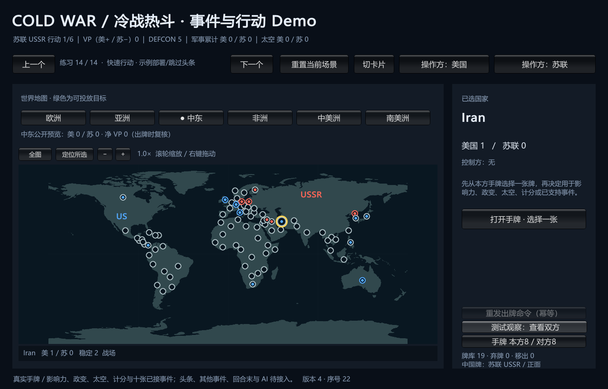

# ColdWarStruggle

《冷战热斗》电脑端学习项目，GitHub 仓库名为 **coldwarheat**，内部项目名为 **ColdWarStruggle**。

## 当前阶段

当前已进入**首批 Unity 原型实现阶段**。仓库已整理 84 个国家及邻接、103 张基础牌的印刷定义、初始布置、回合流程、行动、计分、胜负和分批卡牌事件设计。具体参数绑定与未确认边界见[正式数据索引](Docs/Wiki/map-card-data.md)及各牌的验证报告。

已创建 Unity 6000.6.0f1 工程、纯 C# 规则核心和单窗口 Demo，最新 **1729 项 EditMode 测试通过**。[事件与行动试玩](Docs/Wiki/playable-defcon-vp-events.md)位于 `E:\TwilightStruggle\Builds\DefconEventPlaytest\ColdWarStruggleDemo.exe`：示例部署后进入真实手牌行动，可投放影响力、政变、送太空、计分或发动已接入的十张事件（八张影响力、两张DEFCON/VP）。原手动部署和独立练习保留，旧Demo文件不自动更新。

世界地图已含84国热点，可切World/Tiles/Table；规则邻接与画面分离。一个窗口共用权威局面与两个固定身份会话，正常视图只读自己的牌，测试观察可查看双方。重置新建GameId并使用固定测试发牌结果。当前无完整头条、对手事件加OPS、中国牌用途、回合末、存档、联网或AI，不能完整打一局；部分路线会因余牌尚未支持而需要重置。102项效果绑定不等于102个已实现处理器。

已接普通政变、DEFCON、军事累计、七种计分、太空/计分/核战终局及十张事件。构建与37份载荷一致性已验证，初始地图/手牌实际渲染已检查；鼠标工具激活失败，事件按钮和选择的真实鼠标流程仍未验收。见[验证报告](Docs/Testing/playable-defcon-vp-events.validation.json)。

## 已确认的工程原则

- Unity 6、C#；实际编辑器为 6000.6.0f1，包版本已锁定。首个诊断界面无需 URP；正式渲染与画风后续确定。
- Core 是独立于 Unity、网络与美术的纯规则层。玩家通过 Command 操作，表现层读取按身份过滤的视图。
- 先做单人双边测试原型，再完善同机双人、真实联网与 AI。正常玩家与 AI 只读其获准视图；测试观察入口独立且只读。
- 规则以已核对的 Deluxe 基础资料及明确记录的项目解释为准；未知边界保持待处理，不猜默认值。可选 104–110 号牌未启用。
- 卡牌、地图、固定规则使用共享 JSON 定义；动态局面单独保存。界面通过稳定 ID 关联布局和主题，画风仍可调整。

## 如何查找与继续工作

1. 读 [AGENTS.md](AGENTS.md)，核对当前阶段和 Git 状态。
2. 从 [Wiki 索引](Docs/Wiki/index.md) 的短描述选择知识点。
3. 读命中的模块、数据或脚本描述，再按入口定位相关函数及必要上下文；`planned_entrypoints` 不是已有代码。
4. 修改后同步数据、描述、Wiki、验证证据和工作记录，再审阅、提交并核对远程。

结构与边界见[游戏架构](Docs/Wiki/architecture.md)；共享数据与脚本化条件见[模块、数据及脚本工作流](Docs/Wiki/workflow-and-data.md)。逐批历史已集中到[设计进度记录](Docs/Worklogs/2026-10-13-design-progress-history.md)，不把旧批次的累计数当成当前库存。

## Git 与目录

本地项目为 `E:\TwilightStruggle`；远程为 [joelchuh/coldwarheat](https://github.com/joelchuh/coldwarheat)，`main` 跟踪 `origin/main`。提交保存本地历史，推送并核对后才算远程同步；教程见 [Git 工作流](Docs/Wiki/git-workflow.md)。

代码、规则数据、Wiki、工作日志和项目 Skill 保存在同一仓库。已跟踪 Assets 及 `.meta`、Packages、ProjectSettings；缓存、构建输出、个人设置和编辑器安装文件不纳入仓库。
