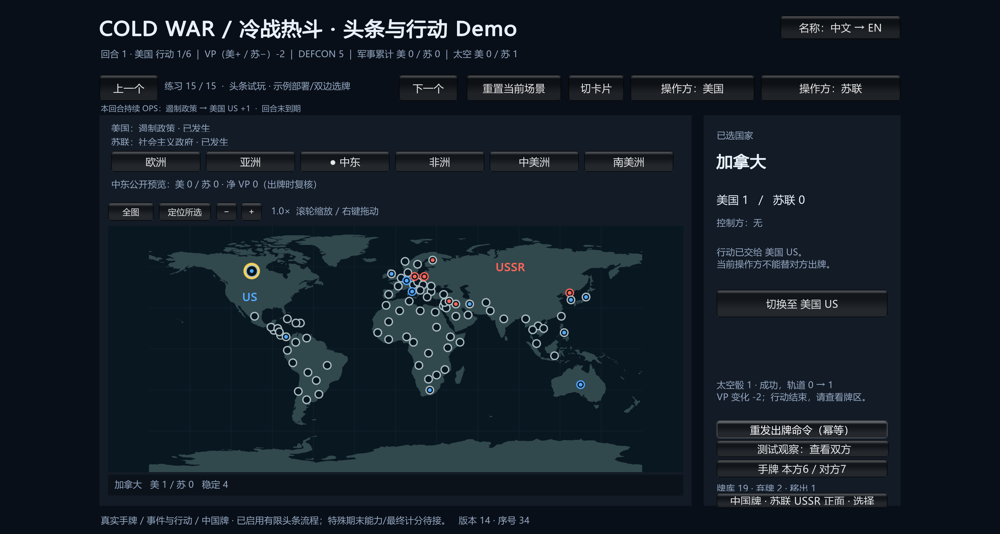

# ColdWarStruggle

《冷战热斗》电脑端学习项目，GitHub 仓库名为 **coldwarheat**，内部项目名为 **ColdWarStruggle**。

## 当前阶段

当前已进入**首批 Unity 原型实现阶段**。仓库已整理 84 个国家及邻接、103 张基础牌的印刷定义、初始布置、回合流程、行动、计分、胜负和分批卡牌事件设计。具体参数绑定与未确认边界见[正式数据索引](Docs/Wiki/map-card-data.md)及各牌的验证报告。

已创建 Unity 6000.6.0f1 工程、纯 C# 规则核心和单窗口 Demo。现有流程包括示例或手动部署、秘密头条、真实手牌行动（投放、政变、调整、太空、计分）、已接入事件与对手事件先后顺序、中国牌四用途及地区奖励、回合末军事/计分牌审核、补牌和时代加入。太空期末弃牌、额外行动、普通空手跳过以及第10回合最终计分也已接通。各批源码、构建与真实鼠标验收分别记录，当前入口见[原型路线图](Docs/Wiki/prototype-roadmap.md)。旧 Demo 文件不会自动更新。

新增[独立红色政权](Docs/Wiki/independent-reds.md)复用国家选择和影响力事务，只增加至追平对方；美国已领先时不减少。专用人工局面用于检查正差额与零变化，最新测试/构建状态见[验证记录](Docs/Testing/independent-reds.validation.json)。经互会短缺边界尚未确认，仍未接入。

新增[练习列表与历史结果提示](Docs/Wiki/demo-navigation-feedback.md)：点击顶部练习名称可直接选关，取消保留当前选择；重发历史出牌明确标示当时与当前版本。该批入口 `Builds/PracticeBrowserPlaytest/ColdWarStruggleDemo.exe`，2656项原生测试通过，列表和重发已实际点击验证。

新增[封锁可玩接线](Docs/Wiki/blockade-play.md)：美国私有弃牌或清除西德影响力，支持原行动/对手OPS/头条续接。最新入口 `Builds/BlockadePlaytest/ColdWarStruggleDemo.exe`，顶部目录第23练习；2772项原生测试、独立审查、54份载荷和直接事件鼠标验收通过，详细边界见[报告](Docs/Testing/blockade-play.validation.json)。

新增[五年计划子事件续接](Docs/Wiki/five-year-plan-play.md)：一次抽样后执行已支持的美国事件，正确返回直接行动、对手OPS或头条。最新入口 `Builds/FiveYearPlanPlaytest/ColdWarStruggleDemo.exe`，顶部目录第24练习；2908项原生测试、55份载荷与直接/先事件后OPS鼠标验收通过。瞬时头条子事件提示有一项已记录Minor，详见[报告](Docs/Testing/five-year-plan-play.validation.json)。

世界地图含84国热点，可切 World/Tiles/Table；规则邻接、显示坐标和画风分离。一个窗口共用权威局面与两个固定身份会话；普通视图只读自己的手牌，显式测试观察可查看双方。重置创建新局并使用确定性测试发牌。**仍是有限可玩原型**：大部分事件和跨卡效果、正式存档/回放、联网与 AI 尚未接入，余牌未支持时可能无法继续，不能据数据定义数量宣称完整游戏。

以下为历史头条试玩截图，不代表最终地图风格：

## 已确认的工程原则

- Unity 6、C#；实际编辑器为 6000.6.0f1，包版本已锁定。首个诊断界面无需 URP；正式渲染与画风后续确定。
- Core 是独立于 Unity、网络与美术的纯规则层。玩家通过 Command 操作，表现层读取按身份过滤的视图。
- 先做单人双边测试原型，再完善同机双人、真实联网与 AI。正常玩家与 AI 只读其获准视图；测试观察入口独立且只读。
- 规则以已核对的 Deluxe 基础资料及明确记录的项目解释为准；未知边界保持待处理，不猜默认值。可选 104–110 号牌未启用。
- 卡牌、地图、固定规则使用共享 JSON 定义；动态局面单独保存。界面通过稳定 ID 关联布局和主题，画风仍可调整。

## 如何查找与继续工作

1. 读 [AGENTS.md](AGENTS.md)，核对当前阶段和 Git 状态。
2. 从 [Wiki 索引](Docs/Wiki/index.md) 的短描述选择知识点。
3. 读命中的模块、数据或脚本描述，再按入口定位相关函数及必要上下文；`planned_entrypoints` 不是已有代码。
4. 修改后同步数据、描述、Wiki、验证证据和工作记录，再审阅、提交并核对远程。

结构与边界见[游戏架构](Docs/Wiki/architecture.md)；共享数据与脚本化条件见[模块、数据及脚本工作流](Docs/Wiki/workflow-and-data.md)。逐批历史已集中到[设计进度记录](Docs/Worklogs/2026-10-13-design-progress-history.md)，不把旧批次的累计数当成当前库存。

## Git 与目录

本地项目为 `E:\TwilightStruggle`；远程为 [joelchuh/coldwarheat](https://github.com/joelchuh/coldwarheat)，`main` 跟踪 `origin/main`。提交保存本地历史，推送并核对后才算远程同步；教程见 [Git 工作流](Docs/Wiki/git-workflow.md)。

代码、规则数据、Wiki、工作日志和项目 Skill 保存在同一仓库。已跟踪 Assets 及 `.meta`、Packages、ProjectSettings；缓存、构建输出、个人设置和编辑器安装文件不纳入仓库。

连续试玩实现与限制见[模块](Docs/Wiki/continuous-turn-playtest.md)。特殊回合末选择、剩余事件与最终计分仍待接，不能按完整整局衡量平衡。

最新版本默认中文短名，右上“名称”按钮可切英文；词典有198个稳定键，含84国和103张牌。名称切换与卡牌规则分离，中文为项目译名。自动测试、构建和实际按钮验收分别见[名称模块报告](Docs/Testing/localized-catalog-names.validation.json)。该名称批次当时2009项测试、构建及独立审查通过，地图中文名称与中英切换已实际通过；该旧版的手牌字形/长标题及选牌后切换当时受窗口激活问题限制；最新头条版实际手牌和名称切换已检查，系统长标题矩阵仍待验证。操作步骤及一条可复现路线见[试玩指引](Docs/Wiki/localized-catalog-names.md#试玩入口与操作)。
